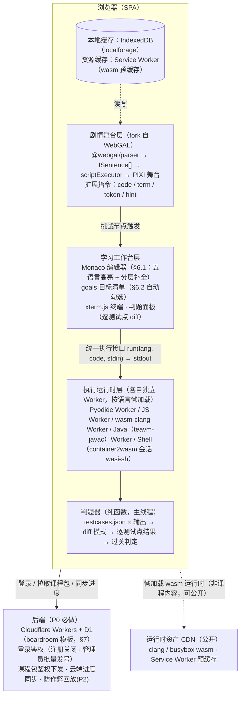

# 编程学习系统设计书（代号：CodeQuest，暂定）

> 版本 v0.3 草案 · 2026-11-24（v0.3 变更：语言范围加入 Java（teavm-javac 打包路线，见 docs/补充选型-20261124-java.md）；CheerpJ 明确排除；服务端构建沙箱仅入提案池不实施）
> 作者：Hermes（Haruki Takehata 组织内立项文档）
> 参考资料：OpenWebGAL/WebGAL、container2wasm/container2wasm、OpenWebGAL/WebGAL_Terre、binji/wasm-clang、OverTheWire Bandit、Pyodide、wasi-sh、v86

---

## 1. 目标与定位

一套**剧情驱动的编程学习系统**：把 galgame 式的叙事演出（立绘、对话、选项分支）作为课程载体，把 OI/竞赛评测常用的 **输入输出比对判题** 作为过关机制。学生在浏览器里登录后写代码、直接运行、直接判定，零安装。**第一版必做登录**：课程包由后端在登录后下发，不支持侧载（不提供面向学员的离线包/公开静态分发）。

### 1.1 核心需求（本设计书范围）

| 编号 | 需求 | 阶段 |
|---|---|---|
| R1 | 浏览器内通过 WASM 运行用户代码（用户代码执行不依赖服务端计算，仅依赖内容下发） | P0 |
| R2 | 通过「输入 → 用户代码 → 输出与期望比对」判定正确性 | P0 |
| R3 | 课程至少包含 **代码学习** 与 **shell 操作学习** 两类 | P0 |
| R4 | 语言至少支持 C/C++、Shell、JavaScript、Python、Java（Java 路线见补充选型文档） | P0 |
| R5 | 剧情系统：对话、立绘/背景、BGM、选项分支、变量门控 | P0 |
| R6 | **登录鉴权（第一版必做）**：注册接口保留但默认关闭，账号由管理员批量发放 | P0 |
| R7 | **课程登录后下发**：课程包仅经鉴权 API 签发，不允许侧载 | P0 |
| R8 | 进度保存与云端同步、章节解锁 | P0 |
| R9 | 成就系统 | P1 |
| R10 | 管理员可创建与编辑课程（课程包格式先行，可视化编辑器后期） | P1 |
| R11 | 防作弊「校验回放」（Worker 侧复跑判题） | P2 |

### 1.2 设计原则

1. **内容即数据**：课程 = 剧本文件 + 测试用例文件 + 资源文件，创作期纯静态、可 git 托管；分发期经后端鉴权签发，不走公开静态 URL。
2. **浏览器即沙箱**：一切用户代码只在 Worker / WASM 内执行，后端只承担「账号 + 课程下发 + 进度存储」，不参与代码执行。
3. **判题器与运行时解耦**：判题只依赖「拿一份 stdout/exitCode 回来」，不同语言的运行时各自封装成统一接口（见 §5）。
4. **最小改动复用上游**：WebGAL 是 MPL-2.0，fork 引入而不是重写；container2wasm 的产物直接作为静态资源加载，不修改其源码；后端鉴权与托管直接套 boardroom 模板（§7）。

---

## 2. 参考方案调研（2026-11-24 核查）

### 2.1 剧情引擎：WebGAL（MPL-2.0）

- 技术栈：React 17 + Redux Toolkit + PIXI.js 6（WebGL 渲染立绘/背景/特效）+ localforage（存档）。
- 架构分层清晰，非常适合我们复用：
  - `@webgal/parser`：把 `.txt` 剧本解析为 `ISentence[]`。语法 `command:content -arg1=value -arg2;注释`，`say` 有说话人冒号糖衣，`choose` 产生分支，`changeScene`/`callScene` 支持场景切换与调用栈，`setVar`+`-when` 支持变量与条件执行。
  - `scriptExecutor`：逐条执行语句 → 产出「演出控制块」→ 演出管理器统一装卸（跳过/自动播放/快进都在这一层实现）。
  - 入口固定为 `start.txt`，解析时顺带做资源预加载（往下一层场景展开）。
- WebGAL Terre：官方编辑器，全栈 TypeScript monorepo（Electron 壳 + Web 前端 + 服务端），多标签剧本编辑 + 素材管理 + 实时预览。**P1 阶段管理端的直接模板**。
- 对我们的意义：剧情演出层不重造轮子，fork 后在 `scriptExecutor` 增加 `code` 指令即可；课程剧本兼容 WebGAL 语法，作者还能用现成 WebGAL 文档与 Terre 工作流。

### 2.2 代码执行层：按语言选型

| 语言 | 方案 | 成熟度 | 备注 |
|---|---|---|---|
| Python | **Pyodide**（CPython→WASM，官方维护） | 高，生产级 | Worker 内运行，patch `sys.stdin` / 重定向 stdout 即可拿到 IO；`loadPackagesFromImports` 可按需加载 numpy 等教学常用库 |
| JavaScript | 原生 **Web Worker**（无需 WASM） | 高 | 无所谓沙箱难度最低；stdin 用预置队列模拟，`console.log` 劫持捕获输出 |
| C/C++ | **binji/wasm-clang**（Apache-2.0）：把 clang + lld 本身编译成 WASM，在浏览器内完成「编译 C/C++ 源码 → 产出 wasm → 运行」全流程（CppCon 2019 演讲，clang wasm 约 35 MB + lld 约 28 MB，Service Worker 缓存后二次进入秒开） | 中 | 这是唯一「学生代码在浏览器里真编译」的路径；替代方案见 §5.2 的风险栏 |
| Shell | **container2wasm**（Apache-2.0）：`c2w busybox:latest out.wasm` 把整个容器（Linux 内核 + runc）打包成单个 WASM，浏览器内经 xterm-pty + browser_wasi_shim 跑出真实 shell；x86_64 用 Bochs、riscv64 用 TinyEMU 模拟（`--to-js` 走 QEMU-wasm） | 中（上游活跃） | 判题走两条腿：交互学习用容器会话，纯 IO 判题可用 **wasi-sh**（busybox applets 编译为纯 wasm32-wasi，`run({script, stdin}) → {stdout, exitCode}`，零依赖单文件）作为轻量路径 |
| Java | **teavm-javac 打包**（live-codes/java，Apache-2.0）：浏览器 Worker 内 javac 编译源码 → TeaVM 转 WasmGC 运行；工件基于支持 stdin 的 Vsprocessing/teavm-javac fork，合计约 7.4MB，vendored + 校验和固定（详细选型与许可注意事项见 docs/补充选型-20261124-java.md；**CheerpJ 已明确排除**） | 中（上游三条线 2026 年内活跃） | TeaVM classlib 非完整 JDK，出题标注可用 API 范围；进阶（多模块/Gradle/Spring）走分层路线（补充选型 §7） |

> v86（x86 全模拟 + Alpine/buildroot）与 StackBlitz WebContainers / CheerpX 也调研过：v86 性能瓶颈明显（纯解释执行 x86），WebContainers 有商用许可限制，均列为备选不进 MVP。

### 2.3 课程设计参考：OverTheWire Bandit

Bandit（34 关）证明了 shell 学习的「游戏化」模型：每关给一个目标（如读出隐藏文件内容），答案是一个**密码/令牌**，凭令牌解锁下一关。它只依赖 ssh + 真实 Linux，我们的对应实现是把关卡环境搬进浏览器容器。要点吸收：

- **关卡由目标驱动，而非知识点驱动**：先给任务，学生自己翻文档。
- **判题 = 状态检查**：shell 关卡不比对 stdout 字符串，而是检查容器内状态（文件是否存在、内容哈希、某命令输出），或者最简单——提交下一关令牌。
- 难度阶梯（ssh/cat → grep/sort/uniq → 压缩/网络 → 脚本编写）可直接映射为我们的章节编排。

### 2.4 判题系统参考：OI/竞赛判题惯例

采用业界通用的黑盒评测（Black-box judging）：

- 测试点 = `输入文件 + 期望输出文件`（标准输入输出，无特殊交互）。
- 比对模式分级：严格逐字节 → 忽略行尾空白/末行换行 → 忽略全部空白差异 → 逐行正则 → 数值容差。
- 反馈给出首个失败测试点的 diff（期望 vs 实际），不直接暴露答案。
- 后期可加时限（wasm 内难做真超时，用「指令数预算」替代，见 §5.4）。

---

## 3. 总体架构



要点：

- **三个运行时 Worker 互不影响**，页面按当前挑战的语言懒加载对应 Worker 脚本与 WASM 资产。
- **判题器不接触任何运行时**：运行时只承诺「给输入、还 stdout/stderr/exitCode」，判题器只做字符串比对 → 换语言零成本。
- **后端 P0 即建，但职责收窄**：只做登录、课程包签发与进度存储，不执行用户代码。课程内容全部走鉴权 API，不经公开静态 URL；wasm 运行时资产不含课程内容，仍走公开 CDN + Service Worker 预缓存。
- **鉴权是内容门禁，不是 DRM**：登录用户拿到课程后前端本地必然可见，管理预期与威胁模型按「防未授权访问、不防拿到内容的人复制」设计（见 §7.1）。

---

## 4. 剧情系统设计

### 4.1 课程结构（数据模型）

```
Course（课程包）
├── course.json            # 元数据：标题、简介、语言、难度、入口
├── start.txt              # 剧本入口（WebGAL 惯例）
├── scenes/*.txt           # 各场景剧本
├── assets/                # 立绘 / 背景 / BGM / 音效
├── challenges/*.json      # 挑战定义（题目描述、代码模板、语言、goals 目标清单）
├── judges/*.json          # 判题配置（测试点、比对模式）
└── i18n/                  # 可选多语言
```

课程包 = 一个 git 仓库或 zip，**创作期**管理员「创建课程」本质上是提供这个包（P1 做上传/编辑 UI，P0 直接手写文件）；**分发期**不走 git/zip 直发：管理员上传后经后端校验入库（D1 存元数据 + R2 存包），学员端仅凭登录会话经 API 拉取，不提供侧载或离线导出（见 §7.1）。

### 4.2 剧本格式：WebGAL 语法 + 扩展指令

直接采用 WebGAL 脚本语法（`command:content -args;注释`，说话人糖衣，`choose` 分支，`changeScene`/`callScene`，`setVar`/`-when` 条件）。fork WebGAL 后在指令注册表中**新增 4 条指令**：

| 指令 | 作用 | 示例 |
|---|---|---|
| `code` | 弹出代码挑战工作台，绑定挑战与判题配置，通过后写变量 | `code:ch01_hello -lang=python -onPass=pass1;` |
| `term` | 弹出终端挑战（shell 关卡），注入初始文件系统 | `term:sh01_ls -preset=bandit-l1 -unlock=nextLevel;` |
| `token` | 令牌验证门（Bandit 式解锁） | `token:下一关密码;` |
| `hint` | 注册当前节点的提示/题解（点击获取，可计消耗） | `hint:hint1.txt;` |

指令扩展方式（2026-11-24 核查 WebGAL 上游后修订）：WebGAL 4.6 稳定版**没有指令级插件 API**——新增语句必须改引擎源码重编译（官方自定义特效 `registerPerform` 即此模式）；4.7-preview 新增的是**界面级**插件（`create-webgal-ui` 脚手架，12 个游戏界面的样式/布局插件包，zip 导入 Terre 模板编辑器），扩展不了指令集。但我们需要的恰是指令级扩展（code/term/token/hint），所以路线是：

**「fork 引擎 → 指令注册表新增 4 条指令 → 打包为 Terre 自定义引擎」**：Terre 4.5.0+ 官方支持自定义引擎（derivative engine，压缩包内含 `manifest.json`/`game`/`index.html`/`webgal-serviceworker.js`，放入用户数据目录即可选用）——改造后的引擎继续由 Terre 编辑、预览与管理，**管理端不必重复造编辑器**。fork 仓库放 HarukiTakehata 账号（见 §10）。风险：4.7-preview 界面插件接口可能在正式版变动，我们对 preview 功能只观察不依赖。

**MVP 折中**：如果 fork WebGAL 的工程成本短期消化不了，先自研一个只实现 `say/choose/changeBg/changeFigure/bgm/setVar/code/term/token/hint` 子集的 React 轻量引擎（约 2-3k 行），剧本格式保持与 WebGAL 兼容，后期可直接切换到完整 WebGAL。两条路产出同一份课程包，不锁死。无论哪条路，「某挑战通过前剧情锁住」的门控都靠 `setVar` + `-when` 条件实现（挑战通过写变量，后续语句带 `-when=pass1==true`）。

### 4.3 舞台美术与课程演出

- 沿用 WebGAL 的 PIXI 渲染：立绘、背景、转场特效全部可用；课程角色 = 「导师」NPC（立绘 + 台词），代码挑战以全屏/半屏工作台形式压在舞台上方。
- 存档（读档/回溯）沿用 localforage：保存「场景 + 语句指针 + 变量」，挑战通过的变量随存档走。

---

## 5. 代码执行与判题

### 5.1 统一执行接口

```ts
// 每个语言的运行时实现同一 Worker 协议
interface RunRequest  { lang: Lang; code: string; stdin: string; files?: Record<string,string>; timeoutMs: number }
interface RunResponse { stdout: string; stderr: string; exitCode: number; logs?: string[] }  // 判题只用 stdout/stderr
```

- `files` 用于 shell/多文件场景（把初始文件系统快照注入运行时）。
- `timeoutMs` 在 wasm 内无法强杀，见 §5.4 降级策略。

### 5.2 各语言运行时

| 语言 | Worker | 机制 | 注意点 |
|---|---|---|---|
| Python | pyodide Worker | `sys.stdin = StringIO(stdin)`；stdout 重定向到 `sys.stdout.write` 收集器；支持 `input()` | 惰性加载（首次约 10MB wasm，SW 缓存）；`micropip` 白名单控制可装包 |
| JavaScript | 普通 Worker | `console.log` 劫持；stdin 用逐行队列模拟 `readline()` | 不用 `eval` 在主线程跑，防死循环卡 UI |
| C/C++ | wasm-clang Worker | clang wasm 在浏览器编译源码 → lld 链接 → 实例化运行；stdin/stdout 经运行时内存缓冲交换 | clang wasm ~35MB + lld ~28MB：**必须** Service Worker 预缓存 + 分包懒加载；仅支持 freestanding 级标准库（C++ 模板/STL 大头可用但受 WASI shim 完整度限制，出题需标注可用范围） |
| Java | teavm-javac Worker | Worker 内加载 vendored `compiler.wasm`（javac）编译源码 → TeaVM WasmGC 运行；stdin 经 Vsprocessing fork 的 console 输入注入；同源码哈希预编译缓存 | compiler 5.2MB + classlib 2.2MB，SW 预缓存；classlib 非完整 JDK，出题标注可用 API；工件独立携带 OpenJDK GPLv2+CE 声明（THIRD-PARTY-NOTICES，许可细节见补充选型 §5） |
| Shell(判题) | wasi-sh Worker（或自打包 busybox wasm） | `run({script: 用户脚本, stdin, files}) → stdout/exitCode` | 纯 wasm、启动毫秒级，适合「写脚本处理输入」型判题 |
| Shell(交互) | container2wasm 会话 | `c2w busybox:latest` 产物 + xterm-pty + browser_wasi_shim 在浏览器里跑真 Linux shell | Bochs/TinyEMU 模拟慢（可用但非即时）；镜像 ~几十 MB，SW 缓存 + 启动预热 |

**C/C++ 风险备选**（若 wasm-clang 在目标设备上不可用）：退化到「模板编译」模式——管理员把题目框架用 Emscripten 预编译为 wasm，用户只填被 `#include` 进来的函数体或通过 stdin 交互的黑盒程序，前端只做运行不编译；再往后是服务端判题（P2 后端顺手支持）。出题模板里声明该题属于哪种模式。

### 5.3 判题器

```ts
interface TestCase { name: string; stdin: string; expected: string; mode: DiffMode; weight?: number }
type DiffMode = 'exact' | 'eol' | 'ws' | 'regex-line' | 'numeric-tol';
```

流程：按顺序跑全部测试点 → 每点比对 → 汇总（全对 = 通过；部分对给通过率）→ 前端展示首个失败点的**行级 diff**（期望 vs 实际，两栏高亮）。

> goals 目标清单（§6.2）与 testcases 正交：goals 驱动过程引导与勾选，testcases 驱动最终判定；`testcase` 类 goal 只是读取判题结果，不改变判题本身。

- `eol`：忽略行尾空白与文件末尾换行（默认值，宽容 `print` 差异）。
- `regex-line`：每行一个正则，供「输出格式自由、数值必对」的题。
- 失败信息分三类文案：输出不符 / 运行报错（stderr 非空）/ 超时（见 5.4）。
- 防作弊：P0 先不做严格防作弊（前端沙箱代码本为教育用途），登录与课程门禁按「防未授权访问」设计；P2 上线「校验回放」（Worker 侧复跑同一判题器比对结果）。

### 5.4 资源限制与死循环

WASM 内无法真正抢占。策略分级：

1. **指令预算**：wasm-clang / Pyodide 运行时可统计指令数（V8/WASM 引擎不支持时退化为输出字节上限，如 stdout 超 1MB 强制结束标记）。
2. **进程级兜底**：Worker 超时后直接 `terminate()` 重建——Worker 模式下代价可接受（运行时 wasm 资产有缓存，重建 1-2 秒）。
3. 出题界面提示「本题限时约 N 秒」。

### 5.5 Shell 关卡的两种判法

| 模式 | 判定方式 | 适用 |
|---|---|---|
| **脚本判题**（term 挑战 + judge 配置） | 用户提交 `.sh`，在 wasi-sh/busybox wasm 内带初始文件系统运行，比对 stdout | 「写一段 shell 处理文件」型 |
| **状态判题**（Bandit 式） | 用户在容器会话里自由操作，找到「令牌」（如某隐藏文件内容）提交 `token` 指令验证 | 「探索式学习」型；判定脚本在容器内跑（文件存在性、md5、命令输出），或直接令牌比对 |

MVP 两种都做：`term -mode=script | -mode=explore`。

#### 5.5.1 状态检查能力矩阵（进程 / 文件 / 端口，2026-11-24 核查）

`-mode=explore` 的判定脚本要跑在**容器会话内**（注入验证脚本 → 执行 → 回传 stdout），所以能力取决于承载它的运行时：

| 检查目标 | container2wasm 会话（模拟 CPU 上的真实 Linux 内核 + runc） | wasi-sh（纯 wasm busybox，fork-free） | v86 + Alpine（真实内核） |
|---|---|---|---|
| 文件（存在/内容/权限/md5） | ✅ `test`/`stat`/`find`/`md5sum`/`sha256sum`，9p 挂载初始文件系统 | ✅ 内存文件系统内完整支持（`run({files})` 注入） | ✅ |
| 进程（存活/参数/信号/后台任务） | ✅ 真实内核 + runc：`ps`/`pgrep`/`pkill`/`pidof`/`kill`/`jobs`/`&` 均为真实进程模型 | ❌ 无 fork，命令是进程内函数调用，不存在多进程 | ✅ |
| 端口（监听/连接） | ⚠️ 部分：**容器内 loopback**（`nc -l 127.0.0.1` + `netstat -ltn` 检查）依赖内核自带 loopback，属合理推断但上游文档未明说，**M4 必须实测**；对外端口转发明确不支持（fetch 代理仅出站 HTTP/HTTPS，受 CORS 限制；WebSocket 模式需宿主机跑 `c2w-net`） | ❌ 无 socket | ⚠️ 同左（loopback 推断可行）；另有 WISP v1 WebSocket 可做受控外连 |

busybox 检查类 applet 已确认存在（busybox.net 官方清单 + Alpine v3.22 构建，2026-11-24）：`ps`/`pgrep`/`pkill`/`pidof`/`netstat`/`nc -l`/`fuser`/`lsof`（Alpine 构建）/`stat`/`md5sum`。但 **applet 取决于构建配置**（Debian 构建就缺 `pgrep`）——因此**不用 `busybox:latest` 官方镜像，改为自建教学镜像**：Dockerfile（alpine 基底 + 预装 `procps`、`iproute2`，按课程清单固化 applet/工具集）→ CI 里 `c2w` 转换并缓存产物，判题器检查也基于该镜像的可预测工具集编写。

结论：**进程/文件类状态检查用 container2wasm 会话路径完整可行；端口类关卡第一版只承诺「容器内 loopback 监听」形态，M4 以实测 spike 为准（不通过则砍掉端口类关卡或降级为文件/进程检查）**。wasi-sh 路径仅承担文件/文本型脚本判题，不承担状态检查。

---

## 6. 前端 UI

- **舞台**（WebGAL fork / 自研轻量引擎）：全屏对话演出。
- **挑战工作台**（从舞台弹出，覆盖 60-100% 视口）：
  - 左：代码编辑器（§6.1）+ 题面 Markdown + 代码模板（模板内 `// TODO` 锚点）+ 目标清单面板（§6.2）。
  - 右上：运行/提交按钮 + stdin 预览（来自测试点，可自填）。
  - 右下：输出与判题结果（测试点列表 → 展开首个失败 diff）。
- **终端工作台**：xterm.js + 会话管理（container2wasm 长会话，切换挑战不重启容器）。
- 提示系统：`hint` 注册的提示逐条解锁，可配置消耗（如成就积分）。

移动端：编辑器降级为「只读浏览 + 提交来自剪贴板」（P1）；教学场景默认桌面。

### 6.1 编辑器选型与补全（2026-11-24 核查）

**选定 Monaco**（`monaco-editor`，Microsoft 维护，VS Code 内核）：

| 关注点 | 结论 | 依据（核查日期 2026-11-24） |
|---|---|---|
| 高亮 | 四语言全支持（Monarch 语法），主题随舞台演出定制 | 内置 |
| JS/TS 补全 | **内置 TS language worker，开箱即用的世界级 IntelliSense**（类型、悬停、诊断） | 官方能力，TS Playground 同款 |
| Python 补全 | `@typefox/pyright-browser`（pyright 语言服务编译到浏览器，TypeFox 维护）+ `monaco-languageclient` 挂载 → 补全/悬停/诊断全有；官方 pyright-play.net 即此形态演示 | 上游在线演示存在 |
| C/C++ 补全 | 无浏览器内 clangd 实用方案，用**三层兜底**：① challenge 模板符号（函数名/类型）② 关键字 + snippet provider ③ **把 wasm-clang 编译错误回填为编辑器诊断标记**（编译输出解析 → 行内红色波浪线），学生至少获得「编不过马上看到在哪」 | 设计决定 |
| Java 补全 | Monaco 内置 Java Monarch 高亮；补全 P0 与 C/C++ 同款三层兜底（模板符号 / 关键字+snippet / **javac 编译错误回填诊断**）；Java 浏览器内 LSP（jdt.ls）列为远期观察项不进排期 | 设计决定 |
| Shell 补全 | 自定义 provider：内建命令 + **教学镜像 applet 清单**（构建期跑 `busybox --list` 生成静态 JSON 随课程包下发，与镜像工具集一致，§5.5.1） | 设计决定 |
| 体量与移动端 | 编辑器本体 ~1.2MB gzipped（未含 workers），worker 需显式接线（Vite `MonacoEnvironment.getWorker`）；**官方不支持移动端**——与「桌面优先 + 移动端只读降级」定位一致 | README 明示无移动支持、无 TextMate 扩展机制 |

排除的备选：**CodeMirror 6**（模块化、~250KB gzipped 含五个语言包、触屏支持好；但 TS/JS 仅语法高亮无 IntelliSense，补全需全部自装配，四语言里反而最贵的是体验缺口）——若 P1 移动端要升级为可编辑，CM6 是降级换装的首选，此处预留；**Ace**（维护活跃度与生态均不如前两者）不采用。

### 6.2 目标清单（goals：过程性目标自动勾选）

挑战定义新增 `goals` 字段——给用户明确的**达成目标清单**（如「必须包含 main 函数」「`/test.sh` 存在」），逐项实时求值、达成即自动勾选：

```ts
interface Goal { id: string; text: string; hint?: string; check: GoalCheck; hidden?: boolean }
type GoalCheck =
  | { kind: 'source-regex';    pattern: string; flags?: string }   // 静态源码检查，如含 main 函数
  | { kind: 'source-not-regex'; pattern: string }                  // 反向：禁止出现某写法
  | { kind: 'output-contains'; value: string }                     // 最近一次运行的 stdout 包含
  | { kind: 'output-regex';    pattern: string }
  | { kind: 'exit-code';       value: number }                     // 运行退出码
  | { kind: 'file-exists';     path: string }                      // shell 会话内文件存在（如 /test.sh）
  | { kind: 'command-stdout';  command: string; expect: string }   // 会话内执行检查命令比对输出
  | { kind: 'testcase';        all?: boolean; id?: string }        // 与判题联动（指定/全部测试点通过）
```

求值管线（自动、无需用户点检查）：

1. **source 类**：编辑防抖 300ms 后在本地对源码求值——零成本、即时反馈。
2. **output/exit-code 类**：复用**最近一次 Run** 的结果求值，不触发额外运行；用户点了「运行」这些项就会刷新。
3. **file-exists / command-stdout 类**（shell 探索关）：复用 §5.5.1 的机制——把检查脚本注入容器会话执行、回传结果；在关键动作（Enter 提交检查 / 定时轮询）时触发。
4. **testcase 类**：由提交后的判题结果驱动。

UI：目标清单面板固定在编辑器侧栏（或终端工作台侧栏），每项一个复选框——未达成空心、达成实心勾 + 高亮动画；全部达成显示「✅ 可以提交」；挑战可配 `requireAllGoals: true`（未全勾则提交按钮禁用）。goals 是**过程引导，不是最终判定**：最终过关仍以 judge 测试点为准，两者正交（§5.3）。

---

## 7. 部署与后端（P0 起即含后端，直接以 March7thTeam/boardroom 为工程模板）

### 7.1 第一版（P0）：登录 + 课程鉴权下发 + 进度同步

第一版就带后端（职责收窄为「账号 + 内容下发 + 进度存储」，不执行用户代码）：

- **托管**：按 boardroom 的 Workers Assets 模式——SPA + 课程静态资产放同一 Worker 项目的 `assets`（SPA fallback），`/api/*` 进 Hono 逻辑。
- **登录（R6）**：
  - 会话与用户管理直接沿用 boardroom `docs/auth.md` 的模式（登录、会话、bootstrap、管理员角色）。
  - **注册接口保留实现但默认关闭**（功能开关 `REGISTRATION_ENABLED=false`），接口路径与校验逻辑先写好、后台可一键开放。
  - **账号由管理员批量发放**：管理端提供「批量发号」——上传名单（CSV：学号/昵称/初始密码或系统生成），批量建号并导出发放表；首次登录强制改密。发放表经一次性下载链接分发，不当明文常驻。
- **课程下发（R7）**：
  - 课程内容（剧本、挑战、判题用例、素材）**仅经鉴权 API 拉取**（`GET /api/courses/:id/*`，校验会话），课程文件不进公开静态 URL，也无学员侧离线包导出——不支持侧载。
  - 明确定位：**鉴权是内容门禁，不是 DRM**——登录学员本地必然持有课程内容，设计上不追求防「已授权者复制」，只防未授权访问与爬取。
- **wasm 运行时资产例外**：clang/busybox 等运行时不属于课程内容，走公开 CDN + Service Worker 预缓存（无内容泄露问题，减轻后端带宽）。
- **进度同步（R8）**：登录即同步——IndexedDB 本地写 + 登录态下定期/关键节点 `PUT /api/progress`；离线改动的进度在下一次登录会话合并。

### 7.2 工程模板：boardroom 逐项对齐

| 关注点 | boardroom 现成做法 | CodeQuest 采纳方式 |
|---|---|---|
| 路由/校验 | Hono 4 + zod | 同栈 |
| SPA 托管 | wrangler `assets` + `run_worker_first`（API 走 Worker、其余落静态） | 第一版即采用，后续加后端能力零迁移 |
| 数据库 | D1 + `migrations/` 迁移目录（`db/schema.sql` 快照） | 同构：用户/会话/进度/课程包版本四张核心表起步 |
| 实时 | Durable Objects + SSE | 进度同步先用轮询，协作/直播间功能（P3+）再上 DO |
| 认证/管理 | `docs/auth.md`（登录、会话、bootstrap、管理员用户管理）、`docs/admin.md`（SMTP/邀请） | 沿用会话与用户管理模式；SMTP/邮件邀请链路留给「开放注册」那天启用 |
| 工程规范 | `AGENTS.md`、vitest、CI | 新仓库按 boardroom 的 AGENTS.md 模板起稿 |
| 一致性 | `docs/consistency.md`（outbox、202 回执） | 课程下发是低频读，不需要 outbox；留文档链接备查 |

course 包：D1 存元数据与版本，R2 存课程包 zip；管理员上传 → 服务端 schema 校验（course.json/challenges/judges，见 §8 M5）→ 入库签发。防作弊校验回放（R11，P2）在 Worker 侧跑同一判题器（纯 TS，前后端共用同一实现）。

---

## 8. 里程碑

| 阶段 | 内容 | 验收标准 |
|---|---|---|
| M0 账号与下发 | Workers Assets + Hono 登录会话；管理员批量发号（CSV → 建号 → 发放表导出）；注册接口实现但默认关闭；课程包鉴权 API（D1 元数据 + R2 包） | 未登录访问课程 API 返回 401；批量发号后学员可登录并拉到课程；注册接口默认关闭可由开关打开 |
| M1 剧情骨架 | fork 或自研剧本引擎；对话/选项/变量门控；`code` 指令弹出工作台（空运行时） | 登录后一段演示剧本可走完「对话→挑战占位→选项分支」 |
| M2 双语言打通 | Monaco 编辑器接入（高亮 + JS/TS worker 补全 + goals 求值管线 source/output 类）+ Pyodide + JS Worker + 统一判题器 + 测试点 diff UI | Python/JS 各 3 题，判题与 diff 正确；goals（含 `source-regex`/`output-contains`）自动勾选可用 |
| M2.5 Java 运行时 | `packages/runtime-java`（teavm-javac 打包，vendored 工件 + 校验和固定 + THIRD-PARTY-NOTICES；选型见 docs/补充选型-20261124-java.md）；javac 错误回填诊断复用 M3 机制 | Java 冒烟题（HelloWorld + stdin 交互 + 退出码判题）可玩；首次编译在时限提示内可接受 |
| M3 C/C++ | wasm-clang 接入（SW 预缓存）；编译错误回填 Monaco 诊断标记（§6.1）；C 语言入门章节 v1 | 在中端设备可编译运行并判题；编译报错在编辑器内行内可见 |
| M4 Shell | 自建教学镜像（alpine+procps+iproute2 → c2w，CI 缓存，`busybox --list` 固化补全清单）；wasi-sh 脚本判题 + 容器会话 + Bandit 式令牌关卡；goals `file-exists`/`command-stdout` 求值；**loopback 端口实测 spike** | 仿 Bandit 前 5 关课程可玩；shell 补全可用；spike 报告给出「容器内 `nc -l 127.0.0.1` + `netstat` 检查」可行/不可行结论 |
| M5 课程包格式 | course.json/challenges/judges schema + 示例课程包 + 手写文档 + 服务端上传校验 | 第三人按文档可产出可玩课程包，且能经管理端入库签发 |
| M6 管理端(P1) | 优先采用 fork 的 WebGAL Terre + 自定义引擎机制（编辑器/预览现成，§4.2），补 goals 字段编辑（§6.2）与批量发号 UI；兜底才自写编辑器 | 管理员在网页上改剧本、配 goals、发账号即时生效 |
| M7 后端进阶(P2) | 成就云同步、统计、防作弊校验回放 | — |

---

## 9. 风险与对策

| 风险 | 影响 | 对策 |
|---|---|---|
| wasm-clang 资产大（合计 ~60MB+）且部分环境 shim 不完整 | C 章节首次加载慢、个别题编不过 | SW 预缓存 + 明确每个 C 题可用库；模板编译模式兜底（§5.2） |
| 模拟型 shell（Bochs/TinyEMU）性能低 | 容器会话操作卡顿 | 交互关卡控制文件规模；脚本判题走 wasi-sh 轻路径；低性能设备提示 |
| 端口/进程类关卡依赖容器会话能力 | 端口 loopback 监听未证实、模拟内核资源有限 | M4 实测 spike 先行；不可行则端口关卡降级为文件/进程检查；教学镜像固化工具集（§5.5.1） |
| 死循环卡死 Worker | 体验差 | §5.4 分级：预算 → terminate 重建 |
| WebGAL fork 的升级维护 | 后期合流成本 | 剧本格式保持兼容子集；fork 变更收敛在指令注册与舞台壳两处 |
| 移动端编辑体验 | 移动用户流失 | P1 降级模式；定位桌面教学 |
| 浏览器内存上限（clang 链接大文件可能超 4GB 上限问题极少见，但 Pyodide+wasm-clang 同页共存内存紧张） | 双运行时并存 OOM | 按语言单 Worker 懒加载，切语言前释放前一个 |
| TeaVM classlib 非完整 JDK、live-codes/java 单人维护 | Java 题可用 API 受限、上游断更风险 | 出题标注 API 白名单（同 C/C++ 策略）；工件 vendored + 校验和固定入仓，必要时自维护 fork（HarukiTakehata 账号） |
| Java 编译器工件含 OpenJDK javac（GPLv2+CE）与主仓库 MIT 并存 | 许可混淆风险 | 编译器 wasm 作为独立 vendored 工件携带原始许可，不并入 MIT 代码；发布附 THIRD-PARTY-NOTICES（详见补充选型 §5） |
| WasmGC 需较新浏览器（Java 运行时依赖） | 旧浏览器 Java 章不可用 | 列入最低浏览器要求提示；其余语言不受影响 |
| 批量发放的初始密码在传递环节泄露 | 学员账号被冒用 | 发放表经一次性下载链接分发、首次登录强制改密；不邮件群发明文（§7.1，待定决策 5） |

---

## 10. 复用组织资产清单

| 资产 | 用途 |
|---|---|
| OpenWebGAL/WebGAL（fork 放 **HarukiTakehata 账号**） | 剧情引擎底座（MPL-2.0 允许衍生需保留版权声明，我们本就开源无冲突）；无指令级插件 API，指令扩展走「fork 重编译 → 打包 Terre 自定义引擎」（§4.2，2026-11-24 核查） |
| OpenWebGAL/WebGAL_Terre（fork 放 **HarukiTakehata 账号**） | 管理端编辑器：4.5.0+ 自定义引擎机制（改造后的引擎 zip 导入即用其编辑/预览工作流）、4.7-preview 界面插件与可视化模板编辑器（只观察不依赖） |
| container2wasm/container2wasm | 产物直接用（`c2w <自建教学镜像>`，不用官方 busybox 镜像以固化 applet 集，§5.5.1），不改源码；CI 里做转换并缓存产物 |
| binji/wasm-clang | C/C++ 运行时底座（Apache-2.0） |
| Pyodide / wasi-sh / xterm.js / Monaco | 依赖引入 |
| live-codes/java + Vsprocessing/teavm-javac（均 Apache-2.0） | Java 运行时工件源：vendored + 校验和固定入仓（补充选型文档）；**CheerpJ 明确排除**（专有许可/禁自托管/强制其 CDN，与自托管与离线缓存原则冲突）；服务端构建沙箱（Gradle/Spring 全量判题）**仅入提案池，不排期不实施** |
| March7thTeam/boardroom（本地克隆，0.2.0+） | P0 起的后端工程模板：Hono + zod + D1 migrations + Durable Objects + Workers Assets SPA 托管、auth/admin 文档与 AGENTS.md 协作规范（详见 §7） |
| March7thTeam/home（本地克隆） | 静态站工程惯例：无构建原生 ES module、`validation/` 验收脚本（课程包验收脚本沿用此模式）、设计令牌、WebGL 降级检查（shell 会话低性能降级的同款思路）、`.kanban/`+`.github/` 治理文件与仓库并存 |
| Yang-qwq 本地克隆（openai_chat_plugin 等） | 与本系统无直接代码复用点；其账号被 flag 无法线上访问，仅作代码风格/工程惯例参考 |

---

## 11. 待定决策（需要用户拍板）

1. **剧情引擎路线**：fork WebGAL 打包为 Terre 自定义引擎（演出强、可继续用 Terre 编辑器，工程重）vs 自研轻量引擎（可控、先跑通）——WebGAL 无指令级插件 API，两条路都要改/写引擎代码（§4.2）；建议 M1 先自研兼容子集，M6 前评估切换 fork + 自定义引擎路线。
2. **课程首个主题**：建议「C 入门 + 仿 Bandit shell 探索」双线开篇，Python/JS 章节随后。
3. **仓库落点**：~~fork 仓库位置~~ 已定——所有 fork（WebGAL、WebGAL_Terre 等）一律放当前 GitHub 账号（HarukiTakehata）；仍待定的是新仓库（如 codequest 主仓库）放 HarukiTakehata 还是 SiliconWorkGroup 组织。
4. C/C++ 是否接受「模板编译」题目先行（M3 提前，wasm-clang 后置）——影响 M3 排期。
5. **批量发号的凭证形式**：名单 CSV 手工导入 vs 管理端表单逐条录入；初始密码「管理员指定」vs「系统生成随机 + 一次性链接领取」——建议先做 CSV + 系统生成随机密码（§7.1）。
6. **课程下发形态**：整包签发（登录后一次性拉全包，实现简单）vs 按章节渐进签发（可做「学到哪发到哪」，实现与缓存复杂）——建议 P0 整包签发、预留接口字段。

已拍板（2026-11-24）：

- **Java 支持采用 teavm-javac 打包路线**（live-codes/java / Vsprocessing fork，详见 docs/补充选型-20261124-java.md），新增里程碑 M2.5。
- **CheerpJ 全面排除**：任何层级（含 Java 进阶与 LSP 方案）都不引入 CheerpJ。
- **服务端构建沙箱（D 层）仅入提案池**：不排期、不实施；Gradle/Spring 进阶教学将来若有需要，走 container2wasm 教学镜像路线（补充选型 §7 C 层）。
