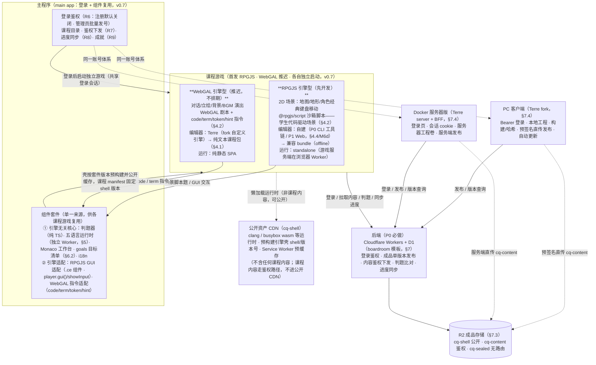

# 编程学习系统设计书（代号：CodeQuest，暂定）

> 版本 v0.8 草案 · 2026-11-27（v0.8 变更：**编辑器源码落独立 fork 仓库** `HarukiTakehata/WebGAL_Terre`（Terre 派生，已有基础编辑功能），主仓库只做集成；**PC 客户端与 Docker 服务器版**作为同一编辑器的两种交付形态，均实现登录与发布（§7.4）；§7.3 三桶存储模型不变）
> 作者：Hermes（Haruki Takehata 组织内立项文档）
> 参考资料：OpenWebGAL/WebGAL、RSamaium/RPG-JS（含 @rpgjs/script；RPGJS Studio 仅作 bundle 格式/HTTP API 参考，v0.5 不采用）、container2wasm/container2wasm、OpenWebGAL/WebGAL_Terre、binji/wasm-clang、OverTheWire Bandit、Pyodide、v86

---

## 1. 目标与定位

一套**剧情驱动的编程学习系统**：把叙事演出作为课程载体（双引擎并行：WebGAL 引擎型 = galgame 式立绘/对话/选项，RPGJS 引擎型 = 2D 场景自由移动 + 学生脚本驱动场景，§4.0），把 OI/竞赛评测常用的 **输入输出比对判题** 作为过关机制。学生在浏览器里登录后写代码、直接运行、直接判定，零安装。**第一版必做登录**：课程包由后端在登录后下发，不支持侧载（不提供面向学员的离线包/公开静态分发）。

### 1.1 核心需求（本设计书范围）

| 编号 | 需求 | 阶段 |
|---|---|---|
| R1 | 浏览器内通过 WASM 运行用户代码（用户代码执行不依赖服务端计算，仅依赖内容下发） | P0 |
| R2 | 通过「输入 → 用户代码 → 输出与期望比对」判定正确性 | P0 |
| R3 | 课程至少包含 **代码学习** 与 **shell 操作学习** 两类 | P0 |
| R4 | 语言至少支持 C/C++、Shell、JavaScript、Python、Java（Java 路线见补充选型文档） | P0 |
| R5 | 剧情系统（双引擎并行，§4）：对话、立绘/背景、BGM、选项分支、变量门控（两引擎共有）；RPGJS 引擎型另含 2D 场景（地图/地形/角色移动）与「学生脚本驱动场景」 | P0 |
| R6 | **登录鉴权（第一版必做）**：注册接口保留但默认关闭，账号由管理员批量发放 | P0 |
| R7 | **课程登录后下发**：课程内容仅经鉴权 API 签发，不允许侧载；引擎壳不含课程内容，可公开缓存（§7.3） | P0 |
| R8 | 进度保存与云端同步、章节解锁 | P0 |
| R9 | 成就系统 | P1 |
| R10 | 教师/管理员可创建与编辑课程（课程包格式先行，可视化编辑器后期） | P1 |
| R11 | 防作弊「校验回放」（Worker 侧复跑判题） | P2 |

### 1.2 设计原则

1. **内容即数据**：课程 = 剧本/地图文件 + 测试用例文件 + 资源文件（双引擎两种课程包格式，§4.1），创作期纯静态、可 git 托管；分发期经后端鉴权签发，不走公开静态 URL。**壳与内容分离**：引擎/组件套件预构建为公开壳，课程内容单独鉴权下发（§7.3）。
2. **浏览器即沙箱**：一切用户代码只在 Worker / WASM 内执行，后端只承担「账号 + 内容下发 + 判题比对 + 进度存储」，不参与代码执行。
3. **判题器与运行时解耦**：判题只依赖「拿一份 stdout/exitCode 回来」，不同语言的运行时各自封装成统一接口（见 §5）。
4. **最小改动复用上游**：WebGAL 是 MPL-2.0，fork 引入而不是重写；RPGJS 引擎/脚本层是 MIT，npm 直接依赖不 fork（编辑器**自建**、不依赖其托管 Studio，见 §2.5/§4.4）；container2wasm 的产物直接作为静态资源加载，不修改其源码；后端鉴权与托管直接套 boardroom 模板（§7）。

---

## 2. 参考方案调研（2026-11-24 核查；§2.5 为 2026-11-26 补充）

### 2.1 剧情引擎（一）：WebGAL（MPL-2.0）

- 技术栈：React 17 + Redux Toolkit + PIXI.js 6（WebGL 渲染立绘/背景/特效）+ localforage（存档）。
- 架构分层清晰，非常适合我们复用：
  - `@webgal/parser`：把 `.txt` 剧本解析为 `ISentence[]`。语法 `command:content -arg1=value -arg2;注释`，`say` 有说话人冒号糖衣，`choose` 产生分支，`changeScene`/`callScene` 支持场景切换与调用栈，`setVar`+`-when` 支持变量与条件执行。
  - `scriptExecutor`：逐条执行语句 → 产出「演出控制块」→ 演出管理器统一装卸（跳过/自动播放/快进都在这一层实现）。
  - 入口固定为 `start.txt`，解析时顺带做资源预加载（往下一层场景展开）。
- WebGAL Terre：官方编辑器，全栈 TypeScript monorepo（Electron 壳 + Web 前端 + 服务端），多标签剧本编辑 + 素材管理 + 实时预览。**编辑器源码在独立 fork 仓库 `HarukiTakehata/WebGAL_Terre` 的 `dev` 分支（4.6.7，`d155f41b`），已有部分编辑功能；不做 serverless 改造**；PC 客户端与 Docker 服务器版两种交付、登录/发布见 §7.4。
- 对我们的意义：剧情演出层不重造轮子，fork 后在 `scriptExecutor` 增加 `code` 指令即可；课程剧本兼容 WebGAL 语法，作者还能用现成 WebGAL 文档与 Terre 工作流。
- **定位（v0.7）**：WebGAL 是**第二课程引擎（WebGAL 引擎型）**的底座；**2026-11-27 拍板推迟、不排期**，首发只做 RPGJS；**Terre 不做 serverless 改造**，保持 Electron/Node 形态（PC 客户端 + Docker 服务器版两种交付）；「fork → 4 条指令 → 打包 Terre 自定义引擎」路线保留待重启。

### 2.2 代码执行层：按语言选型

| 语言 | 方案 | 成熟度 | 备注 |
|---|---|---|---|
| Python | **Pyodide**（CPython→WASM，官方维护） | 高，生产级 | Worker 内运行，patch `sys.stdin` / 重定向 stdout 即可拿到 IO；`loadPackagesFromImports` 可按需加载 numpy 等教学常用库 |
| JavaScript | 原生 **Web Worker**（无需 WASM） | 高 | 无所谓沙箱难度最低；stdin 用预置队列模拟，`console.log` 劫持捕获输出 |
| C/C++ | **binji/wasm-clang**（Apache-2.0）：把 clang + lld 本身编译成 WASM，在浏览器内完成「编译 C/C++ 源码 → 产出 wasm → 运行」全流程（CppCon 2019 演讲，clang wasm 约 35 MB + lld 约 28 MB，Service Worker 缓存后二次进入秒开） | 中 | 这是唯一「学生代码在浏览器里真编译」的路径；替代方案见 §5.2 的风险栏 |
| Shell | **container2wasm**（Apache-2.0）：`c2w <自建教学镜像> out.wasm` 把整个容器（Linux 内核 + runc）打包成单个 WASM，浏览器内经 xterm + browser_wasi_shim 跑出真实 shell；x86_64 用 Bochs、riscv64 用 TinyEMU 模拟（`--to-js` 走 QEMU-wasm） | 中（上游活跃） | 交互探索与脚本判题统一使用真实容器；进入题目/自由模式 Shell 即启动常驻会话，运行复用、手动重置、退出销毁 |
| Java | **teavm-javac 打包**（live-codes/java，Apache-2.0）：浏览器 Worker 内 javac 编译源码 → TeaVM 转 WasmGC 运行；工件基于支持 stdin 的 Vsprocessing/teavm-javac fork，合计约 7.4MB，vendored + 校验和固定（详细选型与许可注意事项见 docs/补充选型-20261124-java.md；**CheerpJ 已明确排除**） | 中（上游三条线 2026 年内活跃） | TeaVM classlib 非完整 JDK，出题标注可用 API 范围；进阶（多模块/Gradle/Spring）走分层路线（补充选型 §7） |

> v86（x86 全模拟 + Alpine/buildroot）与 StackBlitz WebContainers / CheerpX 也调研过：WebContainers 有商用许可限制，列为备选不进 MVP。v86 原判「性能瓶颈明显」已被 2026-11-25 实测修正——本地资产、无网络加载计时下启动 4.8–12.7 s，真实 shell/进程/文件/9p 注入探测全通过；升为默认实现候选。同日已按同口径补测 container2wasm（`net=none` 2.9–4.9 s，8/8 探针全通过），主选保留但需处理镜像构建链、~130 MB 资产与 GPL/LGPL 分发义务；详见 `docs/补充选型-20261125-shell运行时.md`。

### 2.3 课程设计参考：OverTheWire Bandit

Bandit（34 关）证明了 shell 学习的「游戏化」模型：每关给一个目标（如读出隐藏文件内容），答案是一个**密码/令牌**，凭令牌解锁下一关。它只依赖 ssh + 真实 Linux，我们的对应实现是把关卡环境搬进浏览器容器。要点吸收：

- **关卡由目标驱动，而非知识点驱动**：先给任务，学生自己翻文档。
- **判题 = 状态检查**：shell 关卡不比对 stdout 字符串，而是检查容器内状态（文件是否存在、内容哈希、某命令输出），或者最简单——提交下一关令牌。
- 难度阶梯（ssh/cat → grep/sort/uniq → 压缩/网络 → 脚本编写）可直接映射为我们的章节编排。

### 2.4 判题系统参考：OI/竞赛判题惯例

采用业界通用的黑盒评测（Black-box judging）：

- 测试点 = `输入文件 + 期望输出文件`（标准输入输出，无特殊交互）。
- 比对模式分级：严格逐字节 → 忽略行尾空白/末行换行 → 忽略全部空白差异 → 逐行正则 → 数值容差。
- 反馈给出首个失败测试点的 diff（期望 vs 实际），不直接暴露答案。
- 后期可加时限（wasm 内难做真超时，用「指令数预算」替代，见 §5.4）。

### 2.5 剧情引擎（二）：RPGJS（MIT，2026-11-26 v5 分支源码核查）

RPGJS（RSamaium/RPG-JS，TypeScript，MIT，v5 分支活跃开发）是**可嵌入的 2D RPG 引擎 + 配套编辑器**，与 WebGAL 构成两种课程引擎（§4）：

- **技术栈**：`@rpgjs/client`（canvasengine WebGL 渲染 + DOM GUI 层，Vue 组件）+ `@rpgjs/server`（游戏服务端：事件/战斗/房间）+ `@rpgjs/core`；地图为 Tiled 格式（.tmx/.json）。
- **双形态运行**：**standalone 模式**（单机 RPG，游戏服务端跑在浏览器 Worker 内，**无需自建游戏后端**）与 MMORPG 模式（Workers 房间服，官方带 Cloudflare 部署样例）——与本项目「后端不跑用户代码」原则（§1.2）同构。
- **事件与脚本（关键能力）**：
  - 玩家行为 = **经典 RPG 键盘自由移动 + 碰撞**（剧情中保留传统移动方式）；
  - 关卡/剧情逻辑 = 事件块（编辑器可视化编辑，RPG Maker 式指令集：show_text/branch/move_route/战斗/天气等）+ **`@rpgjs/script`**——一个**沙箱化、类型检查的 JavaScript 子集解释器**（绝不 eval，带步骤/迭代/深度预算，仅暴露声明的 API），官方定位即「让游戏、编辑器或 AI agent 以文本方式增加玩法」；
  - 脚本 API 覆盖剧情与门控所需：`showText`/`showChoices`（对话+选项）、`branch`/`label`/`jump`、`canMove`（过场锁移动）、`changeMap`/`teleport`、`setVariable`/`getVariable`、`openGui` + GUI 交互信号、内置 `showInput`（文本/数字/多行输入框，打开期间锁移动）；
  - **判题同源**：`@rpgjs/script/testing` 提供 `parseScript`/`checkScript`/`simulate`/`runTests`——**无头解释器**（不依赖引擎与浏览器，可跑在 Worker 内）。「学生写场景脚本」型题目可在此做确定性断言判定，且与游戏运行时是**同一个解释器**（判的就是跑的）；
  - `describeGameApi` 向 AI agent 输出脚本可用的 TypeScript 声明——编辑器/出题工具的 AI 辅助有现成接口。
- **编辑器 RPGJS Studio（托管服务，v0.5 拍板：不优先采用，仅作格式/API 参考）**：rpgjs.studio 为 API key 制托管服务，可视化编辑地图/地形/事件块/数据库/美术，AI 辅助（地图生成、角色四方向图 5 credits/张、动画 15 credits），对 AI agent 暴露完整 HTTP CRUD API（地图/事件/数据库/媒体/设置）。**仓库内无编辑器 UI 源码、无自托管部署文档**（MIT 只覆盖引擎/脚本/数据层）——本项目**不自建于此、也不依赖此 SaaS**：编辑器自建（§4.4），Studio 的 bundle schema 与 HTTP CRUD API 只当**参考实现**读，运行时加载真相以 `@rpgjs` npm 包（版本钉死）为准。
- **游戏产物（bundle）**：版本化发布快照 = `project.json` + `database.json` + `events.json` + `maps/<id>.json` + `media/media-index.json`（+ PNG 媒体）+ `plugins.json`（脚本以**解析树**存储、不存源码，上游安全设计）；取数三模式：online / published（均依赖 Studio 服务，**本项目不采用**）/ **offline（静态文件夹，`runtimeMode: "offline"`，运行时不依赖 Studio）——本项目只用 offline。
- **美术**：引擎与 Studio **均不自带素材**（官方样例用免费 pipo 素材集）；素材走**自建素材工作流**（§4.4）：免费素材集起步/自制/（可选）外部 AI 生成，不依赖 Studio 计量计费。

对我们的意义：RPGJS 引擎型把「剧情」从纯对话演出升级为 2D 场景，且「学生用代码驱动场景」第一次有现成机制（script 子集 + GUI 交互 + 无头判题）——这是 v0.5 将其排定为**先行课程引擎**的原因（§4.0）。编辑器侧走自建（§4.4），不产生任何 SaaS 依赖。

---

## 3. 总体架构



要点（v0.7）：

- **主程序不承载任何舞台**：只做登录、课程目录、进度、成就，并作为**组件套件的单一来源**；登录后以独立入口启动课程游戏（共享登录会话）。
- **首发只做 RPGJS**：RPGJS 引擎型（2D 场景 + 学生脚本驱动场景）先上线；WebGAL 引擎型（对话演出）**推迟、不排期**；两者仍各自独立引擎/编辑器/产物格式，互不转换（§4.0）。
- **组件套件单一来源复用**：判题器、五语言运行时、Monaco 工作台、goals、i18n 与引擎无关；每种引擎只写一层薄适配（RPGJS：GUI 组件；WebGAL：4 条指令）；套件随引擎壳预构建、按版本公开缓存，课程 manifest 只固定 `shellVersion`（§7.3、§11 已决 7）。
- **游戏自包含**：RPGJS 引擎型 standalone 模式（游戏服务端在浏览器 Worker，无需自建游戏后端）；WebGAL 引擎型纯静态 SPA；两者都只依赖后端做登录/下发/进度，不参与计算（R1 不变）。
- **判题器不接触任何运行时**：运行时只承诺「给输入、还 stdout/stderr/exitCode」，判题器只做字符串比对 → 换语言零成本；场景脚本题额外走 `@rpgjs/script/testing` 无头解释器（§4.2/§5.3）。
- **后端 P0 即建，但职责收窄**：只做登录、成品发布（单版本指针）、内容鉴权下发、判题比对与进度存储，不执行用户代码。课程内容全部走鉴权 API，不经公开静态 URL；引擎壳与 wasm 运行时不含课程内容，走公开 CDN + Service Worker 预缓存（§7.3）。
- **创作端是同一编辑器的两种形态**：PC 客户端与 Docker 服务器版（§7.4）都加载 Terre fork 的编辑器构建，共用账号、角色、发布 API 与 `packages/publish-client`；区别只在工程存储位置与登录会话形态，不复制后端逻辑。
- **鉴权是内容门禁，不是 DRM**：登录用户拿到课程后前端本地必然可见，管理预期与威胁模型按「防未授权访问、不防拿到内容的人复制」设计（见 §7.1）。
- **管理端与学员端分开部署**：学员端与 API 留在 Worker；管理面板、Terre 编辑器放在 VPS 的 `admin.` / `editor.` 子域，由 nginx 统一入口、共用教师/管理员会话（见 §7.5）。

---

## 4. 课程引擎设计（v0.7：首发 RPGJS，WebGAL 推迟）

### 4.0 引擎类型划分

| | **RPGJS 引擎型（首发）** | **WebGAL 引擎型（推迟）** |
|---|---|---|
| 舞台形态 | 2D 场景：地图/地形/角色**经典键盘移动**（传统移动方式）+ 事件 | 对话演出：立绘/背景/BGM/选项 |
| 剧情逻辑 | 事件块（自建编辑器，§4.4）+ **`@rpgjs/script` 沙箱脚本**（学生可编写、驱动场景） | 剧本（WebGAL 语法 + code/term/token/hint 指令） |
| 学生代码驱动场景 | ✅ 原生：脚本子集（JS 语法，沙箱化、带预算）驱动对话/分支/换图/变量；移动保持经典键盘 | 不驱动场景；「代码→剧情推进」靠 code 指令通过写变量门控 |
| 编辑器 | **自建**（P0 CLI 工具链 / P1 Web，可复用 PC 壳；Studio 仅格式/API 参考，§4.4/M6d） | Terre fork（独立仓库；PC + Docker 两种交付，登录/发布见 §7.4） |
| 游戏产物 | content 树（JSON + PNG 媒体 + plugins 解析树）+ `artifact.json`；壳预构建、公开缓存，**独立游戏**（§2.5/§7.3） | 纯文本课程包（文本 + assets）+ 同一套壳，**独立游戏**（§4.1） |
| 运行形态 | standalone：游戏服务端在浏览器 Worker | 纯静态 SPA |
| 判题 | OI I/O → 统一判题器；**场景脚本题 → `@rpgjs/script/testing` 无头解释器**（§4.2.2） | OI I/O → 统一判题器（不变） |
| 素材 | 引擎不自带；**自建素材工作流**（免费素材集/自制/可选外部 AI，§4.4） | 课程包内素材（立绘/背景/BGM） |

两引擎型**地位并行**：同一套主程序、后端、组件套件同时支撑两类游戏；课程按内容选择引擎型，**不做跨引擎自动转换**（跨引擎移植课程为 P3+ 议题，不承诺）。

开发顺序（v0.5 拍板，v0.6/v0.7 修订）：**RPGJS 引擎型先行**——①「学生脚本驱动场景 + 无头判题 + GUI 交互」是 WebGAL 纯演出层不具备的增量能力，正对 R5 新增要求；②引擎/脚本层 MIT、npm 直接依赖，standalone 模式无需自建游戏后端，先行风险最低；③编辑器自建（§4.4）、不依赖托管 Studio，SaaS 依赖风险归零；④组件套件（工作台/判题/运行时）与引擎无关，一旦固化，WebGAL 引擎型的增量只剩一层指令适配。**2026-11-27 修订：首发只做 RPGJS，WebGAL 引擎型整体推迟、不排期**；**Terre 不做 serverless 改造**；编辑器源码落 Terre fork，PC 客户端与 Docker 服务器版两种交付（§7.4）。

### 4.1 课程结构（数据模型，双格式）

**WebGAL 引擎型课程包**（纯文本，沿用原设计）：

```
course-webgal/
├── course.json            # 元数据：标题、简介、语言、难度、入口、引擎类型（engine: webgal）
├── start.txt              # 剧本入口（WebGAL 惯例）
├── scenes/*.txt           # 各场景剧本
├── assets/                # 立绘 / 背景 / BGM / 音效
├── challenges/*.json      # 挑战定义（题目描述、代码模板、语言、goals 目标清单）
├── judges/*.json          # 公开样例（可下发，供本地运行）
├── sealed/judges/*.json   # 隐藏测试点与期望输出（构建时只进 sealed，不下发）
└── i18n/                  # 可选多语言
```

**RPGJS 引擎型课程包**（自建编辑器产出；格式兼容 RPGJS runtime 的 offline bundle + 课程扩展，§4.4）：

```
course-rpgjs/
├── manifest.json          # 课程元数据：标题/简介/难度、engine: rpgjs、引擎版本、组件套件版本
├── project.json           # 项目元数据（自建编辑器管理，§4.4）
├── database.json          # 游戏数据库（物品/技能/敌人/视觉特效/投射物等）
├── events.json            # 事件（块集合，自建编辑器事件编辑器，§4.4）
├── maps/<map-id>.json     # 地图（Tiled 数据：地形/碰撞/图块）
├── media/media-index.json # 媒体索引（tileset/角色/背景）
├── media/*.png            # 二进制媒体（R2 存储，鉴权下发）
├── plugins.json           # 已安装脚本（解析树，不含源码）
├── challenges/*.json      # 代码/终端/场景脚本挑战定义（字段对齐 WebGAL 型）
├── judges/*.json          # 公开样例（可下发）
└── sealed/judges/*.json   # 隐藏测试点与期望输出（不下发）
```

**构建产物 `artifact.json`**（发布单位；源工程布局不变）：

```
artifact/
├── artifact.json          # 清单：版本、shellVersion、entry、files[{path,sha256,size,mime,layer}]、licenses、sealed 哈希
├── content/               # 课程内容：剧本/地图/媒体/挑战定义/公开样例
└── (sealed 内容不进 artifact，构建时直接分流到 cq-sealed)
```

> `artifact.json` 是**产物清单**，与 RPGJS 源工程的 `manifest.json` 不是同一个文件；前者由构建/编辑器产出，后者是创作期元数据。

> 与 WebGAL 型的三点差异：① 含**二进制媒体**——分发管线从纯文本扩展为 blob 文件树（§7.3）；② 脚本以解析树存储——**学生可编辑脚本不在 bundle 里**：学生脚本经工作台编写，由游戏侧 ScriptService 安装/校验，判题走无头解释器（§4.2.2）；③ 关卡逻辑分两层：事件块（教师创作，编辑器产出）+ 脚本（教师预置与学生编写）。

两型共用的创作/分发流程：课程包 = 一个 git 仓库或 zip，**创作期**管理员「创建课程」本质上是提供这个包（RPGJS 引擎型 P0 = 手写 bundle + CLI 工具链校验/构建/冒烟，§4.4；P1 用自建 Web 编辑器——M6d；WebGAL 型 P1 用 fork 的 Terre，**推迟**）；**构建期**产出 `artifact.json` + content 文件树（隐藏用例分流到 sealed）；**分发期**不走 git/zip 直发：编辑器/CLI 逐文件按 sha256 直传 R2，后端校验后原子切换单版本指针，学员端仅凭登录会话经 API 拉取，不提供侧载或离线导出（§7.3）。

### 4.2 剧本与关卡格式

#### 4.2.1 WebGAL 引擎型：WebGAL 语法 + 扩展指令

WebGAL 引擎型课程直接采用 WebGAL 脚本语法（`command:content -args;注释`，说话人糖衣，`choose` 分支，`changeScene`/`callScene`，`setVar`/`-when` 条件）。fork WebGAL 后在指令注册表中**新增 4 条指令**：

| 指令 | 作用 | 示例 |
|---|---|---|
| `code` | 弹出代码挑战工作台，绑定挑战与判题配置，通过后写变量 | `code:ch01_hello -lang=python -onPass=pass1;` |
| `term` | 弹出终端挑战（shell 关卡），注入初始文件系统 | `term:sh01_ls -preset=bandit-l1 -unlock=nextLevel;` |
| `token` | 令牌验证门（Bandit 式解锁） | `token:下一关密码;` |
| `hint` | 注册当前节点的提示/题解（点击获取，可计消耗） | `hint:hint1.txt;` |

指令扩展方式（2026-11-24 核查 WebGAL 上游后修订）：WebGAL 4.6 稳定版**没有指令级插件 API**——新增语句必须改引擎源码重编译（官方自定义特效 `registerPerform` 即此模式）；4.7-preview 新增的是**界面级**插件（`create-webgal-ui` 脚手架，12 个游戏界面的样式/布局插件包，zip 导入 Terre 模板编辑器），扩展不了指令集。但我们需要的恰是指令级扩展（code/term/token/hint），所以路线是：

**「fork 引擎 → 指令注册表新增 4 条指令 → 打包为 Terre 自定义引擎」**：Terre 4.5.0+ 官方支持自定义引擎（derivative engine，压缩包内含 `manifest.json`/`game`/`index.html`/`webgal-serviceworker.js`，放入用户数据目录即可选用）——改造后的引擎继续由 Terre 编辑、预览与管理，**管理端不必重复造编辑器**。fork 仓库放 HarukiTakehata 账号（见 §10）。风险：4.7-preview 界面插件接口可能在正式版变动，我们对 preview 功能只观察不依赖。

> **2026-11-27 排期修订**：WebGAL 引擎型整体推迟、不排期，首发只做 RPGJS；**Terre 编辑器源码在独立 fork 仓库的 `dev` 分支（4.6.7，`d155f41b`），不做 serverless 改造**；PC 客户端与 Docker 服务器版两种交付、登录/发布见 §7.4。

**MVP 折中**：如果 fork WebGAL 的工程成本短期消化不了，先自研一个只实现 `say/choose/changeBg/changeFigure/bgm/setVar/code/term/token/hint` 子集的 React 轻量引擎（约 2-3k 行），剧本格式保持与 WebGAL 兼容，后期可直接切换到完整 WebGAL。两条路产出同一份课程包，不锁死（dev 分支已有该轻量引擎的 `parser`/`executor` 实现，约 192 行，可复用）。无论哪条路，「某挑战通过前剧情锁住」的门控都靠 `setVar` + `-when` 条件实现（挑战通过写变量，后续语句带 `-when=pass1==true`）。

#### 4.2.2 RPGJS 引擎型：事件块 + 学生场景脚本

关卡逻辑分两层（§4.1）：

- **教师层（事件块）**：自建编辑器的事件编辑器可视化编辑（P1，§4.4；P0 手写 JSON），RPG Maker 式指令集（show_text/show_choices/branch/wait/move_route/follow/play_bgm/play_se/set_weather/战斗/伤害/弹射/show_cinematic 等）；门控 = 变量块 + `branch` 条件块。
- **学生层（场景脚本）**：在工作台里编写 **`@rpgjs/script` 子集**——JS 语法（`const`/`let`、函数、`if`/`for`/`while`、模板文本、列表/对象及其 `map/filter/find/reduce/includes/join`、`??` 与 `?.`），**无任意 JS**，带步骤/迭代/深度预算，只能调用游戏声明暴露的 API——它本身就是一个可教的 JS 入门子集，出题可直接要求「用脚本实现场景行为 XX」（如：拾取后扣血并弹出提示、按变量决定分支对话）。
- **驱动 API（剧情与门控）**：`showText`/`showChoices`（对话+选项）、`branch`/`label`/`jump`、`canMove`（过场锁移动）、`changeMap`/`teleport`、`setVariable`/`getVariable`、`openGui` + GUI 交互信号——信号模型 `on("signal", filter, handler)` 即事件触发器。
- **门控**：`setVariable`/`getVariable` + `branch`，对应 WebGAL 型的 `setVar` + `-when`；工作台判题通过后由组件套件写入变量，剧情据此推进。
- **令牌/输入**：引擎内置 `showInput`（文本/数字/多行，打开期间锁移动）——对应 WebGAL 型 `token` 指令的 Bandit 式解锁（§5.5）。
- **移动**：过场中 `canMove` 锁移动；平时玩家为**经典键盘自由移动 + 碰撞**（v0.5 要求：剧情中可使用传统移动方式）。
- **判题**：场景脚本题走 `@rpgjs/script/testing` 的 `runTests`/`simulate`——**无头解释器**（不依赖引擎与浏览器，可在 Worker/管理端运行），对脚本行为做确定性断言（变量值、对话发出、地图切换等）；与游戏运行时是**同一个解释器**（判的就是跑的）。OI I/O 题不受影响，仍走统一判题器（§5.3）。

### 4.3 舞台美术与课程演出（v0.5：双引擎）

**WebGAL 引擎型**——沿用 WebGAL 的 PIXI 渲染：

- 立绘、背景、转场特效全部可用；课程角色 = 「导师」NPC（立绘 + 台词），代码挑战以全屏/半屏工作台形式压在舞台上方。
- 存档（读档/回溯）沿用 localforage：保存「场景 + 语句指针 + 变量」，挑战通过的变量随存档走。

**RPGJS 引擎型**——canvasengine（WebGL 2D 场景）+ DOM GUI 层：

- 课程角色 = 可对话 NPC（地图事件触发对话），导师剧情与玩家**经典键盘移动**探索同场；过场中 `canMove` 锁移动。
- 代码/终端/场景脚本挑战以 **GUI 组件**（`.ce` DOM 容器，`player.gui()` 注入，支持全屏、可锁定背景交互）叠加在场景之上；完成后由组件套件写变量回剧情。
- 素材引擎不自带（§2.5），走**自建素材工作流**（§4.4）：免费素材集起步（官方样例 pipo）/自制，tileset/角色/背景统一入课程包 `media/`（索引化、版本化、鉴权下发、许可登记）。
- 存档：引擎自带存档（玩家变量随存档走）；主程序进度 API 另记「挑战通过位 + 章节」（§7.1）。

### 4.4 编辑器与素材工作流（自建，v0.5 拍板：不优先使用 RPGJS Studio）

**编辑器（RPGJS 引擎型）**——两级推进：

- **P0（M1a）：CLI 工具链**。手写 bundle（JSON + 媒体文件）+ `validate`（schema 校验：manifest/database/events/maps/media-index）+ `build`（媒体打包、plugins 解析树生成）+ `smoke`（offline 无头加载冒烟，复用 `script/testing` 的无引擎解释能力）——首个演示课程即由此产出，编辑器 UI 不阻塞 M1a。
- **P1（M6d）：自建 Web 编辑器**（可复用 PC 壳打包；与 Terre fork 分开，RPGJS 专用）。浏览器/桌面壳直接读写本地工程目录；地图编辑（Tiled JSON：tileset/地形/碰撞/事件摆点）、事件编辑（块集合，指令集参考 RPG Maker 式，§4.2.2）、数据库编辑（物品/技能/敌人/特效）、素材库（按 media-id 引用）；产出 content + `artifact.json`，版本随课程包 manifest（编辑器版本 + 引擎版本 + 组件套件版本）。
- **参考实现，不是依赖**：RPGJS Studio（托管服务，v0.5 拍板不优先采用）的 bundle schema 与 HTTP CRUD API 只当格式/API 参考文档读；运行时加载真相以钉死版本的 `@rpgjs` npm 包为准（M1a spike 用真实加载行为校准 schema，发现偏差记录进本设计书）。
- 自建收益：无 SaaS 依赖（无账号/API key/计量计费/条款约束）；编辑器与课程包同仓库同 CI，可加教学定制（goals 字段联动、挑战注入点、双语标注）；素材合规（下方工作流）内建。

**素材工作流**（双引擎型共用，RPGJS 型为主）：

1. **来源**：免费素材集（起步用官方样例同款 pipo 等；**许可分档见 §4.4.1**：第一档直接入库、第二档先过教育许可、第三档禁用；逐个核实许可并登记）/ 自制 /（可选）外部 AI 生成——不依赖 Studio credits 计量。
2. **导入与规范化**：tileset PNG + tileset.json（Tiled 格式）、四方向角色图（2×2 sheet，规格随项目）、背景、BGM/音效；统一命名约定、透明底/缩放/帧尺寸规范。
3. **索引**：`media/media-index.json`——media-id、路径、尺寸、哈希、许可来源、使用位置；编辑器与课程包一律按 media-id 引用，不硬编码路径。
4. **内容寻址存储**：素材按 sha256 入 `cq-content`（鉴权下发，无公开静态 URL），同图多引用/跨课程共用只存一份；素材变更 = 内容新版本，线上只保留当前版本，旧版本与零引用 blob 按 §7.3 清理。
5. **合规登记**：随课程包维护逐素材许可登记（THIRD-PARTY-NOTICES 式清单）；带署名要求/非商用的免费素材集须先过许可核对再入库。
- WebGAL 引擎型素材（立绘/背景/BGM）复用同一工作流，仅产出目录为 `course-webgal/assets/`。

#### 4.4.1 参考模板素材版权核查（2026-11-27 核查）

核查对象：RPG-JS 主仓 `samples/`（sample-dev、cloudflare-mmorpg）与官方模板 `rpgjs/starter`（v5 分支）、`rpgjs/template`（v3）。方法：v5 源码全文检索署名/许可文件 + 文件内嵌元数据（PNG text 块 / MP3 ID3 帧）+ git blob 哈希跨仓比对 + git 历史溯源 + itch.io 许可条款原文。结论按可用性三档：

**第一档：开源/可商用**（可直接入课程包；义务仅为署名或无）

| 素材 | 许可 | 义务 | 核查证据 |
| --- | --- | --- | --- |
| RPGJS 引擎/脚本/数据层代码（含官方示例代码） | MIT | 无额外义务 | 仓库根 LICENSE（2026-11-26 核查） |
| RevoltFX 特效 sprite sheet（sample-dev `revoltfx-spritesheet.*`） | MIT | 无额外义务 | 源出 `bma73/revolt-fx-examples` 仓库（根目录 MIT，素材随仓库分发） |
| Davidvitas「RPG Music Pack」（BGM/音效） | CC BY 4.0 | 署名（作者+包名+链接） | v3 官方模板 README 署名段（Sounds: Davidvitas, CC BY 4.0） |
| game-icons.net 图标 | CC BY 3.0 | 署名 | v3 官方模板 README 署名段 |
| Kenney 免费素材集（含 RPG tileset，备选源） | CC0 | 无义务 | Kenney 全线 CC0（替代第二档再分发条款的干净选项） |

**第二档：需教育许可**（可商用可自用，但「课程包向学员再分发素材原文件」场景需先取得作者书面许可）

- **Pipoya「FREE RPG Tileset 16x16 / 32x32」系列**（pipo 系列；starter / cloudflare-mmorpg / sample-dev 三处 blob 哈希逐字节一致；官方 starter README 署名 "Graphics: Pipoya"）。许可条款原文（itch.io 包页面）："For commercial or personal use. Use and edit freely. **Not redistribute or resell this assets.** It can be used for game development and other productions."——商用/教学均允许、可自由编辑、须署名（包名 + pipoya + 链接）；限制在**不得再分发素材本身**。课程包内裸 PNG 学员可直接提取，严格读条款属再分发；作者公开口径为「打包进游戏、第三方拿不到原文件即不算再分发」。三选一处置（待定项 9，M1a 出首课前决出）：① 经 itch 页 Contact Form 向作者申请教育再分发书面许可（推荐，成本最低）；② 换用第一档 CC0 源（Kenney，同 16x16/32x32 规格）；③ 课程包不放裸文件、素材走 R2 按鉴权 URL 下发（贴合作者口径）。
- **小尺寸角色 sprite**（starter `hero.png`/`female.png`，哈希同 v3 模板 "Male 01-2"/"Female 13-2"）：模板 README 笼统署名 Pipoya，但 Pipoya 本人在 16x16 包评论中声明该包截图角色**非其制作**（WOLF RPG Editor 生成）——署名粒度存疑，不作课程素材依据；角色图走自制或第一档 CC0 替换。

**第三档：不可用/仅参考**（源出不可证，不得入课程包）

- **sample-dev 独有 10 素材**：`hero.png`(1.3MB)、`monster.png`、`potion.png`、`exp.png`(1.8MB)、`wood.png`、`faceset.png`(3.5MB)、`background.jpg`(1MB)、`music.mp3`(1.5MB)、`cursor.wav`/`typewriter.wav`（两文件哈希相同，实为同一音效）。核查结果：仓库内（README/文档/代码注释）无任何署名；文件内嵌元数据仅 GIMP 重存时间戳（hero 2024-10-18、background 2025-06-28、wood 2025-07-01、potion 2026-01-05）与 LAME 编码器标记，无作者/版权字段；与 v3 模板已署名素材及已知免费包哈希零匹配；git 历史为 2025-06-28 单次提交整体导入，无更早公开溯源。→ **源出不可证，一律不入课程包**；仅其代码结构 / bundle 组织方式可参考（素材全部替换）。`music.mp3` 疑为 Davidvitas 包的重编码（v3 模板声源），但编码不同、无指纹可验，不升档。

---

## 5. 代码执行与判题

**所有代码执行都发生在浏览器（Worker）内**，不经过后端。执行层与引擎无关，两种课程引擎共用（RPGJS 型经 GUI 组件承载、WebGAL 型经指令承载，§3/§4.2）。组件套件统一实现以下接口：

### 5.1 统一执行接口

```ts
// 每个语言的运行时实现同一 Worker 协议
interface RunRequest  { lang: Lang; code: string; stdin: string; files?: Record<string,string>; timeoutMs: number }
interface RunResponse { stdout: string; stderr: string; exitCode: number; logs?: string[] }  // 判题只用 stdout/stderr
```

- `files` 用于 shell/多文件场景（把初始文件系统快照注入运行时）。
- `timeoutMs` 在 wasm 内无法强杀，见 §5.4 降级策略。

### 5.2 各语言运行时

| 语言 | Worker | 机制 | 注意点 |
|---|---|---|---|
| Python | pyodide Worker | `sys.stdin = StringIO(stdin)`；stdout 重定向到 `sys.stdout.write` 收集器；支持 `input()` | 惰性加载（首次约 10MB wasm，SW 缓存）；`micropip` 白名单控制可装包 |
| JavaScript | 普通 Worker | `console.log` 劫持；stdin 用逐行队列模拟 `readline()` | 不用 `eval` 在主线程跑，防死循环卡 UI |
| C/C++ | wasm-clang Worker | clang wasm 在浏览器编译源码 → lld 链接 → 实例化运行；stdin/stdout 经运行时内存缓冲交换 | clang wasm ~35MB + lld ~28MB：**必须** Service Worker 预缓存 + 分包懒加载；仅支持 freestanding 级标准库（C++ 模板/STL 大头可用但受 WASI shim 完整度限制，出题需标注可用范围） |
| Java | teavm-javac Worker | Worker 内加载 vendored `compiler.wasm`（javac）编译源码 → TeaVM WasmGC 运行；stdin 经 Vsprocessing fork 的 console 输入注入；同源码哈希预编译缓存 | compiler 5.2MB + classlib 2.2MB，SW 预缓存；classlib 非完整 JDK，出题标注可用 API；工件独立携带 OpenJDK GPLv2+CE 声明（THIRD-PARTY-NOTICES，许可细节见补充选型 §5） |
| Shell(判题) | container2wasm 常驻会话 | 在同一真实容器内写入脚本/stdin，执行后回收 stdout/stderr/exitCode | 进入工作台即启动，测试点间不重建容器；Bochs 启动成本由常驻会话摊薄 |
| Shell(交互) | container2wasm 会话 | `c2w <自建教学镜像>` 产物 + xterm + browser_wasi_shim 在浏览器里跑真 Linux shell | 进入即启动、运行复用、手动重置、退出销毁；默认禁网 |

#### 5.2.1 语言开发容器镜像

为本地开发、CI 冒烟与后续 container2wasm 转换提供统一的 Alpine 3.22 最小开发镜像。它们不替换
§5.2 的浏览器运行时主链路，也不在服务端执行学员代码。

| 选择器 ID | 镜像 | 固定工具集 |
|---|---|---|
| `shell` | `cq-dev-shell:cn` | Alpine BusyBox + bash + GNU coreutils/findutils/grep/sed |
| `cpp` | `cq-dev-cpp:cn` | GCC/G++、make、CMake、GDB（`build-base`） |
| `java` | `cq-dev-java:cn` | OpenJDK 21 JDK（`javac` / `java`） |
| `python` | `cq-dev-python:cn` | Python 3.12、pip、Python 头文件与原生扩展构建工具 |
| `javascript` | `cq-dev-javascript:cn` | Node.js 22 + npm |

所有镜像统一包含 `git`、`vim`、`nano` 与非 root 的 `student` 工作用户。c2w guest 内存按语言设置：
Shell 128 MiB，C/C++ / Python / JavaScript 256 MiB，Java 512 MiB。

构建统一经 `docker.1ms.run` 拉取 Alpine 3.22，apk 使用清华镜像，Podman 固定 `linux/amd64`。
选择器支持交互选择、`list`、单个语言与 `all`；每个镜像都有真实编译/运行冒烟测试：

```bash
node scripts/build-language-container.mjs list
node scripts/build-language-container.mjs java --test
node scripts/build-language-container.mjs all --test
node scripts/test-language-containers.mjs
node scripts/containers/build-c2w.mjs all
```

Container Shell 顶栏提供语言环境选择器，按 `runtime/cq-dev-<language>.wasm.gz` 动态加载；
切换环境会重启容器。浏览器清单记录压缩大小与完整 SHA-256；字节数用于下载进度，VM Worker 通过
Cache API 按工件路径持久化响应。每次命中缓存都重新计算压缩字节的 SHA-256，一致才复用，不一致则删除
并重新下载；`requestId` 只用于关联启动进度，不参与缓存键。首次下载通过校验后才写入缓存。

**C/C++ 风险备选**（若 wasm-clang 在目标设备上不可用）：退化到「模板编译」模式——管理员把题目框架用 Emscripten 预编译为 wasm，用户只填被 `#include` 进来的函数体或通过 stdin 交互的黑盒程序，前端只做运行不编译；再往后是服务端判题（P2 后端顺手支持）。出题模板里声明该题属于哪种模式。

> 各运行时对**文件系统与网络**的支持差异（持久化策略、网络白名单、章节落层速查）见 `docs/能力矩阵-文件系统与网络.md`（2026-11-24 核查）。

### 5.3 判题器

```ts
interface TestCase { name: string; stdin: string; expected: string; mode: DiffMode; weight?: number }
type DiffMode = 'exact' | 'eol' | 'ws' | 'regex-line' | 'numeric-tol';
```

流程（v0.6 分层）：

1. **本地运行**：前端只带**公开样例**，跑完就地比对，用于调试与 goals 的 `output-*` 求值；
2. **提交判定**：把 stdout/stderr/exitCode 回传 `POST /api/judge/:challengeId`，Worker 用**同一份纯 TS 判题器**对 sealed 层的隐藏测试点比对；
3. **反馈**：只回判定结果 + 首个失败点的**行级 diff**（期望 vs 实际），隐藏用例的 stdin/expected 永不下发。

> goals 目标清单（§6.2）与 testcases 正交：goals 驱动过程引导与勾选，testcases 驱动最终判定；`testcase` 类 goal 只是读取判题结果，不改变判题本身。

- `eol`：忽略行尾空白与文件末尾换行（默认值，宽容 `print` 差异）。
- `regex-line`：每行一个正则，供「输出格式自由、数值必对」的题。
- 失败信息分三类文案：输出不符 / 运行报错（stderr 非空）/ 超时（见 5.4）。
- 防作弊（v0.6）：隐藏用例与期望输出只存 `cq-sealed`，随包下发的只有公开样例——学生无法读答案硬编码；P2 的「校验回放」仍保留，用于复跑代码而非仅比对输出。

**场景脚本题（RPGJS 引擎型专用，2026-11-26 核查）**：学生编写的 `@rpgjs/script` 脚本**不走 I/O 判题器**，走官方 `@rpgjs/script/testing` 无头解释器：`runTests`/`simulate` 不依赖引擎与浏览器（可在 Worker/管理端确定性复跑，天然满足 P2「校验回放」），对脚本行为断言（变量值、发出的对话、地图/场景切换、GUI 信号）。与游戏运行时**同一个解释器**——判的就是跑的。挑战定义里 `judge` 二选一：`oi`（默认，走 5.3 流程）或 `script`（断言集）；两种判题的结果统一汇入 goals 勾选与进度 API（§6.2/§7.1）。

### 5.4 资源限制与死循环

WASM 内无法真正抢占。策略分级：

1. **指令预算**：wasm-clang / Pyodide 运行时可统计指令数（V8/WASM 引擎不支持时退化为输出字节上限，如 stdout 超 1MB 强制结束标记）。
2. **进程级兜底**：Worker 超时后直接 `terminate()` 重建——Worker 模式下代价可接受（运行时 wasm 资产有缓存，重建 1-2 秒）。
3. 出题界面提示「本题限时约 N 秒」。

### 5.5 Shell 关卡的两种判法

| 模式 | 判定方式 | 适用 |
|---|---|---|
| **脚本判题**（term 挑战 + judge 配置） | 用户提交 `.sh`，在题目对应的 container2wasm 常驻容器内带初始文件系统运行，比对 stdout | 「写一段 shell 处理文件」型 |
| **状态判题**（Bandit 式） | 用户在容器会话里自由操作，找到「令牌」（如某隐藏文件内容）提交 `token` 指令验证 | 「探索式学习」型；判定脚本在容器内跑（文件存在性、md5、命令输出），或直接令牌比对 |

MVP 两种都做：`term -mode=script | -mode=explore`。RPGJS 引擎型没有 term 指令，交互探索题用引擎原生 `showInput` + 变量断言表达（§4.2.2），语义等价。

#### 5.5.1 状态检查能力矩阵（进程 / 文件 / 端口，2026-11-24 核查）

`-mode=explore` 的判定脚本要跑在**容器会话内**（注入验证脚本 → 执行 → 回传 stdout），所以能力取决于承载它的运行时：

| 检查目标 | container2wasm 会话（模拟 CPU 上的真实 Linux 内核 + runc） | v86 + Alpine（真实内核，备选） |
|---|---|---|
| 文件（存在/内容/权限/md5） | ✅ `test`/`stat`/`find`/`md5sum`/`sha256sum`，初始文件在容器内真实写入 | ✅ |
| 进程（存活/参数/信号/后台任务） | ✅ 真实内核 + runc：`ps`/`pgrep`/`pkill`/`pidof`/`kill`/`jobs`/`&` 均为真实进程模型 | ✅ |
| 端口（监听/连接） | ✅ **容器内 loopback** 已实测（`nc -l -p 8080 127.0.0.1` + `netstat -ltn`）；对外端口默认关闭 | ⚠️ 另有 WISP v1 WebSocket 可做受控外连 |

busybox 检查类 applet 已确认存在（busybox.net 官方清单 + Alpine v3.22 构建，2026-11-24）：`ps`/`pgrep`/`pkill`/`pidof`/`netstat`/`nc -l`/`fuser`/`lsof`（Alpine 构建）/`stat`/`md5sum`。但 **applet 取决于构建配置**（Debian 构建就缺 `pgrep`）——因此**不用 `busybox:latest` 官方镜像，改为自建教学镜像**：Dockerfile（alpine 基底 + 预装 `procps`、`iproute2`，按课程清单固化 applet/工具集）→ CI 里 `c2w` 转换并缓存产物，判题器检查也基于该镜像的可预测工具集编写。

结论：**Shell 教学与判题统一使用 container2wasm 真实容器，不保留 TypeScript 模拟 shell 或 wasi-sh 运行时**。进程/文件类状态检查在容器内执行；容器内 loopback 已实测通过，默认仍禁网。

---

## 6. 前端 UI

- **舞台（v0.5 双引擎，各自独立游戏内）**：WebGAL 型 = WebGAL fork / 自研轻量引擎的全屏对话演出；RPGJS 型 = 2D 场景（地图/角色/事件，§4.3）。
- **挑战工作台**（两种引擎同构，承载方式不同：WebGAL 型由 `code` 指令弹出，RPGJS 型由 GUI 组件叠加；覆盖 60-100% 视口）：
  - 左：代码编辑器（§6.1）+ 题面 Markdown + 代码模板（模板内 `// TODO` 锚点）+ 目标清单面板（§6.2）。
  - 右上：运行/提交按钮 + stdin 预览（来自测试点，可自填）。
  - 右下：输出与判题结果（测试点列表 → 展开首个失败 diff）。
- **终端工作台**：xterm.js + 会话管理（container2wasm 长会话，切换挑战不重启容器）。
- 提示系统：`hint` 注册的提示逐条解锁，可配置消耗（如成就积分）。

移动端：编辑器降级为「只读浏览 + 提交来自剪贴板」（P1）；教学场景默认桌面。

### 6.0.1 视觉系统、i18n 与深色模式（2026-11-26）

学习端视觉参考 `earthol-player-profile`，采用统一的轻量设计系统，不改变剧情、判题、容器运行时或课程包格式：

- **公共壳层**：粘性半透明顶栏、品牌标识、语言切换、主题切换；登录、初始化、课程列表、自由模式、剧情舞台和终端工作台共享同一套组件。
- **设计令牌**：以 CSS HSL 变量统一背景、前景、卡片、边框、主色、成功/警告/危险色和阴影；亮色为白底蓝/青主色，深色为近黑底粉/紫主色。卡片圆角 14px，按钮/输入框采用胶囊形，多行输入保留圆角矩形。
- **i18n**：界面提供 English / 简体中文，默认跟随浏览器语言并持久化选择；英文字典为键的事实源，中文字典受类型约束。课程标题、题面、剧本等作者内容保持原语言。
- **深色模式**：首次访问跟随系统 `prefers-color-scheme`，用户切换后持久化；Monaco 与终端配色同步主题，页面加载前应用主题以避免闪烁。
- **可访问性**：图标按钮提供本地化 `aria-label`，语言菜单支持键盘与 Escape，所有交互提供可见焦点和减弱动画适配。

### 6.1 编辑器选型与补全（2026-11-24 核查）

**选定 Monaco**（`monaco-editor`，Microsoft 维护，VS Code 内核）：

| 关注点 | 结论 | 依据（核查日期 2026-11-24） |
|---|---|---|
| 高亮 | 四语言全支持（Monarch 语法），主题随舞台演出定制 | 内置 |
| JS/TS 补全 | **内置 TS language worker，开箱即用的世界级 IntelliSense**（类型、悬停、诊断） | 官方能力，TS Playground 同款 |
| Python 补全 | `@typefox/pyright-browser`（pyright 语言服务编译到浏览器，TypeFox 维护）+ `monaco-languageclient` 挂载 → 补全/悬停/诊断全有；官方 pyright-play.net 即此形态演示 | 上游在线演示存在 |
| C/C++ 补全 | 无浏览器内 clangd 实用方案，用**三层兜底**：① challenge 模板符号（函数名/类型）② 关键字 + snippet provider ③ **把 wasm-clang 编译错误回填为编辑器诊断标记**（编译输出解析 → 行内红色波浪线），学生至少获得「编不过马上看到在哪」 | 设计决定 |
| Java 补全 | Monaco 内置 Java Monarch 高亮；补全 P0 与 C/C++ 同款三层兜底（模板符号 / 关键字+snippet / **javac 编译错误回填诊断**）；Java 浏览器内 LSP（jdt.ls）列为远期观察项不进排期 | 设计决定 |
| Shell 补全 | 自定义 provider：内建命令 + **教学镜像 applet 清单**（构建期跑 `busybox --list` 生成静态 JSON 随课程包下发，与镜像工具集一致，§5.5.1） | 设计决定 |
| 体量与移动端 | 编辑器本体 ~1.2MB gzipped（未含 workers），worker 需显式接线（Vite `MonacoEnvironment.getWorker`）；**官方不支持移动端**——与「桌面优先 + 移动端只读降级」定位一致 | README 明示无移动支持、无 TextMate 扩展机制 |

排除的备选：**CodeMirror 6**（模块化、~250KB gzipped 含五个语言包、触屏支持好；但 TS/JS 仅语法高亮无 IntelliSense，补全需全部自装配，四语言里反而最贵的是体验缺口）——若 P1 移动端要升级为可编辑，CM6 是降级换装的首选，此处预留；**Ace**（维护活跃度与生态均不如前两者）不采用。

### 6.2 目标清单（goals：过程性目标自动勾选）

挑战定义新增 `goals` 字段——给用户明确的**达成目标清单**（如「必须包含 main 函数」「`/test.sh` 存在」），逐项实时求值、达成即自动勾选：

```ts
interface Goal { id: string; text: string; hint?: string; check: GoalCheck; hidden?: boolean }
type GoalCheck =
  | { kind: 'source-regex';    pattern: string; flags?: string }   // 静态源码检查，如含 main 函数
  | { kind: 'source-not-regex'; pattern: string }                  // 反向：禁止出现某写法
  | { kind: 'output-contains'; value: string }                     // 最近一次运行的 stdout 包含
  | { kind: 'output-regex';    pattern: string }
  | { kind: 'exit-code';       value: number }                     // 运行退出码
  | { kind: 'file-exists';     path: string }                      // shell 会话内文件存在（如 /test.sh）
  | { kind: 'command-stdout';  command: string; expect: string }   // 会话内执行检查命令比对输出
  | { kind: 'testcase';        all?: boolean; id?: string }        // 与判题联动（指定/全部测试点通过）
```

求值管线（自动、无需用户点检查）：

1. **source 类**：编辑防抖 300ms 后在本地对源码求值——零成本、即时反馈。
2. **output/exit-code 类**：复用**最近一次 Run** 的结果求值，不触发额外运行；用户点了「运行」这些项就会刷新。
3. **file-exists / command-stdout 类**（shell 探索关）：复用 §5.5.1 的机制——把检查脚本注入容器会话执行、回传结果；在关键动作（Enter 提交检查 / 定时轮询）时触发。
4. **testcase 类**：由提交后的判题结果驱动。

UI：目标清单面板固定在编辑器侧栏（或终端工作台侧栏），每项一个复选框——未达成空心、达成实心勾 + 高亮动画；全部达成显示「✅ 可以提交」；挑战可配 `requireAllGoals: true`（未全勾则提交按钮禁用）。goals 是**过程引导，不是最终判定**：最终过关仍以 judge 测试点为准，两者正交（§5.3）。

---

## 7. 部署与后端（P0 起即含后端，直接以 March7thTeam/boardroom 为工程模板）

### 7.1 第一版（P0）：登录 + 课程鉴权下发 + 进度同步

第一版就带后端（职责收窄为「账号 + 内容下发 + 判题比对 + 进度存储」，不执行用户代码）：

- **托管**：按 boardroom 的 Workers Assets 模式——学习端 SPA 与管理端静态资产放同一 Worker 项目的 `assets`（SPA fallback），`/api/*` 进 Hono 逻辑；**课程内容不放 Workers Assets**，走 `cq-content` + 鉴权路径（§7.3）。
- **登录（R6）**：
  - 会话与用户管理直接沿用 boardroom `docs/auth.md` 的模式（登录、会话、bootstrap），角色采用 **学生（student）-教师（teacher）-管理员（admin）** 三级模型。
  - **登录标识与账号资料**：用户必须拥有唯一用户名（3–32 个字符，允许 Unicode 字母/数字及 `._-`，统一小写存储、登录不区分大小写）；邮箱可选，填写时校验格式、统一小写并保持唯一。登录接受用户名或邮箱，用户名匹配优先。初始化、注册、批量发号和账号编辑均写入用户名；CSV 格式为 `username,email,display_name[,password]`，邮箱列允许留空。用户与审计公开信息包含用户名，邮箱可为 `null`。学习端与管理端登录后提供**用户信息面板**：展示用户名、邮箱、角色、注册与最近登录时间，并允许用户自行修改展示用 `display_name`；用户名与邮箱仍由教师/管理员维护。`display_name` 为空或只剩占位/乱码字符时，界面统一回退显示用户名。
  - **角色权限**：
    - 学生：登录、课程学习、进度同步、自由模式与 Container Shell，不进入管理面板。
    - 教师：课程上传/版本更新/上下架、学生账号搜索/启停/重置、批量发号与批次管理，可读取实例配置；不能管理教师、查看审计或修改系统配置。
    - 管理员：拥有全部权限，额外管理教师账号、查看完整审计与系统配置；可批量创建学生或教师账号。任何角色都不能停用、改密或删除管理员账号。
    - 角色变更会立即使受影响账号的既有会话失效，权限以服务端会话中的最新角色为准。
  - **注册接口保留实现但默认关闭**（功能开关 `REGISTRATION_ENABLED=false`），接口路径与校验逻辑先写好、后台可一键开放；开放注册只创建学生账号。
  - **账号由教师/管理员批量发放（v0.5 定稿）**：管理面板支持 CSV 上传/粘贴、服务端预览与冲突检查、系统生成或管理员指定初始密码、原子批量建号和一次性发放表下载；首次登录强制改密。默认采用系统生成随机密码，CSV 第四列可显式指定，空列自动生成。教师只能批量创建学生；管理员可选择创建学生或教师。
    - **发放链接**：256 位随机 token，数据库只存带 pepper 的哈希；24 小时过期；领取通过单条条件 UPDATE 原子消费，重复/并发领取只有一方成功；领取后立即清空 CSV 明文。管理端读取与每小时 Cloudflare Cron 共同清除过期/撤销批次的明文。API 创建响应和批次历史均不返回密码或 CSV；导出带 UTF-8 BOM，并防护电子表格公式注入。
    - **失败原子性**：任一用户名或邮箱重复/占用都使整批回滚，不留下半批账号；预览只读、不建号、不生成最终凭证。
    - **管理能力**：教师管理学生账号搜索/筛选/分页、启停、重置临时密码（返回一次并强制改密）、学生批次历史与撤销尚未领取的链接；管理员还可管理教师账号、查看完整审计与系统配置。记录发号、账号启停/角色变更、重置密码和撤销等管理审计事件。
    - **凭证传递**：链接本身是 bearer credential，只通过可信渠道分发；不邮件群发明文，不写入 URL 查询日志以外的冗余副本；管理员重置密码同样只展示一次。撤销链接不等于停用已创建的账号，需在账号管理中另行停用。
  - **实例初始化**：前端与后端只保留 `POST /api/v1/setup` 一个初始化入口；管理面板检测到空实例时跳转到 `/api/v1/auth/status` 返回的 `setup_url`（默认 `/setup`，独立学习端子域由 `LEARNER_URL` 拼接），不再渲染第二套初始化表单。`/setup` 创建首个管理员、写入实例名（默认 `CodeQuest`）、记录 `bootstrap` 审计并签发会话，可选传课程包。管理员、实例名、可选课程元数据、审计和会话记录在同一个 D1 batch 中提交；R2 暂存失败或 D1 回滚都不会留下半初始化状态。检测到用户或 bootstrap claim 都拒绝重复初始化，`/setup/status` 与 `/auth/status` 使用同一判定。
- **课程下发（R7）**：
  - **当前版本状态（2026-11-27）**：课程接口已抽象为通用 `CourseProvider`，不依赖 WebGAL、剧本格式或课程包布局；默认实现固定无课——`GET /api/v1/courses` 返回 `{ courses: [] }`，课程详情、整包与单文件接口固定 404。课程包存储、上传校验与 WebGAL 兼容引擎代码保留为后续实现，学习端与管理端 UI 暂不开放课程入口。
  - 课程内容（剧本、挑战、公开样例、素材）**仅经鉴权 API 拉取**（`GET /play/:course/v/:version/*`，校验会话），不进公开静态 URL，也无学员侧离线包导出——不支持侧载；隐藏判题数据（`cq-sealed`）没有任何读路由（§7.3）。
  - 引擎壳（不含课程内容）走公开 CDN，按 `shellVersion` 不可变缓存；`/play/:course/` 只负责引导与版本解析（§7.3）。
  - 明确定位：**鉴权是内容门禁，不是 DRM**——登录学员本地必然持有课程内容，设计上不追求防「已授权者复制」，只防未授权访问与爬取。
- **公开资产例外**：wasm 运行时与预构建引擎壳（`cq-shell`）不含课程内容，走公开 CDN + Service Worker 预缓存（无内容泄露问题，减轻后端带宽）。
- **进度同步（R8）**：登录即同步——IndexedDB 本地写 + 登录态下定期/关键节点 `PUT /api/progress`；离线改动的进度在下一次登录会话合并。进度记录字段（v0.5，双引擎通用）：`engine`（webgal/rpgjs）、`course_id`、`chapter`、`passed_challenges[]`（引擎无关）、`scene_cursor`（RPGJS 型 = 存档引用/地图+事件位；WebGAL 型 = 场景+语句指针）、`variables`（玩家变量）。

### 7.2 工程模板：boardroom 逐项对齐

| 关注点 | boardroom 现成做法 | CodeQuest 采纳方式 |
|---|---|---|
| 路由/校验 | Hono 4 + zod | 同栈 |
| SPA 托管 | wrangler `assets` + `run_worker_first`（API 走 Worker、其余落静态） | 第一版即采用，后续加后端能力零迁移 |
| 数据库 | D1 + `migrations/` 迁移目录（`db/schema.sql` 快照） | 同构起步，但业务层只依赖 `Database` / `DbStatement` 契约；D1 仅是实现适配器。当前未发布，schema 以 `migrations/0001_init.sql` 为唯一基线，允许 `npm run db:reset` 删库重建，不维护旧版本迁移兼容 |
| 实时 | Durable Objects + SSE | 进度同步先用轮询，协作/直播间功能（P3+）再上 DO |
| 认证/管理 | `docs/auth.md`（登录、会话、bootstrap、管理员用户管理）、`docs/admin.md`（SMTP/邀请） | 沿用会话与用户管理模式；SMTP/邮件邀请链路留给「开放注册」那天启用 |
| 工程规范 | `AGENTS.md`、vitest、CI | 新仓库按 boardroom 的 AGENTS.md 模板起稿 |
| 一致性 | `docs/consistency.md`（outbox、202 回执） | 课程下发是低频读，不需要 outbox；留文档链接备查 |

课程内容（v0.6）：D1 存元数据与**单版本指针**，R2 分三桶——`cq-shell`（公开，引擎壳）、`cq-content`（鉴权，课程内容 blob）、`cq-sealed`（无路由，判题答案）；发布、去重、GC 与下发细节见 §7.3。判题比对（含 P2 校验回放）在 Worker 侧跑同一判题器（纯 TS，前后端共用同一实现）；场景脚本题的校验回放同样适用（无头解释器可在 Worker 确定性复跑，§5.3）。

---

### 7.3 成品存储与分发（v0.6 起）

成品游戏按**不可变构建产物**存储，不按课程文件树存储。四条硬规则：

1. **单一在线版本**：每门课线上只有当前版本；发布成功即删旧版本，旧 URL 返回 404，不保留可回滚的历史版本。
2. **内容寻址**：文件按 `sha256` 存 blob，同一内容只存一份——同版本重复引用、跨课程共用壳、发布重叠期新旧共用都去重。
3. **答案不下发**：隐藏测试点与期望输出只进 `cq-sealed`，没有任何读路由。
4. **发布原子**：内容先上传校验、指针后切换；任意时刻线上版本引用的 blob 都齐全。

#### 7.3.1 三个桶（按可见性划分，不按课程分目录）

| 桶 | 可见性 | 内容 | 缓存 / 鉴权 |
|---|---|---|---|
| `cq-shell` | 公开 CDN | 引擎 + 组件套件 + 入口 HTML，**不含课程内容** | 按 `shellVersion` 不可变缓存；SW 预缓存 |
| `cq-content` | 仅 Worker | 剧本/地图/媒体/挑战定义（`blob/<sha256>`）+ 版本清单 `manifests/<course>/<version>.json` | 版本化路径 + 会话校验；`ETag=<sha256>`、`immutable` |
| `cq-sealed` | 无任何路由 | 隐藏测试点、期望输出、答案脚本 | 仅判题 Worker 经 service binding 读 |

按可见性分桶而不是按课程建目录：路由配错最多让某类内容不可用，不会把 sealed 内容暴露出去。

#### 7.3.2 产物清单 `artifact.json`

```json
{
  "schema": 1,
  "course": "taiyan-tower",
  "version": "1.0.0+20261127T0315Z",
  "shellVersion": "rpgjs-5.0.0-kit-0.6.1",
  "entry": "content/boot.json",
  "files": [
    { "path": "content/boot.json", "sha256": "…", "size": 512, "mime": "application/json", "layer": "content" },
    { "path": "content/maps/tower.json", "sha256": "…", "size": 9000, "mime": "application/json", "layer": "content" },
    { "path": "media/hero.png", "sha256": "…", "size": 42000, "mime": "image/png", "layer": "content" }
  ],
  "sealed": { "judgesSha256": "…", "hiddenCaseCount": 12 },
  "licenses": [ { "asset": "media/hero.png", "license": "CC0", "source": "…" } ],
  "build": { "tool": "cq-cli", "toolVersion": "0.3.0", "reproducible": true }
}
```

规则：

- `artifact.json` 是**产物清单**，与 RPGJS 源工程的 `manifest.json` 不是同一个文件；
- 路径必须相对、无 `..`、无绝对路径、无大小写冲突；MIME 取白名单，不按扩展名猜；
- `media/*` 必须逐项登记许可，缺失即拒绝发布；
- `sealed` 只记哈希与数量，不记可访问路径。

#### 7.3.3 D1 元数据（不存文件）

| 表 | 作用 | 关键约束 |
|---|---|---|
| `courses` | 课程主档 | `current_version_id` 单指针；slug 唯一 |
| `course_versions` | 版本 | `(course_id, version)` 唯一；`status ∈ ready/published/failed`；存 `manifest_key`、`manifest_sha`、`size_bytes`、`file_count` |
| `blobs` | blob 索引 | `sha256` 主键、size、mime |
| `version_blobs` | 版本 → 文件 | `(version_id, path)` 主键；供校验与 GC |
| `upload_tickets` | 直传票据 | 15 分钟过期，按 sha 列表签发 |
| `asset_licenses` | 素材许可 | 发布前必须覆盖全部 `media/*` |
| `audit_log` | 发布 / 撤回 | 记录 `manifest_sha` 与操作者 |

「每课只有一个 published」用部分唯一索引兜底：

```sql
CREATE UNIQUE INDEX course_one_published
  ON course_versions(course_id) WHERE status = 'published';
```

#### 7.3.4 发布流水线

1. **构建**：编辑器/CLI 产出 content 文件树 + `artifact.json`；隐藏用例直接分流到 `cq-sealed`，不写进 content。
2. **哈希**：逐文件 `sha256`（PC/Docker BFF/CLI 用 Node `crypto` 流式；Web 管理端小改时用 WebCrypto）。
3. **直传**：`POST /api/admin/upload-tickets` 换缺失 blob 的预签名 URL（15 分钟、单 key），发布客户端（PC/Docker BFF/CLI）`PUT` 到 R2，带 `If-None-Match: *`（签名时纳入 SignedHeaders）——已存在则 412 命中并跳过。**不经过 Worker**：Worker 请求体上限与 128MB 内存都不适合大文件；客户端流式读写，必要时 multipart（5MiB 分片）。
4. **提交**：`POST /api/admin/courses/:id/publish` 带 `artifact.json`；Worker 校验 schema、路径安全、`shellVersion` 存在、许可登记、HEAD 核对存在与大小（≤50 个一批，避开 Free 的 subrequest 限制）。
5. **原子切换**：D1 `batch()` 一次完成「插版本 → 置 published → 改 `courses.current_version_id` → 删旧版本行与其 `version_blobs` 行 → 记审计」；任一句失败整体回滚；旧 `manifest` 对象随后删除。
6. **清理**：旧版本独占的 blob 进入待删队列，24 小时后物理删除；仍被当前版本引用的 blob 保留（这就是 sha 去重的收益）。

#### 7.3.5 下发与缓存

```
GET /play/:course/                    → 公开壳（入口 HTML/JS）
GET /api/courses/:id/bootstrap        → 鉴权，返回 { version, shellVersion, contentBase }
GET /api/courses/:id/version          → 轻量轮询（当前 version，用于刷新提示）
GET /play/:course/v/:version/*        → 鉴权 → manifest → cq-content blob
```

- 内容路径带版本：Vite 的相对 chunk 引用与 `base` 都能原样工作，缓存天然按版本失效；
- 响应头 `ETag: "<sha256>"`、`Cache-Control: public, max-age=31536000, immutable`；支持 `Range` 与 `If-None-Match`（304）；
- 鉴权在 Worker 内先于缓存读取，边缘缓存不会把内容漏给未登录请求；
- 旧版本行删除后，旧路径一律 404；客户端每 60 秒及页面重新可见时轮询版本，变化即提示「课程已更新，刷新继续」；
- **不挂公开自定义域、不用预签名直链**：预签名只能用 S3 域名、签名变化击穿缓存、URL 外泄即失守。

#### 7.3.6 回滚与撤回

- **回滚 = 重新发布上一版**（本地工程/git 仍在，未变 blob 全部命中，通常 1–3 分钟），不是切指针的秒级操作；
- **撤回 = 删版本行 + `current_version_id` 置空（课程下线）+ 旧路径 404 + 清该版本边缘缓存**，用于安全事件；
- 两者都不保留「可在线上访问的旧版本」——这是 2026-11-27 的明确取舍。

#### 7.3.7 完整性与校验

- 上传端算 sha，服务端 HEAD 核对大小并抽样复算；不依赖 R2 的 checksum 参数（支持度不确定）；
- 上传者是管理员、走 HTTPS，威胁模型不对抗；如需更强保证，P2 加 manifest 签名（Ed25519，公钥内置客户端）；
- `cq-sealed` 只向发布票据开放**写入**（一次发布有效、按 sha 列表签发）；编辑器/CLI 永远没有读权限，读只发生在判题 Worker。

#### 7.3.8 容量与成本（2026-11-27 核实）

| 项 | 单价 | 30 门课 · 单版本（约 48MB/课） |
|---|---|---|
| R2 存储 | $0.015/GB·月，10GB 免费 | 去重后 <1GB → **$0** |
| Class A 写 | $4.50/百万，100 万免费 | 发布只传变化文件 → **$0** |
| Class B 读 | $0.36/百万，1000 万免费 | 千人次/天 × 250 文件 ≈ 750 万/月 → **$0** |
| 出口 | 免费 | — |

成本不是约束；单版本模型还把存储从「随版本数线性增长」压成常数。

#### 7.3.9 不采用的方案

| 方案 | 结论 | 原因 |
|---|---|---|
| 每版本整树复制 | 否 | 重复存储、上传慢、无跨课复用 |
| 每课程一个 Worker + Workers Assets | 否 | 静态资产默认不经 Worker、25MiB/文件、500 Worker/账号、发布必须走 wrangler |
| 整包 zip 单文件下发 | 否（仅管理员导出） | 首屏等于全量、不能按需、改一个文件重传全包 |
| 公开 CDN + 不可猜哈希路径 | 否 | 违反 R7；不可猜不等于不公开 |
| 预签名 URL 直链 | 否 | 不能配自定义域、缓存失效、URL 即凭证 |
| 保留历史版本可回滚 | 否（2026-11-27 拍板） | 线上只留当前版本；回滚改重建发布 |

### 7.4 创作端：PC 客户端与 Docker 服务器版

**编辑器源码在独立 fork 仓库的 `dev` 分支**：`HarukiTakehata/WebGAL_Terre@dev`（Terre 派生，4.6.7，当前 `d155f41b`；剧本/素材/预览等基础编辑功能已可用）；主仓库不复制编辑器源码，只做登录、发布与两种交付形态的集成。两者共用账号、课程、版本与发布 API，差别只在运行环境与工程存储位置。

| 形态 | 运行位置 | 工程文件 | 登录 | 适用 |
|---|---|---|---|---|
| PC 客户端 | 用户桌面（Electron） | 本地目录 | Bearer，token 只在 main | 个人/离线作者 |
| Docker 服务器版 | 学校/团队容器 | 卷 `/data` | BFF 会话 cookie | 不能装客户端、多人共用服务器 |

#### 7.4.1 登录（与 Web 同源）

| 端点 | 用途 |
|---|---|
| `POST /api/auth/login` | 账号密码 + 设备/实例名 → access（15 分钟）/ refresh（30 天） |
| `POST /api/auth/refresh` | 刷新并轮换 refresh token |
| `POST /api/auth/logout` | 注销当前设备会话 |
| `GET /api/auth/me` | 角色、可发布课程列表 |

- 账号、角色、`users` / `sessions` 与 Web 端同库；`sessions.kind = web | desktop | server`，可按设备/实例吊销。
- 首次登录强制改密、注册默认关闭、管理员批量发号规则沿用 §7.1；发布权限按 `publisher` / `admin` 校验，三端共用中间件。
- PC：main 进程用 `safeStorage` 加密保存 refresh token，renderer 不接触 token；Docker：BFF 持有上游 token，浏览器只拿 HttpOnly + Secure + SameSite=Lax 会话 cookie，写请求带 CSRF token。

#### 7.4.2 发布（同一 SDK）

`packages/publish-client` 是唯一实现，CLI、PC、Docker BFF、Web 管理端都调它：

```
hashTree(dir) → requestTickets(files) → uploadBlobs(concurrency) → publish(artifact) → verify()
```

- 端点复用 §7.3.4：`POST /api/admin/upload-tickets`、`POST /api/admin/courses/:id/publish`、`GET /api/admin/courses/:id/version`。
- Node 侧流式 `sha256`、multipart（5MiB 分片）、断点续传；不受浏览器 100MB 请求体 / 128MB 内存限制。
- 预检三端一致：登录态、角色、`shellVersion` 兼容、素材许可、路径安全、隐藏用例分流；不内置 R2 密钥，只用 15 分钟单 key 预签名 URL。

#### 7.4.3 PC 客户端（Electron）

- 直接复用 fork 的 Electron 构建，新增登录窗口、发布面板、自动更新；编辑器主体不改。
- 工程 = 用户选择的本地目录（Terre 既有行为），不上传工程文件、不做云草稿；单实例锁 + 目录锁。
- main：认证、token、文件系统、哈希/打包、直传、更新；renderer：编辑器 + 登录/发布 UI；`contextIsolation: true`、`nodeIntegration: false`、`sandbox: true`。

#### 7.4.4 Docker 服务器版

- **单容器单租户**：Terre 是单用户桌面架构，工程目录是全局状态；一个容器服务一个老师/团队，卷 `/data` 独立；多租户不在本期。
- **进程模型**：`editor` = fork 的 Terre NestJS 服务，只监听 `127.0.0.1:3000`；`bff` = 唯一对外端口（如 `8080`），负责登录页、会话 cookie、CSRF、静态资源与 `/api` 反代、`/publish`。
- **登录**：`/login` → BFF 调 `POST /api/auth/login` → 写会话 cookie；未登录访问任何编辑器路由 302 到 `/login`；退出清 cookie 并注销上游会话。
- **工程与发布**：`/data/projects` 挂卷，rootfs 只读、固定 uid；发布在 BFF 侧 Node 流式哈希与上传，浏览器不传大文件，也不需要给 R2 配浏览器 CORS。
- **配置**：`CQ_API_BASE`、`CQ_COOKIE_SECRET`、`CQ_INSTANCE_NAME`、`CQ_PUBLISH_ROLE`；镜像钉 digest，数据卷升级不动，回滚换旧 tag。

#### 7.4.5 更新与分发

- 构建统一从 `HarukiTakehata/WebGAL_Terre@dev` 取源码，钉 `TERRE_SHA=d155f41b3f36ced65fca4e35bcaa0d7fcd91d221`；升级 = 改 SHA + 回归登录/打开工程/预览/打包/发布。
- PC：Windows NSIS / macOS dmg（签名+公证）/ Linux AppImage；`electron-updater` + 签名源；P0 可先内测未签名。
- Docker：`deploy/docker/Dockerfile` + `docker-compose.yml`；构建参数 `TERRE_REF=dev`、`TERRE_SHA=<pin>`；健康检查 `/healthz`；镜像 tag 与 fork commit 对应。

> 详细方案与风险表：`docs/创作端-PC与Docker.md`。

### 7.5 管理端部署拓扑（2026-11-25 拍板，v0.8 沿用）

管理端（CodeQuest 管理面板）与剧本编辑器（WebGAL Terre）使用**独立子域**，但作为**同一套部署**发布：同一份 `docker-compose.yml`、同一份 nginx 配置、同一条发布流水线。

| 子域 | 内容 | 承载 |
|---|---|---|
| `learn.<domain>` | 学员端 SPA + `/api/v1/*` | Cloudflare Worker（维持现状） |
| `admin.<domain>` | 管理面板 SPA；`/api/v1/*` 反代到 Worker | VPS（nginx + 静态产物） |
| `editor.<domain>` | WebGAL Terre 编辑器 + BFF（登录/发布），根路径 | VPS（nginx → Terre/BFF 容器，§7.4.4） |

实现要点：

- **反向代理使用 nginx**，配置为 Terre fork 根目录的 `.nginx.conf`；随 Compose 挂载到 nginx 容器。不使用 Caddy。
- **发布单元**：`docker-compose.yml` 编排 `terre`（多阶段 Dockerfile）、`bff` 与 `nginx`；可选 `cloudflared` tunnel profile。
- **Terre 运行模式**：`TERRE_SERVER_MODE=1`，数据保存在命名卷 `/app/data`（portable 模式）；容器内监听 3001，不依赖桌面环境。
- **跨子域会话**：Worker 设置 `SESSION_COOKIE_DOMAIN=.example.com`，管理员在 `admin.<domain>` 登录后，`codequest_session` 以父域 Cookie 下发；nginx 在 `editor.<domain>` 用 `auth_request` 调 `GET /api/v1/admin/check`，仅管理员放行 `/api/`、`/games/`、`/templates/`、`/template-preview/`。
- **编辑器登录**：按 §7.4.4 由 BFF 提供登录页与 HttpOnly 会话 cookie；`auth_request` 作为第二道门。不得把 `editor.<domain>` 裸暴露公网；也可用 Cloudflare Access 统一保护两个子域（此时可移除 `auth_request`）。
- **管理面板产物**：`apps/admin` 使用独立 React/Vite 构建，输出到 `deploy/admin/`（本仓库的 `npm run build:admin` 亦在 `apps/admin/dist/` 生成同一产物）；管理端路由为根路径，不与 Terre 的 `/api`、`/games` 冲突。
- **管理面板第一版（M6.1）**：提供教师/管理员登录/登出、概览统计、批量发号向导、账号管理、课程包上传/上下架、发放记录和审计记录；`EDITOR_URL` 配置后可跳转独立编辑器子域。学习端头部向教师/管理员展示管理面板入口，地址由 `ADMIN_URL` 配置，未配置时默认 `/admin/`。生产同源反代 `/api/v1/*`，复用父域 `codequest_session` Cookie，不在管理端 localStorage 保存会话或密码。
- **不使用 `/editor` 路径前缀**：Terre 前端有大量绝对路径、WebSocket 与 iframe 地址，挂子路径需要全量加基址，回归面大；独立子域可直接使用默认 `--base=./` 构建。
- **后续发布链路**：Terre 工作区读取 `game/**` → 打包为课程包 → 管理面板上传 → `POST /api/v1/admin/courses`；从编辑器一键推送属于 M6 后续，不在 M6.1 范围内。
- **现状边界**：部署镜像当前仍使用 npm `webgal-engine@4.6.7`；fork 的四条 `code/term/token/hint` 指令要等 parser/engine 接入 Terre 后才会在编辑器预览中生效。

---

## 8. 里程碑

| 阶段 | 内容 | 验收标准 |
|---|---|---|
| M0 账号与下发 | Workers Assets + Hono 登录会话；教师/管理员批量发号（CSV → 建号 → 发放表导出）；注册接口实现但默认关闭；**成品存储骨架**：三桶 + `artifact.json` + 单版本发布 + 内容鉴权下发（§7.3） | 未登录访问课程 API 返回 401；批量发号后学员可登录并拉到课程；发布新版本后旧版本 URL 返回 404；注册接口默认关闭可由开关打开 |
| M1a RPGJS 引擎骨架（首发） | `@rpgjs/client` standalone 接入（游戏服务端在浏览器 Worker）；壳预构建入 `cq-shell`、content 从 `cq-content` 拉取；2D 地图 + 角色键盘移动 + NPC 对话事件；组件套件核心（Monaco 工作台 + 统一执行接口占位）经 GUI 组件叠加场景；学生场景脚本（`@rpgjs/script` 子集安装/校验 + `script/testing` 无头判题）；**CLI 工具链**（validate/build/smoke，§4.4，首个演示课程 = 手写 bundle + 工具链产出；spike 用 offline 真实加载校准 bundle schema） | 登录后演示课程可走完「NPC 对话 → 键盘移动到门 → 场景脚本题通过 → 变量门控进下一张图」；发布新版本后刷新即生效、旧 URL 404 |
| M1b WebGAL 引擎骨架（**推迟，不排期**） | fork 或自研剧本引擎；对话/选项/变量门控；`code` 指令弹出工作台（空运行时）；**Terre 引擎不改造**；编辑器交付见 §7.4/M6b/M6c | 首发不验收；重启条件见 §11 待定 1 |
| M2 双语言打通（组件套件，引擎无关） | Monaco 编辑器接入（高亮 + JS/TS worker 补全 + goals 求值管线 source/output 类）+ Pyodide + JS Worker + 统一判题器 + 测试点 diff UI | Python/JS 各 3 题，判题与 diff 正确；goals（含 `source-regex`/`output-contains`）自动勾选可用；先落在 RPGJS 型游戏内，WebGAL 型重启后直接复用 |
| M2.5 Java 运行时 | `packages/runtime-java`（teavm-javac 打包，vendored 工件 + 校验和固定 + THIRD-PARTY-NOTICES；选型见 docs/补充选型-20261124-java.md）；javac 错误回填诊断复用 M3 机制 | Java 冒烟题（HelloWorld + stdin 交互 + 退出码判题）可玩；首次编译在时限提示内可接受 |
| M3 C/C++ | wasm-clang 接入（SW 预缓存）；编译错误回填 Monaco 诊断标记（§6.1）；C 语言入门章节 v1 | 在中端设备可编译运行并判题；编译报错在编辑器内行内可见 |
| M4 Shell | 自建教学镜像（alpine+procps+iproute2 → c2w，CI 缓存，`busybox --list` 固化补全清单）；container2wasm 常驻容器承担探索终端与脚本判题（进入即启动、运行复用、手动重置、退出销毁）；Bandit 式令牌关卡（WebGAL 型 `term`/`token` 指令；RPGJS 型经 GUI + `showInput`，§5.5）；goals `file-exists`/`command-stdout` 在容器内求值；**loopback 端口实测** | 仿 Bandit 前 5 关课程可玩；shell 补全可用；Shell 源码无模拟器；浏览器 E2E 验证预设文件、会话持久、重置销毁、stdin/stdout 与 loopback |
| M5 课程包格式（首发 RPGJS） | RPGJS 型 manifest.json/bundle + `artifact.json` schema；公开样例 / `sealed/judges` 分流规则；素材许可登记校验；一个示例课程包；服务端上传校验 | 第三人按文档产出可玩课程包，且能经管理端入库签发；发布时缺许可、缺 blob、路径非法均被拒绝；隐藏用例不随包下发 |
| M6a 创作端公共层 | 认证端点（Bearer + 刷新轮换）、`packages/publish-client`、登录 UI 组件 | CLI 用同一 SDK 发布成功；三端登录拿到同一账号与角色 |
| M6b PC 客户端 | fork `dev` 的 Electron 构建 + 登录/发布/自动更新（§7.4，钉 `d155f41b`） | 登录后打开本地工程、发布成功；Web 端看到同一版本 |
| M6c Docker 服务器版 | fork `dev` 的 Terre server + BFF 镜像、登录页、卷、compose、备份说明（§7.4、§7.5，钉 `d155f41b`） | `docker compose up` 后浏览器登录、建工程、发布全流程通过；未登录访问被拦截 |
| M6.1 管理面板第一版(P1，已实现) | 独立 React 管理面板；教师/管理员会话、概览、CSV 发号预览/原子建号、一次性领取、学生/教师账号管理、临时密码重置、课程包上传/上下架、批次撤销与管理审计 | 学生/未登录被拒绝；教师不能查看审计或管理教师；重复用户名或邮箱整批回滚；领取并发只有一方成功且过期/已领取链接失效；领取后数据库无 CSV 明文；启停/重置即时影响登录；上传非法课程包被拒绝；构建产物与 SPA 路由可部署 |
| M6d RPGJS 自建编辑器 | Web 构建（可复用 PC 壳打包），地图/事件/数据库/素材库 | 按 §4.4 验收；不影响 M6b/M6c |
| M7 后端进阶(P2) | 成就云同步、统计、防作弊校验回放、可选 AI 素材生成工具评估（提案池，§4.4） | — |

---

## 9. 风险与对策

| 风险 | 影响 | 对策 |
|---|---|---|
| wasm-clang 资产大（合计 ~60MB+）且部分环境 shim 不完整 | C 章节首次加载慢、个别题编不过 | SW 预缓存 + 明确每个 C 题可用库；模板编译模式兜底（§5.2） |
| 模拟型 shell（Bochs/TinyEMU）性能低 | 容器首次启动有成本 | 进入题目即启动并复用常驻会话；控制单次脚本规模；低性能设备提示 |
| 端口/进程类关卡依赖容器会话能力 | 模拟内核资源有限 | 教学镜像固化工具集（§5.5.1）；容器内 loopback 已实测通过，对外端口仍默认关闭 |
| 死循环卡死 Worker | 体验差 | §5.4 分级：预算 → terminate 重建 |
| WebGAL fork 的升级维护 | 后期合流成本 | 剧本格式保持兼容子集；fork 变更收敛在指令注册与舞台壳两处；**2026-11-27 已推迟，风险随之押后** |
| RPGJS 编辑器自建（v0.5 拍板不优先使用托管 Studio） | 地图/事件/数据库编辑器功能工作量；Studio 的格式/API 独立演进，参考实现可能与真实运行时行为有偏差 | bundle 加载真相以钉死版本的 `@rpgjs` npm 包为准（M1a spike 校准）；P0 先用 CLI 工具链保住出课能力（§4.4），Web 编辑器 P1（M6）；编辑器与课程包同仓库同 CI，偏差随课程包版本管理 |
| RPGJS 处于 v5 活跃开发期，API 可能变动 | 引擎型课程升级/迁移成本 | `@rpgjs/*` 版本钉死并写入 manifest；引擎升级 = 新 shell 版本 + 重新发布 content；线上不保留旧版本，回滚靠重建发布（§7.3） |
| 线上只保留当前版本，无秒级回滚；发布瞬间老页面可能 404 | 事故恢复慢、课堂中断 | 客户端轮询版本并提示刷新；低峰发布；旧 blob 物理延迟 24h 删除；回滚 = 重新发布上一版（本地工程 + 去重，分钟级） |
| 隐藏判题数据若误入 content 桶 | 答案泄露、判题失效 | 构建期按目录强制分流；`cq-sealed` 无任何读路由；M5 验收含「包内无隐藏用例」检查 |
| 客户端发布依赖预签名与凭证管理 | 发布失败或凭证泄露 | 预签名 15 分钟、单 key；客户端不存 R2 密钥；token 走 OS keychain；失败回退 CLI |
| Docker 单租户限制与卷数据 | 多用户共享不便、数据丢失 | 明确单容器单租户；卷备份/恢复文档；多租户列为后续改造 |
| Docker 内 Terre 依赖 Electron 专有 API | 功能缺失或启动失败 | server 模式启动；CI 冒烟覆盖登录/打开工程/预览/打包/发布；不支持菜单隐藏 |
| Electron 签名/公证与三平台构建 | 分发成本、安装拦截 | P0 内测未签名并提示；公测前办 Windows/macOS 证书；CI 三平台构建，优先 Windows |
| PC/Docker 与 Web 端编辑器 UI 分叉 | 维护成本 | PC/Docker 共用 Terre fork 构建；RPGJS 编辑器独立（M6d）；登录/发布只在共享 SDK 与 BFF |
| 移动端编辑体验 | 移动用户流失 | P1 降级模式；定位桌面教学 |
| 浏览器内存上限（clang 链接大文件可能超 4GB 上限问题极少见，但 Pyodide+wasm-clang 同页共存内存紧张） | 双运行时并存 OOM | 按语言单 Worker 懒加载，切语言前释放前一个 |
| TeaVM classlib 非完整 JDK、live-codes/java 单人维护 | Java 题可用 API 受限、上游断更风险 | 出题标注 API 白名单（同 C/C++ 策略）；工件 vendored + 校验和固定入仓，必要时自维护 fork（HarukiTakehata 账号） |
| Java 编译器工件含 OpenJDK javac（GPLv2+CE）与主仓库 MIT 并存 | 许可混淆风险 | 编译器 wasm 作为独立 vendored 工件携带原始许可，不并入 MIT 代码；发布附 THIRD-PARTY-NOTICES（详见补充选型 §5） |
| WasmGC 需较新浏览器（Java 运行时依赖） | 旧浏览器 Java 章不可用 | 列入最低浏览器要求提示；其余语言不受影响 |
| 批量发放的初始密码在传递环节泄露 | 学员账号被冒用 | 发放表经 24 小时一次性下载链接分发、首次登录强制改密；领取后清除明文，可撤销未领取链接，不邮件群发明文（§7.1） |
| Terre 编辑器无内置登录却可读写文件 | 未授权访问、误删课程 | 必须由 nginx `auth_request` 或 Cloudflare Access 保护；`TERRE_SERVER_MODE=1` 关闭桌面副作用；数据卷定期备份（§7.5） |
| 管理端单 VPS + 单容器 | 单点故障、编辑器不可用 | 课程发布后 D1/R2 有独立副本；`/app/data` 定期备份；后续可拆为多副本/对象存储 |
| 跨子域会话依赖父域 Cookie | 配置遗漏时编辑器全部 401 | Worker 显式配置 `SESSION_COOKIE_DOMAIN`；部署检查清单加入 `/api/v1/admin/check` 冒烟 |

---

## 10. 复用组织资产清单

| 资产 | 用途 |
|---|---|
| RSamaium/RPG-JS（v5 分支；引擎层 MIT，2026-11-26 核查） | **RPGJS 引擎型课程引擎**：`@rpgjs/client` standalone（游戏服务端在浏览器 Worker）+ `@rpgjs/script` 沙箱脚本（学生写场景脚本）+ `@rpgjs/script/testing` 无头判题；编辑器**自建**（P0 CLI 工具链 / P1 Web 编辑器，§4.4；Studio 托管服务不采用，仅其 bundle schema / HTTP CRUD API 作参考），壳以 `offline` 模式预构建、content 鉴权下发（§7.3）；素材走自建素材工作流（§4.4） |
| OpenWebGAL/WebGAL（fork 放 **HarukiTakehata 账号**） | WebGAL 引擎型剧情底座（MPL-2.0 允许衍生需保留版权声明，我们本就开源无冲突）；无指令级插件 API，指令扩展走「fork 重编译 → 打包 Terre 自定义引擎」（§4.2.1，2026-11-24 核查） |
| OpenWebGAL/WebGAL_Terre（fork 放 **HarukiTakehata 账号**，基线 **`dev` 分支** 4.6.7 / `d155f41b`） | **编辑器源码仓库**（Terre 派生，已有基础编辑功能）：4.5.0+ 自定义引擎机制、4.7-preview 界面插件与模板编辑器；PC 与 Docker 两种交付，登录/发布集成见 §7.4；不做 serverless 改造 |
| container2wasm/container2wasm | 产物直接用（`c2w <自建教学镜像>`，不用官方 busybox 镜像以固化 applet 集，§5.5.1），不改源码；CI 里做转换并缓存产物 |
| binji/wasm-clang | C/C++ 运行时底座（Apache-2.0） |
| Pyodide / xterm.js / Monaco | 依赖引入 |
| live-codes/java + Vsprocessing/teavm-javac（均 Apache-2.0） | Java 运行时工件源：vendored + 校验和固定入仓（补充选型文档）；**CheerpJ 明确排除**（专有许可/禁自托管/强制其 CDN，与自托管与离线缓存原则冲突）；服务端构建沙箱（Gradle/Spring 全量判题）**仅入提案池，不排期不实施** |
| March7thTeam/boardroom（本地克隆，0.2.0+） | P0 起的后端工程模板：Hono + zod + D1 migrations + Durable Objects + Workers Assets SPA 托管、auth/admin 文档与 AGENTS.md 协作规范（详见 §7） |
| March7thTeam/home（本地克隆） | 静态站工程惯例：无构建原生 ES module、`validation/` 验收脚本（课程包验收脚本沿用此模式）、设计令牌、WebGL 降级检查（shell 会话低性能降级的同款思路）、`.kanban/`+`.github/` 治理文件与仓库并存 |
| Yang-qwq 本地克隆（openai_chat_plugin 等） | 与本系统无直接代码复用点；其账号被 flag 无法线上访问，仅作代码风格/工程惯例参考 |

---

## 11. 待定决策（需要用户拍板）

1. ~~WebGAL 引擎型 fork 深度~~ **已推迟（2026-11-27）**：WebGAL 引擎型不排期，首发只做 RPGJS；**Terre 不做 serverless 改造，保持 PC + Docker 两种交付**；重启时再评估 fork 深度与引擎路线（dev 分支的兼容子集 `parser`/`executor` 仍可复用）。
2. **课程首个主题**：建议「C 入门 + 仿 Bandit shell 探索」双线开篇，Python/JS 章节随后。
3. **仓库落点**：~~fork 仓库位置~~ 已定——所有 fork（WebGAL、WebGAL_Terre 等）一律放当前 GitHub 账号（HarukiTakehata）；自建编辑器与素材工具链进 codequest 主仓库（与组件套件同仓同 CI，§4.4）；仍待定的是新仓库（codequest 主仓库，含主程序 + 组件套件 + 自建编辑器）放 HarukiTakehata 还是 SiliconWorkGroup 组织。
4. C/C++ 是否接受「模板编译」题目先行（M3 提前，wasm-clang 后置）——影响 M3 排期。
5. ~~批量发号的凭证形式~~ 已定（2026-11-27）：CSV 上传/粘贴 + 服务端预览；默认系统生成随机密码，也允许 CSV 第四列指定；统一使用 24 小时一次性链接领取（§7.1）。
6. ~~课程下发形态~~ **已定（2026-11-27）**：按文件懒加载 + 版本化路径 `/play/:course/v/:version/*`；整包只保留给管理员导出/备份，不向学员提供（§7.3）。
7. ~~组件套件注入课程游戏的方式~~ **已定（2026-11-27）**：引擎壳（引擎 + 套件）预构建、按 `shellVersion` 公开缓存；课程 manifest 固定壳版本，内容鉴权下发（§7.3）。
8. ~~RPGJS Studio 账号与计费策略~~ 已定（2026-11-26）：**不优先使用 Studio，编辑器与素材工作流自建**（§4.4）——P0 CLI 工具链（手写 bundle + validate/build/smoke）保住出课能力，P1 自建 Web 编辑器（M6d）；Studio 仅作 bundle schema / HTTP CRUD API 参考实现，无账号、无计费、无运行时依赖；AI 素材生成（无论 Studio credits 还是其他工具）进提案池，M7 评估、不排期。
9. **Pipoya tileset 教育再分发许可**（§4.4.1 第二档）：M1a 出首个演示课程前三选一——① 经 itch 页 Contact Form 向 Pipoya 申请教育课程再分发书面许可（推荐）；② tileset 换第一档 CC0 源（Kenney）；③ 课程包不放裸素材文件、改 R2 鉴权 URL 下发（贴合作者"第三方拿不到原文件即不算再分发"口径）。未决出前，首课不携带 pipo 素材或仅以 URL 引用方式引用。
10. **创作端形态**：Terre fork `dev` 分支的 PC 客户端 + Docker 服务器版（同源、共用登录/发布，M6b/M6c）；RPGJS 自建编辑器 M6d（§7.4）——已定 2026-11-27。

已拍板（2026-11-24）：

- **Java 支持采用 teavm-javac 打包路线**（live-codes/java / Vsprocessing fork，详见 docs/补充选型-20261124-java.md），新增里程碑 M2.5。
- **CheerpJ 全面排除**：任何层级（含 Java 进阶与 LSP 方案）都不引入 CheerpJ。
- **服务端构建沙箱（D 层）仅入提案池**：不排期、不实施；Gradle/Spring 进阶教学将来若有需要，走 container2wasm 教学镜像路线（补充选型 §7 C 层）。

已拍板（2026-11-26）：

- **课程引擎双引擎并行**（2026-11-27 修订：首发只做 RPGJS，WebGAL 推迟、不排期；Terre 保持原样、不做 serverless 改造）：RPGJS 引擎型（M1a）先上线，WebGAL 引擎型（M1b）延后；两者仍不做跨引擎自动转换（§4.0）。
- **主程序不承载舞台**：各编辑器产物（课程游戏）作为**独立游戏启动**，主程序负责登录与组件套件（判题/运行时/工作台/goals/i18n + 引擎适配）的单一来源复用（§3）。
- **RPGJS 引擎型的学生脚本驱动**：`@rpgjs/script` 沙箱子集 + `script/testing` 无头判题（同源解释器）；OI I/O 题仍走统一判题器，互不干扰（§4.2.2/§5.3）。
- **RPGJS 型编辑器自建、不优先使用 Studio**：P0 CLI 工具链保出课能力（M1a），P1 自建 Web 编辑器（M6d，地图/事件/数据库/素材库，产出 content + `artifact.json`）；Studio 仅作格式/API 参考，运行时以钉死版本的 `@rpgjs` npm 包为准；素材走自建工作流（来源→规范化→索引→内容寻址存储→合规登记，§4.4），AI 素材生成进提案池不排期。

已拍板（2026-11-27）：

- **成品存储三桶 + 单版本指针 + sha256 去重**（§7.3）：线上每课只保留当前版本，不保留可回滚历史；回滚 = 重新发布（分钟级）。
- **判题答案下沉 sealed 层**：隐藏测试点/期望输出不下发，提交后由 Worker 用同一判题器比对（§5.3）。
- **壳与内容分离**：引擎壳公开预构建、按 `shellVersion` 缓存；课程内容鉴权下发（§3/§7.3）。
- **WebGAL 引擎型推迟**：首发只做 RPGJS。
- **撤回 Terre serverless 方案**：Terre 不做浏览器化改造。
- **编辑器源码落独立 fork 仓库**：`HarukiTakehata/WebGAL_Terre`，主仓库只做登录/发布/交付集成。
- **PC 客户端 + Docker 服务器版**：同一编辑器两种交付，均实现登录，共用 `packages/publish-client`（§7.4、`docs/创作端-PC与Docker.md`）。
- **管理端部署形态（2026-11-25，v0.8 沿用）**：管理面板与 Terre 编辑器使用独立子域（`admin.` / `editor.`），不使用 `/editor` 路径前缀；两者作为同一套 nginx + Docker Compose 部署发布（§7.5）。
