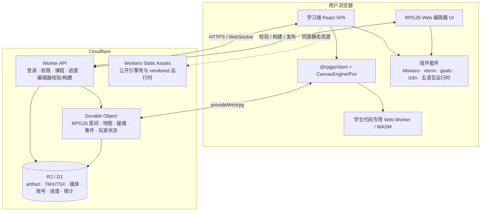

# 编程学习系统设计书（代号：CodeQuest，暂定）

> 版本 v0.9 · 2026-11-28（当前有效架构：**彻底废除 WebGAL/Terre，只使用 RPGJS v5；不 fork 框架；游戏服务端运行于 Cloudflare Worker + Durable Object；编辑器 UI 与游戏渲染运行于用户浏览器；不引入 VPS、安装客户端、Docker 服务器版或外部运行时 SaaS**。详细边界见 [RPGJS + Cloudflare 单边界架构设计](RPGJS-Cloudflare架构设计.md)）
> 作者：Hermes（Haruki Takehata 组织内立项文档）
> 参考资料：RSamaium/RPG-JS（含 `@rpgjs/client`、`@rpgjs/server/cloudflare`、`@rpgjs/tiledmap`、`@rpgjs/script`）、container2wasm/container2wasm、binji/wasm-clang、OverTheWire Bandit、Pyodide、v86。WebGAL/Terre 仅作为历史调研记录，不再是技术路线。

---

## 1. 目标与定位

一套**剧情驱动的编程学习系统**：把 RPGJS 2D 场景作为唯一课程引擎，以地图、事件、角色移动和学生沙箱脚本承载剧情与编程挑战，把 OI/竞赛评测常用的 **输入输出比对判题** 作为过关机制。学生在浏览器里登录后写代码、直接运行、直接判定，零安装。**第一版必做登录**：课程内容由 Cloudflare Worker 鉴权下发，不支持侧载。系统只能依赖 Cloudflare 与用户浏览器，不要求安装客户端。

### 1.1 核心需求（本设计书范围）

| 编号 | 需求 | 阶段 |
|---|---|---|
| R1 | 浏览器内通过 WASM/Web Worker 运行用户代码；Cloudflare 只运行可信引擎与教师课程逻辑，不执行学生代码 | P0 |
| R2 | 通过「输入 → 用户代码 → 输出与期望比对」判定正确性 | P0 |
| R3 | 课程至少包含 **代码学习** 与 **shell 操作学习** 两类 | P0 |
| R4 | 语言至少支持 C/C++、Shell、JavaScript、Python、Java（Java 路线见补充选型文档） | P0 |
| R5 | RPGJS 单引擎剧情系统：2D 地图/地形/角色移动、NPC 对话、BGM、选项分支、变量门控与「学生脚本驱动场景」 | P0 |
| R6 | **登录鉴权（第一版必做）**：注册接口保留但默认关闭，账号由管理员批量发放 | P0 |
| R7 | **课程登录后下发**：课程内容仅经鉴权 API 签发，不允许侧载；引擎壳不含课程内容，可公开缓存（§7.3） | P0 |
| R8 | 进度保存与云端同步、章节解锁 | P0 |
| R9 | 成就系统 | P1 |
| R10 | 教师/管理员可通过浏览器编辑器创建与编辑课程；核心校验与构建在 Cloudflare Worker，不要求安装客户端 | P1 |
| R11 | 防作弊「校验回放」；学生代码仍只在浏览器 Worker 执行，服务端回放需另行批准 | P2 |

### 1.2 设计原则

1. **内容即数据**：课程 = RPGJS artifact（TMX/TSX、事件/数据库、挑战、判题配置与媒体），创作期可 git 托管；分发期经 Cloudflare Worker 鉴权签发，不走公开静态 URL。**壳与内容分离**：引擎/组件套件预构建为公开壳，课程内容单独鉴权下发（§7.3）。
2. **浏览器即学生代码沙箱**：学生代码只在浏览器 Worker / WASM 内执行；Cloudflare Worker 运行可信 RPGJS 引擎、房间状态、教师事件逻辑和内容服务，不执行学生源码。
3. **判题器与运行时解耦**：判题只依赖统一运行结果，不同语言的运行时各自封装成统一接口（见 §5）。
4. **不 fork 框架**：RPGJS、CanvasEngine、PixiJS 与脚本解释器全部使用官方 npm 包和公开扩展点；编辑器与适配层自研，不修改上游源码。container2wasm 工件直接作为静态资源加载；后端鉴权与托管使用 Cloudflare 原生能力。

---

## 2. 参考方案调研（2026-11-24 核查；§2.5 为 2026-11-26 补充）

### 2.1 WebGAL / Terre（历史调研，已废除）

WebGAL 与 Terre 曾作为第二引擎和 PC/Docker 创作端候选。2026-11-28 决议：

- **彻底废除 WebGAL 技术路线**，不再保留兼容解析器、剧本格式、fork 或 Terre 集成；
- 不再开发 PC 客户端、Electron、Docker 服务器版或 VPS 部署；
- 历史文档 `docs/WebGAL魔改检查.md`、`docs/创作端-PC与Docker.md` 仅作为归档记录，不构成当前实现要求；
- 当前唯一引擎与编辑器路线见 §2.5、§4 和 [RPGJS + Cloudflare 单边界架构设计](RPGJS-Cloudflare架构设计.md)。

### 2.2 代码执行层：按语言选型

| 语言 | 方案 | 成熟度 | 备注 |
|---|---|---|---|
| Python | **Pyodide**（CPython→WASM，官方维护） | 高，生产级 | Worker 内运行，patch `sys.stdin` / 重定向 stdout 即可拿到 IO；`loadPackagesFromImports` 可按需加载 numpy 等教学常用库 |
| JavaScript | 原生 **Web Worker**（无需 WASM） | 高 | 无所谓沙箱难度最低；stdin 用预置队列模拟，`console.log` 劫持捕获输出 |
| C/C++ | **binji/wasm-clang**（Apache-2.0）：把 clang + lld 本身编译成 WASM，在浏览器内完成「编译 C/C++ 源码 → 产出 wasm → 运行」全流程（CppCon 2019 演讲，clang wasm 约 35 MB + lld 约 28 MB，Service Worker 缓存后二次进入秒开） | 中 | 这是唯一「学生代码在浏览器里真编译」的路径；替代方案见 §5.2 的风险栏 |
| Shell | **container2wasm**（Apache-2.0）：`c2w <自建教学镜像> out.wasm` 把整个容器（Linux 内核 + runc）打包成单个 WASM，浏览器内经 xterm + browser_wasi_shim 跑出真实 shell；x86_64 用 Bochs、riscv64 用 TinyEMU 模拟（`--to-js` 走 QEMU-wasm） | 中（上游活跃） | 交互探索与脚本判题统一使用真实容器；进入题目/自由模式 Shell 即启动常驻会话，运行复用、手动重置、退出销毁 |
| Java | **teavm-javac 打包**（live-codes/java，Apache-2.0）：浏览器 Worker 内 javac 编译源码 → TeaVM 转 WasmGC 运行；工件基于支持 stdin 的 Vsprocessing/teavm-javac fork，合计约 7.4MB，vendored + 校验和固定（详细选型与许可注意事项见 docs/补充选型-20261124-java.md；**CheerpJ 已明确排除**） | 中（上游三条线 2026 年内活跃） | TeaVM classlib 非完整 JDK，出题标注可用 API 范围；进阶（多模块/Gradle/Spring）走分层路线（补充选型 §7） |

> v86（x86 全模拟 + Alpine/buildroot）与 StackBlitz WebContainers / CheerpX 也调研过：WebContainers 有商用许可限制，列为备选不进 MVP。v86 原判「性能瓶颈明显」已被 2026-11-25 实测修正——本地资产、无网络加载计时下启动 4.8–12.7 s，真实 shell/进程/文件/9p 注入探测全通过；升为默认实现候选。同日已按同口径补测 container2wasm（`net=none` 2.9–4.9 s，8/8 探针全通过），主选保留但需处理镜像构建链、~130 MB 资产与 GPL/LGPL 分发义务；详见 `docs/补充选型-20261125-shell运行时.md`。

### 2.3 课程设计参考：OverTheWire Bandit

Bandit（34 关）证明了 shell 学习的「游戏化」模型：每关给一个目标（如读出隐藏文件内容），答案是一个**密码/令牌**，凭令牌解锁下一关。它只依赖 ssh + 真实 Linux，我们的对应实现是把关卡环境搬进浏览器容器。要点吸收：

- **关卡由目标驱动，而非知识点驱动**：先给任务，学生自己翻文档。
- **判题 = 状态检查**：shell 关卡不比对 stdout 字符串，而是检查容器内状态（文件是否存在、内容哈希、某命令输出），或者最简单——提交下一关令牌。
- 难度阶梯（ssh/cat → grep/sort/uniq → 压缩/网络 → 脚本编写）可直接映射为我们的章节编排。

### 2.4 判题系统参考：OI/竞赛判题惯例

采用业界通用的黑盒评测（Black-box judging）：

- 测试点 = `输入文件 + 期望输出文件`（标准输入输出，无特殊交互）。
- 比对模式分级：严格逐字节 → 忽略行尾空白/末行换行 → 忽略全部空白差异 → 逐行正则 → 数值容差。
- 反馈给出首个失败测试点的 diff（期望 vs 实际），不直接暴露答案。
- 后期可加时限（wasm 内难做真超时，用「指令数预算」替代，见 §5.4）。

### 2.5 课程引擎：RPGJS v5（唯一引擎）

RPGJS（RSamaium/RPG-JS，TypeScript，MIT）是 CodeQuest 的唯一课程引擎，不 fork、不引入 WebGAL/Terre：

- **客户端**：`@rpgjs/client` + CanvasEngine/Pixi 在用户浏览器渲染地图、角色、GUI 与音频。
- **服务端**：`@rpgjs/server/cloudflare` + Durable Object 在 Cloudflare 运行房间、地图、碰撞、事件、变量、战斗与玩家同步。
- **地图**：`@rpgjs/tiledmap` 使用 Tiled TMX/TSX；Tiled JSON 需转换或通过 `provideLoadMap()` 自定义适配。
- **脚本**：`@rpgjs/script` 在浏览器专用 Worker 中解释学生代码；`@rpgjs/script/testing` 提供确定性无头判题。
- **运行模式**：统一使用 MMORPG 模式连接 Cloudflare Worker；单机课程只是单玩家房间，不使用浏览器进程内 standalone 桥接。
- **编辑器**：自研 React Web 编辑器，UI 在浏览器，校验/构建核心由 Cloudflare Worker API 提供；不依赖 RPGJS Studio。
- **素材**：引擎不自带素材，素材经许可登记后进入 Cloudflare R2，运行时不热链第三方地址。
- **版本基线**：`@rpgjs/client@5.5.1`、`@rpgjs/server@5.4.1`、`@rpgjs/tiledmap@5.0.3`、`@rpgjs/script@5.3.0`、CanvasEngine/Pixi 固定安装。内容类型见 [RPGJS v5 运行时与内容类型基线](RPGJS运行时与内容类型.md)，整体边界见 [RPGJS + Cloudflare 单边界架构设计](RPGJS-Cloudflare架构设计.md)。

学生脚本判题与真实世界提交共用同一 API 描述：判题在浏览器 Worker 的 `SimWorld` 中完成，通过后由适配层把 effect 一次性提交给 Cloudflare 房间；失败 attempt 不污染权威世界。

---

## 3. 总体架构



当前有效要点：

- **唯一引擎**：只使用 RPGJS v5；WebGAL、Terre、PC 客户端和 Docker 服务器版全部废除。
- **Cloudflare 与浏览器两端边界**：所有内容、状态和权威逻辑位于 Cloudflare；所有 UI、渲染、输入和学生代码执行位于用户浏览器。
- **不 fork 框架**：使用官方 `@rpgjs/server/cloudflare`、`provideMmorpg()`、`provideTiledMap()`、GUI/provider 扩展点。
- **权威游戏流程在 Durable Object**：移动验证、碰撞、事件、变量、任务、战斗和挑战完成由 Worker 房间决定；浏览器不覆盖权威状态。
- **学生代码仍在浏览器 Worker**：Cloudflare 只运行可信引擎和教师课程逻辑，不执行学生源码。
- **编辑器是 Web SPA**：React/DOM/Canvas UI 在浏览器，纯模型、校验、artifact 构建逻辑由 Worker API 提供。
- **内容全部托管 Cloudflare**：R2/Workers Static Assets 提供地图、媒体和运行时，不热链第三方素材或 SaaS。
- **鉴权是内容门禁，不是 DRM**：登录学员本地必然可见课程内容，威胁模型只防未授权访问（§7.1）。

---

## 4. 课程引擎设计（RPGJS 单引擎）

### 4.0 引擎边界

| 维度 | 当前设计 |
|---|---|
| 引擎 | 只使用 RPGJS v5，不 fork |
| 客户端 | 用户浏览器中的 `@rpgjs/client` + CanvasEngine/Pixi |
| 服务端 | Cloudflare Worker + Durable Object 中的 `@rpgjs/server/cloudflare` |
| 地图 | Tiled TMX/TSX；JSON 需转换或自定义 `provideLoadMap()` |
| 剧情 | 教师事件块 + 数据库 + 学生 `@rpgjs/script` 沙箱脚本 |
| 编辑器 | 自研 React Web SPA；核心校验/构建在 Worker |
| 产物 | `artifact.json` + TMX/TSX + 事件/数据库 + 媒体 + 挑战/判题 |
| 运行模式 | 统一 MMORPG 房间模式；单机课程 = 单玩家房间 |
| 部署 | 仅 Cloudflare + 用户浏览器，无 VPS、安装客户端或外部 SaaS |

WebGAL 剧本、`start.txt`、Terre、PC 客户端和 Docker 服务器版不属于当前课程格式。

### 4.1 课程结构

```
course-rpgjs/
├── project.json              # 创作期元数据
├── maps/*.tmx                # Tiled 地图
├── tilesets/*.tsx            # Tiled 瓦片集
├── media/*                   # PNG/WebP/SVG 等图片
├── sounds/*                  # OGG/MP3/WAV
├── events/*.json             # 教师事件块
├── database/*.json           # 物品、技能、职业、状态等
├── challenges/*.json         # 代码、终端、场景脚本挑战
├── judges/*.json             # 公开判题配置
├── licenses/*                # 素材许可与来源登记
└── sealed/judges/*.json      # 隐藏判题数据，只进 sealed
```

发布产物：

```
artifact/
├── artifact.json              # 版本、shellVersion、入口、文件哈希/MIME/许可
├── content/                   # 鉴权下发的课程内容
└── (sealed 内容不进入 content)
```

课程流程分两层：

1. **教师层**：地图对象、事件块、数据库与条件分支，运行在 Cloudflare Durable Object。
2. **学生层**：浏览器 Worker 中解释的学生脚本；判题通过后才把 effect 提交给权威房间。

### 4.2 关卡格式

#### 4.2.1 教师事件块

自研编辑器输出声明式事件 JSON，不使用 WebGAL 文本语法。事件块覆盖：

- 对话、选项、分支、等待；
- 变量、任务与条件门控；
- 移动路线、传送、换图；
- 战斗、物品、技能；
- BGM、音效、天气与 cinematic；
- 挑战触发点、令牌输入和完成信号。

事件块是可信教师内容，由 Cloudflare Worker 中的 RPGJS server 执行。

#### 4.2.2 学生场景脚本

- **语法与隔离**：`@rpgjs/script` JavaScript 子集，带步骤、迭代、字符串、列表和深度预算；不使用 `eval`，只暴露声明 API。
- **执行位置**：学生代码只在浏览器专用 Worker 中运行；Cloudflare Worker 不执行学生源码。
- **判题**：`@rpgjs/script/testing` 从不可变 `WorldInit` 新建 `SimWorld`，断言状态、返回值、对话和 effect。
- **提交**：判题通过后，由挑战适配层把 effect 一次性提交给 Cloudflare Durable Object；失败 attempt 直接丢弃，不对权威世界 undo。
- **课程门面 API**：编辑器声明、宿主实现和无头判题共用 `ApiDescription` / `ApiImpl`；首个扩展为 `game.player.move(way, times)`，不 fork RPGJS。
- **OI 题**：继续走统一 stdout/stderr/exitCode 判题器，与场景脚本判题互不替换。

### 4.3 舞台美术与课程演出

- 浏览器使用 CanvasEngine/Pixi 渲染 2D 地图、角色、动画、天气和 GUI。
- 课程角色是可对话 NPC；玩家使用经典键盘移动与碰撞，过场可由 `canMove` 锁定。
- 代码、终端和场景脚本挑战通过 RPGJS GUI 组件叠加在场景上，完成后向 Worker 房间发送完成信号。
- 素材统一登记为 media-id，进入 Cloudflare R2；运行时不热链 Kenney、itch 或其他第三方地址。
- Durable Object 保存权威房间状态，D1 保存挑战通过位、章节和变量摘要；浏览器本地存档只用于恢复体验。

### 4.4 编辑器与素材工作流

**编辑器**：

- 浏览器 React SPA 提供地图、事件、数据库、素材和挑战编辑；
- Worker API 提供 schema、路径、尺寸、引用、许可、哈希和 artifact 构建校验；
- 地图输出 TMX/TSX；若继续使用编辑器 JSON，必须实现 `provideLoadMap()` 适配层并补齐碰撞/事件/渲染契约；
- 不使用 Terre、Electron、RPGJS Studio 或任何安装客户端。

**素材工作流**：

1. 来源可为自制、CC0 或已获再分发许可的素材；逐个登记来源和许可。
2. 导入后统一尺寸、帧网格、透明底、命名和 MIME。
3. 生成 media-index，记录 media-id、路径、尺寸、SHA-256、许可和使用位置。
4. 素材按 SHA-256 进入 `cq-content`，同图跨课去重；运行时只从 Cloudflare 拉取。
5. 发布前验证所有 `media/*` 都有许可登记；缺失、来源不明或不允许再分发的素材拒绝入库。

#### 4.4.1 参考模板素材版权核查（2026-11-27 核查）

核查对象：RPG-JS 主仓 `samples/`（sample-dev、cloudflare-mmorpg）与官方模板 `rpgjs/starter`（v5 分支）、`rpgjs/template`（v3）。方法：v5 源码全文检索署名/许可文件 + 文件内嵌元数据（PNG text 块 / MP3 ID3 帧）+ git blob 哈希跨仓比对 + git 历史溯源 + itch.io 许可条款原文。结论按可用性三档：

**第一档：开源/可商用**（可直接入课程包；义务仅为署名或无）

| 素材 | 许可 | 义务 | 核查证据 |
| --- | --- | --- | --- |
| RPGJS 引擎/脚本/数据层代码（含官方示例代码） | MIT | 无额外义务 | 仓库根 LICENSE（2026-11-26 核查） |
| Davidvitas「RPG Music Pack」（BGM/音效） | CC BY 4.0 | 署名（作者+包名+链接） | v3 官方模板 README 署名段（Sounds: Davidvitas, CC BY 4.0） |
| game-icons.net 图标 | CC BY 3.0 | 署名 | v3 官方模板 README 署名段 |
| Kenney 免费素材集（含 RPG tileset，备选源） | CC0 | 无义务 | Kenney 全线 CC0（替代第二档再分发条款的干净选项） |

**第二档：需教育许可**（可商用可自用，但「课程包向学员再分发素材原文件」场景需先取得作者书面许可）

- **Pipoya「FREE RPG Tileset 16x16 / 32x32」系列**（pipo 系列；starter / cloudflare-mmorpg / sample-dev 三处 blob 哈希逐字节一致；官方 starter README 署名 "Graphics: Pipoya"）。许可条款原文（itch.io 包页面）："For commercial or personal use. Use and edit freely. **Not redistribute or resell this assets.** It can be used for game development and other productions."——商用/教学均允许、可自由编辑、须署名（包名 + pipoya + 链接）；限制在**不得再分发素材本身**。课程包内裸 PNG 学员可直接提取，严格读条款属再分发；作者公开口径为「打包进游戏、第三方拿不到原文件即不算再分发」。三选一处置（待定项 9，M1a 出首课前决出）：① 经 itch 页 Contact Form 向作者申请教育再分发书面许可（推荐，成本最低）；② 换用第一档 CC0 源（Kenney，同 16x16/32x32 规格）；③ 课程包不放裸文件、素材走 R2 按鉴权 URL 下发（贴合作者口径）。
- **小尺寸角色 sprite**（starter `hero.png`/`female.png`，哈希同 v3 模板 "Male 01-2"/"Female 13-2"）：模板 README 笼统署名 Pipoya，但 Pipoya 本人在 16x16 包评论中声明该包截图角色**非其制作**（WOLF RPG Editor 生成）——署名粒度存疑，不作课程素材依据；角色图走自制或第一档 CC0 替换。

**第三档：不可用/仅参考**（源出不可证，不得入课程包）

- **sample-dev 独有 10 素材**：`hero.png`(1.3MB)、`monster.png`、`potion.png`、`exp.png`(1.8MB)、`wood.png`、`faceset.png`(3.5MB)、`background.jpg`(1MB)、`music.mp3`(1.5MB)、`cursor.wav`/`typewriter.wav`（早期核查记录为相同哈希；2026-11-28 固定 commit `5616eda1` 审计发现两者 Git blob SHA 不同但 bytes 同为 176478，因属第三档未下载内容，不能重新断言字节是否相同；两者均保持禁用）。核查结果：仓库内（README/文档/代码注释）无任何署名；文件内嵌元数据仅 GIMP 重存时间戳（hero 2024-10-18、background 2025-06-28、wood 2025-07-01、potion 2026-01-05）与 LAME 编码器标记，无作者/版权字段；与 v3 模板已署名素材及已知免费包哈希零匹配；git 历史为 2025-06-28 单次提交整体导入，无更早公开溯源。→ **源出不可证，一律不入课程包**；仅其代码结构 / bundle 组织方式可参考（素材全部替换）。`music.mp3` 疑为 Davidvitas 包的重编码（v3 模板声源），但编码不同、无指纹可验，不升档。

---

## 5. 代码执行与判题

**所有学生代码执行都发生在浏览器 Worker/WASM 内**，不经过 Cloudflare 服务端。Cloudflare Worker 只运行可信 RPGJS 引擎、教师事件逻辑和内容服务。执行层与游戏引擎解耦，通过 RPGJS GUI/挑战适配层挂载。组件套件统一实现以下接口：

### 5.1 统一执行接口

```ts
// 每个语言的运行时实现同一 Worker 协议
interface RunRequest  { lang: Lang; code: string; stdin: string; files?: Record<string,string>; timeoutMs: number }
interface RunResponse { stdout: string; stderr: string; exitCode: number; logs?: string[] }  // 判题只用 stdout/stderr
```

- `files` 用于 shell/多文件场景（把初始文件系统快照注入运行时）。
- `timeoutMs` 在 wasm 内无法强杀，见 §5.4 降级策略。

### 5.2 各语言运行时

| 语言 | Worker | 机制 | 注意点 |
|---|---|---|---|
| Python | pyodide Worker | `sys.stdin = StringIO(stdin)`；stdout 重定向到 `sys.stdout.write` 收集器；支持 `input()` | 惰性加载（首次约 10MB wasm，SW 缓存）；`micropip` 白名单控制可装包 |
| JavaScript | 普通 Worker | `console.log` 劫持；stdin 用逐行队列模拟 `readline()` | 不用 `eval` 在主线程跑，防死循环卡 UI |
| C/C++ | wasm-clang Worker | clang wasm 在浏览器编译源码 → lld 链接 → 实例化运行；stdin/stdout 经运行时内存缓冲交换 | clang wasm ~35MB + lld ~28MB：**必须** Service Worker 预缓存 + 分包懒加载；仅支持 freestanding 级标准库（C++ 模板/STL 大头可用但受 WASI shim 完整度限制，出题需标注可用范围） |
| Java | teavm-javac Worker | Worker 内加载 vendored `compiler.wasm`（javac）编译源码 → TeaVM WasmGC 运行；stdin 经 Vsprocessing fork 的 console 输入注入；同源码哈希预编译缓存 | compiler 5.2MB + classlib 2.2MB，SW 预缓存；classlib 非完整 JDK，出题标注可用 API；工件独立携带 OpenJDK GPLv2+CE 声明（THIRD-PARTY-NOTICES，许可细节见补充选型 §5） |
| Shell(判题) | container2wasm 常驻会话 | 在同一真实容器内写入脚本/stdin，执行后回收 stdout/stderr/exitCode | 进入工作台即启动，测试点间不重建容器；Bochs 启动成本由常驻会话摊薄 |
| Shell(交互) | container2wasm 会话 | `c2w <自建教学镜像>` 产物 + xterm + browser_wasi_shim 在浏览器里跑真 Linux shell | 进入即启动、运行复用、手动重置、退出销毁；默认禁网 |

#### 5.2.1 语言开发容器镜像

为本地开发、CI 冒烟与后续 container2wasm 转换提供统一的 Alpine 3.22 最小开发镜像。它们不替换
§5.2 的浏览器运行时主链路，也不在服务端执行学员代码。

| 选择器 ID | 镜像 | 固定工具集 |
|---|---|---|
| `shell` | `cq-dev-shell:cn` | Alpine BusyBox + bash + GNU coreutils/findutils/grep/sed |
| `cpp` | `cq-dev-cpp:cn` | GCC/G++、make、CMake、GDB（`build-base`） |
| `java` | `cq-dev-java:cn` | OpenJDK 21 JDK（`javac` / `java`） |
| `python` | `cq-dev-python:cn` | Python 3.12、pip、Python 头文件与原生扩展构建工具 |
| `javascript` | `cq-dev-javascript:cn` | Node.js 22 + npm |

所有镜像统一包含 `git`、`vim`、`nano` 与非 root 的 `student` 工作用户。c2w guest 内存按语言设置：
Shell 128 MiB，C/C++ / Python / JavaScript 256 MiB，Java 512 MiB。

构建统一经 `docker.1ms.run` 拉取 Alpine 3.22，apk 使用清华镜像，Podman 固定 `linux/amd64`。
选择器支持交互选择、`list`、单个语言与 `all`；每个镜像都有真实编译/运行冒烟测试：

```bash
node scripts/build-language-container.mjs list
node scripts/build-language-container.mjs java --test
node scripts/build-language-container.mjs all --test
node scripts/test-language-containers.mjs
node scripts/containers/build-c2w.mjs all
```

Container Shell 顶栏提供语言环境选择器，按 `runtime/cq-dev-<language>.wasm.gz` 动态加载；
切换环境会重启容器。浏览器清单记录压缩大小与完整 SHA-256；字节数用于下载进度，VM Worker 通过
Cache API 按工件路径持久化响应。每次命中缓存都重新计算压缩字节的 SHA-256，一致才复用，不一致则删除
并重新下载；`requestId` 只用于关联启动进度，不参与缓存键。首次下载通过校验后才写入缓存。

**C/C++ 风险备选**（若 wasm-clang 在目标设备上不可用）：退化到「模板编译」模式——管理员把题目框架用 Emscripten 预编译为 wasm，用户只填被 `#include` 进来的函数体或通过 stdin 交互的黑盒程序，前端只做运行不编译；再往后是服务端判题（P2 后端顺手支持）。出题模板里声明该题属于哪种模式。

> 各运行时对**文件系统与网络**的支持差异（持久化策略、网络白名单、章节落层速查）见 `docs/能力矩阵-文件系统与网络.md`（2026-11-24 核查）。

### 5.3 判题器

```ts
interface TestCase { name: string; stdin: string; expected: string; mode: DiffMode; weight?: number }
type DiffMode = 'exact' | 'eol' | 'ws' | 'regex-line' | 'numeric-tol';
```

判题采用**两条并行轨道**，共享工作台、goals、成绩与进度，但互不替代：

1. **stdio 轨**：JavaScript、Python、C/C++、Java、Shell 统一产生 `stdout/stderr/exitCode`，由纯 TS OI 判题器比对。
2. **世界状态轨**：RPGJS 学生脚本在浏览器 Worker 的 `SimWorld` 中运行，断言 `state/effects/listeners/texts`，不依赖 stdio。

两条轨可以独立执行；同一挑战默认声明一条主轨。若未来需要同一挑战同时跑两条轨，再扩展 composite judge schema 并聚合结果，不把世界状态断言伪装成 stdio。

流程（v0.6 分层，stdio 轨）：

1. **本地运行**：前端只带**公开样例**，跑完就地比对，用于调试与 goals 的 `output-*` 求值；
2. **提交判定**：把 stdout/stderr/exitCode 回传 `POST /api/judge/:challengeId`，Worker 用**同一份纯 TS 判题器**对 sealed 层的隐藏测试点比对；
3. **反馈**：只回判定结果 + 首个失败点的**行级 diff**（期望 vs 实际），隐藏用例的 stdin/expected 永不下发。

> goals 目标清单（§6.2）与 testcases 正交：goals 驱动过程引导与勾选，testcases 驱动最终判定；`testcase` 类 goal 只是读取判题结果，不改变判题本身。

- `eol`：忽略行尾空白与文件末尾换行（默认值，宽容 `print` 差异）。
- `regex-line`：每行一个正则，供「输出格式自由、数值必对」的题。
- 失败信息分三类文案：输出不符 / 运行报错（stderr 非空）/ 超时（见 5.4）。
- 防作弊（v0.6）：隐藏用例与期望输出只存 `cq-sealed`，随包下发的只有公开样例——学生无法读答案硬编码；P2 的「校验回放」仍保留，用于复跑代码而非仅比对输出。

**场景脚本题（RPGJS 世界状态轨，2026-11-26 核查）**：学生编写的 `@rpgjs/script` 脚本与各语言 stdio 判题**并行存在**，不进入 OI 判题器，而走官方 `@rpgjs/script/testing` 无头解释器。当前实现只在浏览器专用 Worker 中运行学生脚本，对变量、对话、地图切换和 GUI 信号做确定性断言；Cloudflare 不执行学生源码。与游戏运行时使用同一个解释器——判的就是跑的。挑战定义里 `judge` 二选一：`oi`（默认，stdio 轨）或 `script`（世界状态轨）；两条轨的结果都汇入 goals 勾选与进度 API（§6.2/§7.1）。服务端校验回放属于 P2，需先修改学生代码执行边界并获批准。

**课程自定义 API 兼容层（2026-11-28）**：官方 `checkScript`/`runTests` 写死原生 API 描述，不能直接接受 `game.*`。实现改用 `@rpgjs/script/core` 的 `parseScript` → `compileProgram` → `Program.call/fire` 薄封装，并以 `@rpgjs/script/testing` 的 `SimWorld` 作为宿主世界；编辑器、宿主与判题共用 `ApiDescription`。每个测试/提交新建世界，判定 `state` 与有序 `effects`，支持 `effect:<name>:<path>` 断言；失败即丢弃本次世界，从同一 `WorldInit` 重放。记录 `initHash`、`scriptHash`、`effects`、`partialState`、`verdict` 作为 attempt ledger，不在真实游戏世界执行逆操作。

### 5.4 资源限制与死循环

WASM 内无法真正抢占。策略分级：

1. **指令预算**：wasm-clang / Pyodide 运行时可统计指令数（V8/WASM 引擎不支持时退化为输出字节上限，如 stdout 超 1MB 强制结束标记）。
2. **进程级兜底**：Worker 超时后直接 `terminate()` 重建——Worker 模式下代价可接受（运行时 wasm 资产有缓存，重建 1-2 秒）。
3. 出题界面提示「本题限时约 N 秒」。

### 5.5 Shell 关卡接口与判定

c2w 对课程只暴露 **Shell/终端接口**，不提供文件系统、进程或端口的结构化世界状态 API。因此 Shell 判题统一走 stdio 轨：

| 模式 | 判定方式 | 适用 |
|---|---|---|
| **脚本判题**（term 挑战 + judge 配置） | 用户提交 `.sh`，在 container2wasm 常驻容器内运行，判定 stdout/stderr/exitCode | 「写一段 shell 处理文件」型 |
| **探索/令牌关** | 用户自由操作终端，找到令牌后通过 RPGJS GUI 的 `showInput` 提交；令牌比对属于游戏流程，不读取容器结构化状态 | 「探索式学习」型 |

文件、进程、端口等教学检查必须写成 shell 探针命令，由探针的 stdio/退出码体现结果。例如用 `test -e`、`ps`、`ss`、`md5sum` 等命令输出作为判题输入；不得假设 c2w 提供独立的 `file-exists` 或 `command-stdout` 世界状态通道。现有便利 goals 若保留，必须编译为上述 shell 探针，不能绕过 stdio 判题器。

#### 5.5.1 状态检查能力矩阵（进程 / 文件 / 端口，2026-11-24 核查）

Shell 探针命令要跑在**容器会话内**（写入/执行探针 → 回收 stdout/stderr/exitCode），所以可检查能力取决于承载它的运行时；这不是独立的世界状态判题 API：

| 检查目标 | container2wasm 会话（模拟 CPU 上的真实 Linux 内核 + runc） | v86 + Alpine（真实内核，备选） |
|---|---|---|
| 文件（存在/内容/权限/md5） | ✅ `test`/`stat`/`find`/`md5sum`/`sha256sum`，初始文件在容器内真实写入 | ✅ |
| 进程（存活/参数/信号/后台任务） | ✅ 真实内核 + runc：`ps`/`pgrep`/`pkill`/`pidof`/`kill`/`jobs`/`&` 均为真实进程模型 | ✅ |
| 端口（监听/连接） | ✅ **容器内 loopback** 已实测（`nc -l -p 8080 127.0.0.1` + `netstat -ltn`）；对外端口默认关闭 | ⚠️ 另有 WISP v1 WebSocket 可做受控外连 |

busybox 检查类 applet 已确认存在（busybox.net 官方清单 + Alpine v3.22 构建，2026-11-24）：`ps`/`pgrep`/`pkill`/`pidof`/`netstat`/`nc -l`/`fuser`/`lsof`（Alpine 构建）/`stat`/`md5sum`。但 **applet 取决于构建配置**（Debian 构建就缺 `pgrep`）——因此**不用 `busybox:latest` 官方镜像，改为自建教学镜像**：Dockerfile（alpine 基底 + 预装 `procps`、`iproute2`，按课程清单固化 applet/工具集）→ CI 里 `c2w` 转换并缓存产物，判题器检查也基于该镜像的可预测工具集编写。

结论：**Shell 教学与判题统一使用 container2wasm 真实容器，不保留 TypeScript 模拟 shell 或 wasi-sh 运行时**。进程/文件类状态检查在容器内执行；容器内 loopback 已实测通过，默认仍禁网。

---

## 6. 前端 UI

- **舞台**：RPGJS 2D 场景（地图/角色/事件），由浏览器 `@rpgjs/client` 渲染，Cloudflare Durable Object 提供权威状态。
- **挑战工作台**（通过 RPGJS GUI 组件叠加，覆盖 60-100% 视口）：
  - 左：代码编辑器（§6.1）+ 题面 Markdown + 代码模板（模板内 `// TODO` 锚点）+ 目标清单面板（§6.2）。
  - 右上：运行/提交按钮 + stdin 预览（来自测试点，可自填）。
  - 右下：输出与判题结果（测试点列表 → 展开首个失败 diff）。
- **终端工作台**：xterm.js + 会话管理（container2wasm 长会话，切换挑战不重启容器）。
- 提示系统：`hint` 注册的提示逐条解锁，可配置消耗（如成就积分）。

移动端：编辑器降级为「只读浏览 + 提交来自剪贴板」（P1）；教学场景默认桌面。

### 6.0.1 视觉系统、i18n 与深色模式（2026-11-26）

学习端视觉参考 `earthol-player-profile`，采用统一的轻量设计系统，不改变剧情、判题、容器运行时或课程包格式：

- **公共壳层**：粘性半透明顶栏、品牌标识、语言切换、主题切换；登录、初始化、课程列表、自由模式、剧情舞台和终端工作台共享同一套组件。
- **设计令牌**：以 CSS HSL 变量统一背景、前景、卡片、边框、主色、成功/警告/危险色和阴影；亮色为白底蓝/青主色，深色为近黑底粉/紫主色。卡片圆角 14px，按钮/输入框采用胶囊形，多行输入保留圆角矩形。
- **i18n**：界面提供 English / 简体中文，默认跟随浏览器语言并持久化选择；英文字典为键的事实源，中文字典受类型约束。课程标题、题面、剧本等作者内容保持原语言。
- **深色模式**：首次访问跟随系统 `prefers-color-scheme`，用户切换后持久化；Monaco 与终端配色同步主题，页面加载前应用主题以避免闪烁。
- **可访问性**：图标按钮提供本地化 `aria-label`，语言菜单支持键盘与 Escape，所有交互提供可见焦点和减弱动画适配。

### 6.1 编辑器选型与补全（2026-11-24 核查）

**选定 Monaco**（`monaco-editor`，Microsoft 维护，VS Code 内核）：

| 关注点 | 结论 | 依据（核查日期 2026-11-24） |
|---|---|---|
| 高亮 | 四语言全支持（Monarch 语法），主题随舞台演出定制 | 内置 |
| JS/TS 补全 | **内置 TS language worker，开箱即用的世界级 IntelliSense**（类型、悬停、诊断） | 官方能力，TS Playground 同款 |
| Python 补全 | `@typefox/pyright-browser`（pyright 语言服务编译到浏览器，TypeFox 维护）+ `monaco-languageclient` 挂载 → 补全/悬停/诊断全有；官方 pyright-play.net 即此形态演示 | 上游在线演示存在 |
| C/C++ 补全 | 无浏览器内 clangd 实用方案，用**三层兜底**：① challenge 模板符号（函数名/类型）② 关键字 + snippet provider ③ **把 wasm-clang 编译错误回填为编辑器诊断标记**（编译输出解析 → 行内红色波浪线），学生至少获得「编不过马上看到在哪」 | 设计决定 |
| Java 补全 | Monaco 内置 Java Monarch 高亮；补全 P0 与 C/C++ 同款三层兜底（模板符号 / 关键字+snippet / **javac 编译错误回填诊断**）；Java 浏览器内 LSP（jdt.ls）列为远期观察项不进排期 | 设计决定 |
| Shell 补全 | 自定义 provider：内建命令 + **教学镜像 applet 清单**（构建期跑 `busybox --list` 生成静态 JSON 随课程包下发，与镜像工具集一致，§5.5.1） | 设计决定 |
| 体量与移动端 | 编辑器本体 ~1.2MB gzipped（未含 workers），worker 需显式接线（Vite `MonacoEnvironment.getWorker`）；**官方不支持移动端**——与「桌面优先 + 移动端只读降级」定位一致 | README 明示无移动支持、无 TextMate 扩展机制 |

排除的备选：**CodeMirror 6**（模块化、~250KB gzipped 含五个语言包、触屏支持好；但 TS/JS 仅语法高亮无 IntelliSense，补全需全部自装配，四语言里反而最贵的是体验缺口）——若 P1 移动端要升级为可编辑，CM6 是降级换装的首选，此处预留；**Ace**（维护活跃度与生态均不如前两者）不采用。

### 6.2 目标清单（goals：过程性目标自动勾选）

挑战定义新增 `goals` 字段——给用户明确的**达成目标清单**（如「必须包含 main 函数」「`/test.sh` 存在」），逐项实时求值、达成即自动勾选：

```ts
interface Goal { id: string; text: string; hint?: string; check: GoalCheck; hidden?: boolean }
type GoalCheck =
  | { kind: 'source-regex';    pattern: string; flags?: string }   // 静态源码检查，如含 main 函数
  | { kind: 'source-not-regex'; pattern: string }                  // 反向：禁止出现某写法
  | { kind: 'output-contains'; value: string }                     // 最近一次运行的 stdout 包含
  | { kind: 'output-regex';    pattern: string }
  | { kind: 'exit-code';       value: number }                     // 运行退出码
  | { kind: 'file-exists';     path: string }                      // 编译为 shell 探针，按 stdio/退出码判断文件存在
  | { kind: 'command-stdout';  command: string; expect: string }   // 容器内执行 shell 探针并比对 stdout/stderr
  | { kind: 'testcase';        all?: boolean; id?: string }        // 与判题联动（指定/全部测试点通过）
```

求值管线（自动、无需用户点检查）：

1. **source 类**：编辑防抖 300ms 后在本地对源码求值——零成本、即时反馈。
2. **output/exit-code 类**：复用**最近一次 Run** 的结果求值，不触发额外运行；用户点了「运行」这些项就会刷新。
3. **file-exists / command-stdout 类**（shell 探索关）：编译为容器内 shell 探针，回收 stdout/stderr/exitCode 后按 stdio 轨求值；不读取结构化容器状态。在关键动作（Enter 提交检查 / 定时轮询）时触发。
4. **testcase 类**：由提交后的判题结果驱动。

UI：目标清单面板固定在编辑器侧栏（或终端工作台侧栏），每项一个复选框——未达成空心、达成实心勾 + 高亮动画；全部达成显示「✅ 可以提交」；挑战可配 `requireAllGoals: true`（未全勾则提交按钮禁用）。goals 是**过程引导，不是最终判定**：最终过关仍以 judge 测试点为准，两者正交（§5.3）。

---

## 7. 部署与后端（P0 起即含后端，直接以 March7thTeam/boardroom 为工程模板）

### 7.1 第一版（P0）：登录 + 课程鉴权下发 + 进度同步

第一版就带后端（职责收窄为「账号 + 内容下发 + 判题比对 + 进度存储」，不执行用户代码）：

- **托管**：按 boardroom 的 Workers Assets 模式——学习端 SPA 与管理端静态资产放同一 Worker 项目的 `assets`（SPA fallback），`/api/*` 进 Hono 逻辑；**课程内容不放 Workers Assets**，走 `cq-content` + 鉴权路径（§7.3）。
- **学习端显式路由（2026-11-28）**：使用 History API，将页面状态与 URL 同步，支持刷新深链接、浏览器前进/后退和登录后返回原目标页。路由表：

  | 路径 | 页面 | 访问规则 |
  |---|---|---|
  | `/` | 学习端入口 | 按初始化/登录状态替换到 `/setup`、`/login` 或 `/courses` |
  | `/setup` | 实例初始化 | 仅空实例；已初始化后替换到登录或课程页 |
  | `/login` | 登录 | 未登录；已登录时替换到课程页 |
  | `/password` | 首次登录强制改密 | 仅 `must_change_password=true` 的会话 |
  | `/courses` | 课程与实验场列表 | 需登录 |
  | `/courses/:courseId` | 课程剧情与挑战舞台 | 需登录；刷新时重新拉取课程包与进度，课程不存在显示错误 |
  | `/free` | 自由模式 | 需登录 |
  | `/container` | 独立 Container Shell | 需登录且功能开关允许 |
  | `*` | 学习端 404 | 已登录用户可见明确提示与返回课程页链接 |

  已知页面路径由 Worker 显式回退到学习端 `index.html` 并使用 `no-cache`；`/assets/*` 仍由静态资源层处理，API 与 `/admin`、`/editor`、`/runtime` 边界不变。个人资料继续使用弹窗，不作为独立页面；挑战深链接需等待挑战 ID 与剧情指针映射稳定后再增加。
- **登录（R6）**：
  - 会话与用户管理直接沿用 boardroom `docs/auth.md` 的模式（登录、会话、bootstrap），角色采用 **学生（student）-教师（teacher）-管理员（admin）** 三级模型。
  - **登录标识与账号资料**：用户必须拥有唯一用户名（3–32 个字符，允许 Unicode 字母/数字及 `._-`，统一小写存储、登录不区分大小写）；邮箱可选，填写时校验格式、统一小写并保持唯一。登录接受用户名或邮箱，用户名匹配优先。初始化、注册、批量发号和账号编辑均写入用户名；CSV 格式为 `username,email,display_name[,password]`，邮箱列允许留空。用户与审计公开信息包含用户名，邮箱可为 `null`。学习端与管理端登录后提供**用户信息面板**：展示用户名、邮箱、角色、注册与最近登录时间，并允许用户自行修改展示用 `display_name`；用户名与邮箱仍由教师/管理员维护。`display_name` 为空或只剩占位/乱码字符时，界面统一回退显示用户名。
  - **角色权限**：
    - 学生：登录、课程学习、进度同步、自由模式与 Container Shell，不进入管理面板。
    - 教师：课程上传/版本更新/上下架、学生账号搜索/启停/重置、批量发号与批次管理，可读取实例配置；不能管理教师、查看审计或修改系统配置。
    - 管理员：拥有全部权限，额外管理教师账号、查看完整审计与系统配置；可批量创建学生或教师账号。任何角色都不能停用、改密或删除管理员账号。
    - 角色变更会立即使受影响账号的既有会话失效，权限以服务端会话中的最新角色为准。
  - **注册接口保留实现但默认关闭**（功能开关 `REGISTRATION_ENABLED=false`），接口路径与校验逻辑先写好、后台可一键开放；开放注册只创建学生账号。
  - **账号由教师/管理员批量发放（v0.5 定稿）**：管理面板支持 CSV 上传/粘贴、服务端预览与冲突检查、系统生成或管理员指定初始密码、原子批量建号和一次性发放表下载；首次登录强制改密。默认采用系统生成随机密码，CSV 第四列可显式指定，空列自动生成。教师只能批量创建学生；管理员可选择创建学生或教师。
    - **发放链接**：256 位随机 token，数据库只存带 pepper 的哈希；24 小时过期；领取通过单条条件 UPDATE 原子消费，重复/并发领取只有一方成功；领取后立即清空 CSV 明文。管理端读取与每小时 Cloudflare Cron 共同清除过期/撤销批次的明文。API 创建响应和批次历史均不返回密码或 CSV；导出带 UTF-8 BOM，并防护电子表格公式注入。
    - **失败原子性**：任一用户名或邮箱重复/占用都使整批回滚，不留下半批账号；预览只读、不建号、不生成最终凭证。
    - **管理能力**：教师管理学生账号搜索/筛选/分页、启停、重置临时密码（返回一次并强制改密）、学生批次历史与撤销尚未领取的链接；管理员还可管理教师账号、查看完整审计与系统配置。记录发号、账号启停/角色变更、重置密码和撤销等管理审计事件。
    - **凭证传递**：链接本身是 bearer credential，只通过可信渠道分发；不邮件群发明文，不写入 URL 查询日志以外的冗余副本；管理员重置密码同样只展示一次。撤销链接不等于停用已创建的账号，需在账号管理中另行停用。
  - **实例初始化**：前端与后端只保留 `POST /api/v1/setup` 一个初始化入口；管理面板检测到空实例时跳转到 `/api/v1/auth/status` 返回的 `setup_url`（默认 `/setup`，独立学习端子域由 `LEARNER_URL` 拼接），不再渲染第二套初始化表单。`/setup` 创建首个管理员、写入实例名（默认 `CodeQuest`）、记录 `bootstrap` 审计并签发会话，可选传课程包。管理员、实例名、可选课程元数据、审计和会话记录在同一个 D1 batch 中提交；R2 暂存失败或 D1 回滚都不会留下半初始化状态。检测到用户或 bootstrap claim 都拒绝重复初始化，`/setup/status` 与 `/auth/status` 使用同一判定。
- **课程下发（R7）**：
  - **当前版本状态（2026-11-28）**：课程接口保留通用 `CourseProvider` 抽象；当前默认 provider 仍固定无课，RPGJS Worker 房间与 artifact 下发链路尚未接通。
  - 课程内容（TMX/TSX、事件/数据库、挑战、公开样例、媒体）**仅经 Cloudflare Worker 鉴权 API 拉取**，不进公开静态 URL，也无学员侧离线包导出；隐藏判题数据（`cq-sealed`）没有任何读路由（§7.3）。
  - 引擎壳与 vendored 运行时由 Cloudflare Workers Static Assets/R2 提供，按 `shellVersion` 不可变缓存；课程 manifest 固定兼容版本。
  - 明确定位：**鉴权是内容门禁，不是 DRM**——登录学员本地必然持有课程内容，设计上不追求防「已授权者复制」，只防未授权访问与爬取。
- **公开资产例外**：wasm 运行时与预构建引擎壳不含课程内容，可由 Cloudflare 公开缓存；课程内容始终走鉴权路径。
- **进度同步（R8）**：Durable Object 保存当前房间权威状态，D1 保存课程级进度摘要；浏览器本地存档用于恢复体验。进度字段为 `engine: "rpgjs"`、`course_id`、`course_version`、`room_id`、`map_id`、`variables`、`challenges`、`updated_at`，不再使用 WebGAL 的 `scene/pointer`。

### 7.2 工程模板：boardroom 逐项对齐

| 关注点 | boardroom 现成做法 | CodeQuest 采纳方式 |
|---|---|---|
| 路由/校验 | Hono 4 + zod | 同栈 |
| SPA 托管 | wrangler `assets` + `run_worker_first`（API 走 Worker、其余落静态） | 第一版即采用，后续加后端能力零迁移 |
| 数据库 | D1 + `migrations/` 迁移目录（`db/schema.sql` 快照） | 同构起步，但业务层只依赖 `Database` / `DbStatement` 契约；D1 仅是实现适配器。当前未发布，schema 以 `migrations/0001_init.sql` 为唯一基线，允许 `npm run db:reset` 删库重建，不维护旧版本迁移兼容 |
| 实时 | Durable Objects + WebSocket | RPGJS 房间从 P0 起使用 DO；非游戏进度摘要仍可用轮询/API |
| 认证/管理 | `docs/auth.md`（登录、会话、bootstrap、管理员用户管理）、`docs/admin.md`（SMTP/邀请） | 沿用会话与用户管理模式；SMTP/邮件邀请链路留给「开放注册」那天启用 |
| 工程规范 | `AGENTS.md`、vitest、CI | 新仓库按 boardroom 的 AGENTS.md 模板起稿 |
| 一致性 | `docs/consistency.md`（outbox、202 回执） | 课程下发是低频读，不需要 outbox；留文档链接备查 |

课程内容（v0.6）：D1 存元数据与**单版本指针**，R2 分三桶——`cq-shell`（公开，引擎壳）、`cq-content`（鉴权，课程内容 blob）、`cq-sealed`（无路由，判题答案）；发布、去重、GC 与下发细节见 §7.3。判题比对（含 P2 校验回放）在 Worker 侧跑同一判题器（纯 TS，前后端共用同一实现）；场景脚本题的校验回放同样适用（无头解释器可在 Worker 确定性复跑，§5.3）。

---

### 7.3 成品存储与分发（v0.6 起）

成品游戏按**不可变构建产物**存储，不按课程文件树存储。四条硬规则：

1. **单一在线版本**：每门课线上只有当前版本；发布成功即删旧版本，旧 URL 返回 404，不保留可回滚的历史版本。
2. **内容寻址**：文件按 `sha256` 存 blob，同一内容只存一份——同版本重复引用、跨课程共用壳、发布重叠期新旧共用都去重。
3. **答案不下发**：隐藏测试点与期望输出只进 `cq-sealed`，没有任何读路由。
4. **发布原子**：内容先上传校验、指针后切换；任意时刻线上版本引用的 blob 都齐全。

#### 7.3.1 三个桶（按可见性划分，不按课程分目录）

| 桶 | 可见性 | 内容 | 缓存 / 鉴权 |
|---|---|---|---|
| `cq-shell` | Cloudflare 公开静态资源 | 引擎 + 组件套件 + 入口 HTML，**不含课程内容** | Workers Static Assets/R2 按 `shellVersion` 不可变缓存；SW 预缓存 |
| `cq-content` | 仅 Worker | 剧本/地图/媒体/挑战定义（`blob/<sha256>`）+ 版本清单 `manifests/<course>/<version>.json` | 版本化路径 + 会话校验；`ETag=<sha256>`、`immutable` |
| `cq-sealed` | 无任何路由 | 隐藏测试点、期望输出、答案脚本 | 仅判题 Worker 经 service binding 读 |

按可见性分桶而不是按课程建目录：路由配错最多让某类内容不可用，不会把 sealed 内容暴露出去。

#### 7.3.2 产物清单 `artifact.json`

```json
{
  "schema": 1,
  "course": "taiyan-tower",
  "version": "1.0.0+20261127T0315Z",
  "shellVersion": "rpgjs-5.0.0-kit-0.6.1",
  "entry": "content/boot.json",
  "files": [
    { "path": "content/boot.json", "sha256": "…", "size": 512, "mime": "application/json", "layer": "content" },
    { "path": "content/maps/tower.tmx", "sha256": "…", "size": 9000, "mime": "application/xml", "layer": "content" },
    { "path": "media/hero.png", "sha256": "…", "size": 42000, "mime": "image/png", "layer": "content" }
  ],
  "sealed": { "judgesSha256": "…", "hiddenCaseCount": 12 },
  "licenses": [ { "asset": "media/hero.png", "license": "CC0", "source": "…" } ],
  "build": { "tool": "cq-rpgjs-builder", "toolVersion": "0.3.0", "reproducible": true }
}
```

规则：

- `artifact.json` 是**产物清单**，与 RPGJS 源工程的 `manifest.json` 不是同一个文件；
- 路径必须相对、无 `..`、无绝对路径、无大小写冲突；MIME 取白名单，不按扩展名猜；
- `media/*` 必须逐项登记许可，缺失即拒绝发布；
- `sealed` 只记哈希与数量，不记可访问路径。

#### 7.3.3 D1 元数据（不存文件）

| 表 | 作用 | 关键约束 |
|---|---|---|
| `courses` | 课程主档 | `current_version_id` 单指针；slug 唯一 |
| `course_versions` | 版本 | `(course_id, version)` 唯一；`status ∈ ready/published/failed`；存 `manifest_key`、`manifest_sha`、`size_bytes`、`file_count` |
| `blobs` | blob 索引 | `sha256` 主键、size、mime |
| `version_blobs` | 版本 → 文件 | `(version_id, path)` 主键；供校验与 GC |
| `upload_tickets` | 直传票据 | 15 分钟过期，按 sha 列表签发 |
| `asset_licenses` | 素材许可 | 发布前必须覆盖全部 `media/*` |
| `audit_log` | 发布 / 撤回 | 记录 `manifest_sha` 与操作者 |

「每课只有一个 published」用部分唯一索引兜底：

```sql
CREATE UNIQUE INDEX course_one_published
  ON course_versions(course_id) WHERE status = 'published';
```

#### 7.3.4 发布流水线

1. **构建**：浏览器编辑器或 Cloudflare Worker 构建 API 产出 content 文件树 + `artifact.json`；隐藏用例直接分流到 `cq-sealed`，不写进 content。
2. **哈希**：逐文件计算 `sha256`；浏览器小改使用 WebCrypto，Worker 构建使用 WebCrypto/流式处理。
3. **上传**：浏览器通过 Worker 签发上传票据或直接调用同源上传 API，将 blob 写入 Cloudflare R2；不引入 VPS/CLI 作为必需发布端。大文件使用分片或预签名直传，避免把完整媒体缓冲进单个 Worker 请求。
4. **提交**：`POST /api/admin/courses/:id/publish` 带 `artifact.json`；Worker 校验 schema、路径安全、`shellVersion` 存在、许可登记、HEAD 核对存在与大小（≤50 个一批，避开 Free 的 subrequest 限制）。
5. **原子切换**：D1 `batch()` 一次完成「插版本 → 置 published → 改 `courses.current_version_id` → 删旧版本行与其 `version_blobs` 行 → 记审计」；任一句失败整体回滚；旧 `manifest` 对象随后删除。
6. **清理**：旧版本独占的 blob 进入待删队列，24 小时后物理删除；仍被当前版本引用的 blob 保留（这就是 sha 去重的收益）。

#### 7.3.5 下发与缓存

```
GET /play/:course/                    → 公开壳（入口 HTML/JS）
GET /api/courses/:id/bootstrap        → 鉴权，返回 { version, shellVersion, contentBase }
GET /api/courses/:id/version          → 轻量轮询（当前 version，用于刷新提示）
GET /play/:course/v/:version/*        → 鉴权 → manifest → cq-content blob
```

- 内容路径带版本：Vite 的相对 chunk 引用与 `base` 都能原样工作，缓存天然按版本失效；
- 响应头 `ETag: "<sha256>"`、`Cache-Control: public, max-age=31536000, immutable`；支持 `Range` 与 `If-None-Match`（304）；
- 鉴权在 Worker 内先于缓存读取，边缘缓存不会把内容漏给未登录请求；
- 旧版本行删除后，旧路径一律 404；客户端每 60 秒及页面重新可见时轮询版本，变化即提示「课程已更新，刷新继续」；
- **不挂公开自定义域、不用预签名直链**：预签名只能用 S3 域名、签名变化击穿缓存、URL 外泄即失守。

#### 7.3.6 回滚与撤回

- **回滚 = 重新发布上一版**（本地工程/git 仍在，未变 blob 全部命中，通常 1–3 分钟），不是切指针的秒级操作；
- **撤回 = 删版本行 + `current_version_id` 置空（课程下线）+ 旧路径 404 + 清该版本边缘缓存**，用于安全事件；
- 两者都不保留「可在线上访问的旧版本」——这是 2026-11-27 的明确取舍。

#### 7.3.7 完整性与校验

- 上传端算 sha，服务端 HEAD 核对大小并抽样复算；不依赖 R2 的 checksum 参数（支持度不确定）；
- 上传者是管理员、走 HTTPS，威胁模型不对抗；如需更强保证，P2 加 manifest 签名（Ed25519，公钥内置客户端）；
- `cq-sealed` 只向发布票据开放**写入**（一次发布有效、按 sha 列表签发）；编辑器/CLI 永远没有读权限，读只发生在判题 Worker。

#### 7.3.8 容量与成本（2026-11-27 核实）

| 项 | 单价 | 30 门课 · 单版本（约 48MB/课） |
|---|---|---|
| R2 存储 | $0.015/GB·月，10GB 免费 | 去重后 <1GB → **$0** |
| Class A 写 | $4.50/百万，100 万免费 | 发布只传变化文件 → **$0** |
| Class B 读 | $0.36/百万，1000 万免费 | 千人次/天 × 250 文件 ≈ 750 万/月 → **$0** |
| 出口 | 免费 | — |

成本不是约束；单版本模型还把存储从「随版本数线性增长」压成常数。

#### 7.3.9 不采用的方案

| 方案 | 结论 | 原因 |
|---|---|---|
| 每版本整树复制 | 否 | 重复存储、上传慢、无跨课复用 |
| 每课程一个 Worker + Workers Assets | 否 | 静态资产默认不经 Worker、25MiB/文件、500 Worker/账号、发布必须走 wrangler |
| 整包 zip 单文件下发 | 否（仅管理员导出） | 首屏等于全量、不能按需、改一个文件重传全包 |
| 公开 CDN + 不可猜哈希路径 | 否 | 违反 R7；不可猜不等于不公开 |
| 预签名 URL 下载直链 | 否 | 不能配自定义域、缓存失效、URL 即凭证；上传直传可使用短时票据 |
| 保留历史版本可回滚 | 否（2026-11-27 拍板） | 线上只留当前版本；回滚改重建发布 |

### 7.4 创作端：浏览器 Web 编辑器

创作端只有浏览器 Web SPA 一种形态：

- UI：`apps/editor` React/Vite 应用；
- 工程草稿：浏览器 localStorage/IndexedDB，后续可同步到 D1/R2；
- 核心校验与构建：Cloudflare Worker API；
- 预览：浏览器 `@rpgjs/client` 连接 Worker 房间；
- 发布：同源管理/编辑器 API 将 artifact 与媒体写入 R2，并切换 D1 单版本指针。

不提供 Electron、安装客户端、Docker 服务器版、VPS 或 Terre。发布权限复用教师/管理员会话，不引入第二套账号体系。

### 7.5 Cloudflare 部署拓扑

| 路径/服务 | 内容 | 承载 |
|---|---|---|
| `/` | 学员端 SPA | Cloudflare Workers Static Assets |
| `/admin/` | 管理面板 SPA | Cloudflare Workers Static Assets |
| `/editor/` | RPGJS Web 编辑器 SPA | Cloudflare Workers Static Assets |
| `/api/v1/*` | 登录、权限、课程、进度、编辑器构建/发布 | Cloudflare Worker |
| RPGJS WebSocket 房间 | 地图、碰撞、事件、玩家同步 | Durable Object |
| `/runtime/*` 与 vendored 工件 | c2w、Clang、Java、Pyodide | R2 或 Workers Static Assets |
| 课程 artifact 与媒体 | TMX/TSX、PNG/OGG、挑战/判题配置 | R2，Worker 鉴权下发 |

实现要点：

- 学习端、管理端、编辑器全部由同一 Cloudflare Worker/Static Assets 提供，可同源部署，也可使用 Cloudflare 自定义子域；
- 不引入 nginx、Compose、cloudflared、BFF 或外部容器作为运行时依赖；
- 会话使用 HttpOnly + Secure + SameSite Cookie；同源部署时不需要父域跨站会话；
- 编辑器与学习端共享课程 schema、artifact 构建器和发布 API；
- 所有静态资源和运行时工件在构建期打包/vendored，运行时只访问 Cloudflare 与浏览器本地缓存。

---

## 8. 里程碑

| 阶段 | 内容 | 验收标准 |
|---|---|---|
| M0 账号与下发 | Workers Assets + Hono 登录会话；教师/管理员批量发号（CSV → 建号 → 发放表导出）；注册接口实现但默认关闭；**成品存储骨架**：三桶 + `artifact.json` + 单版本发布 + 内容鉴权下发（§7.3） | 未登录访问课程 API 返回 401；批量发号后学员可登录并拉到课程；发布新版本后旧版本 URL 返回 404；注册接口默认关闭可由开关打开 |
| M1a RPGJS Worker 引擎骨架 | 浏览器 `@rpgjs/client` 使用 `provideMmorpg()`；Cloudflare `createRpgServerWorker()` + Durable Object；TMX/TSX 地图、碰撞、NPC 事件；挑战 GUI 叠加；学生脚本在浏览器 Worker 判题并通过 effect 提交房间 | 登录后完成「NPC 对话 → 键盘移动碰撞 → 场景脚本题 → 效果提交 → 换图」；断线重连后权威状态一致；无 WebGAL/standalone/Terre |
| M1b WebGAL / Terre | **已废除，不排期** | 不交付 |
| M2 双语言打通（组件套件，引擎无关） | Monaco 编辑器接入（高亮 + JS/TS worker 补全 + goals 求值管线 source/output 类）+ Pyodide + JS Worker + 统一判题器 + 测试点 diff UI | Python/JS 各 3 题，判题与 diff 正确；goals 自动勾选可用；通过 RPGJS GUI 挂载 |
| M2.5 Java 运行时 | `packages/runtime-java`（teavm-javac 打包，vendored 工件 + 校验和固定 + THIRD-PARTY-NOTICES；选型见 docs/补充选型-20261124-java.md）；javac 错误回填诊断复用 M3 机制 | Java 冒烟题（HelloWorld + stdin 交互 + 退出码判题）可玩；首次编译在时限提示内可接受 |
| M3 C/C++ | wasm-clang 接入（SW 预缓存）；编译错误回填 Monaco 诊断标记（§6.1）；C 语言入门章节 v1 | 在中端设备可编译运行并判题；编译报错在编辑器内行内可见 |
| M4 Shell | 自建教学镜像（alpine+procps+iproute2 → c2w，CI 缓存，`busybox --list` 固化补全清单）；container2wasm 常驻容器承担探索终端与 stdio 判题；Bandit 式令牌关卡经 RPGJS GUI + `showInput`；文件/进程/端口 goals 编译为 shell 探针并按 stdio/退出码求值；**loopback 端口实测** | 仿 Bandit 前 5 关课程可玩；shell 补全可用；Shell 源码无模拟器；浏览器 E2E 验证预设文件、会话持久、重置销毁、stdin/stdout 与 loopback |
| M5 课程包格式（RPGJS） | TMX/TSX + 事件/数据库 + `artifact.json` schema；公开样例 / `sealed/judges` 分流；素材许可登记；示例课程；Cloudflare Worker 上传校验 | 浏览器编辑器产出可玩 artifact 并经管理端入库；缺许可、缺 blob、路径非法均拒绝；隐藏用例不随包下发 |
| M6a 创作端公共层 | 同源会话、编辑器校验/构建 API、artifact 上传与发布 API | 浏览器编辑器登录后完成构建、上传、发布；无独立客户端或 BFF |
| M6b PC 客户端 | **已废除，不排期** | 不交付 |
| M6c Docker 服务器版 | **已废除，不排期** | 不交付 |
| M6.1 管理面板第一版(P1，已实现) | 独立 React 管理面板；教师/管理员会话、概览、CSV 发号预览/原子建号、一次性领取、学生/教师账号管理、临时密码重置、课程包上传/上下架、批次撤销与管理审计 | 学生/未登录被拒绝；教师不能查看审计或管理教师；重复用户名或邮箱整批回滚；领取并发只有一方成功且过期/已领取链接失效；领取后数据库无 CSV 明文；启停/重置即时影响登录；上传非法课程包被拒绝；构建产物与 SPA 路由可部署 |
| M6d RPGJS 自建编辑器 | 浏览器 Web SPA，地图/事件/数据库/素材库；Worker 校验/构建 | 无需安装即可创建地图、生成 artifact、发布并在学习端预览 |
| M7 后端进阶(P2) | 成就云同步、统计、防作弊校验回放、可选 AI 素材生成工具评估（提案池，§4.4） | — |

---

## 9. 风险与对策

| 风险 | 影响 | 对策 |
|---|---|---|
| wasm-clang 资产大（合计 ~60MB+）且部分环境 shim 不完整 | C 章节首次加载慢、个别题编不过 | SW 预缓存 + 明确每个 C 题可用库；模板编译模式兜底（§5.2） |
| 模拟型 shell（Bochs/TinyEMU）性能低 | 容器首次启动有成本 | 进入题目即启动并复用常驻会话；控制单次脚本规模；低性能设备提示 |
| 端口/进程类关卡依赖容器会话能力 | 模拟内核资源有限 | 教学镜像固化工具集（§5.5.1）；容器内 loopback 已实测通过，对外端口仍默认关闭 |
| 死循环卡死 Worker | 体验差 | §5.4 分级：预算 → terminate 重建 |
| RPGJS Worker 房间生命周期与断线重连 | 房间状态丢失、重连后位置或事件回退 | Durable Object 持久化关键状态；客户端只保存恢复引用；以 Worker 状态为准；E2E 覆盖刷新/断线/重连 |
| 编辑器 JSON 与 RPGJS TMX/TSX 不兼容 | 地图无法加载或碰撞/事件丢失 | 优先输出 TMX/TSX；若保留 JSON，必须实现 `provideLoadMap()` 适配层并补齐渲染、碰撞、事件契约 |
| 学生脚本 effect 提交真实世界 | 失败 attempt 污染权威状态或重复提交 | 浏览器 Worker 先判题；通过后按 attempt-id 幂等提交；失败直接丢弃；Worker 记录提交回执 |
| RPGJS v5 API 变动 | 引擎升级导致课程不兼容 | `@rpgjs/*` 版本钉死并写入 artifact；升级 = 新 shell 版本 + 全量回归 + 重新发布 content |
| Worker CPU/内存与包体限制 | 大 bundle 启动慢或超限 | 客户端/编辑器留在 Static Assets；Worker 只加载 server 与纯逻辑；媒体进 R2；避免全局重初始化 |
| WebSocket/Durable Object 成本与限流 | 单机课程也产生持续房间成本 | 单玩家房间按空闲策略 hibernation/清理；控制同步频率；先测真实成本再扩量 |
| 线上只保留当前版本，无秒级回滚 | 事故恢复慢、课堂中断 | 低峰发布；旧 blob 延迟 24h 删除；回滚 = 从本地工程重新发布 |
| 隐藏判题数据误入 content | 答案泄露 | 构建期强制分流；`cq-sealed` 无读路由；M5 检查包内无隐藏用例 |
| 浏览器发布大媒体 | 请求体/内存压力 | R2 分片或预签名直传；Worker 只校验 manifest/哈希，不缓冲完整媒体 |
| 移动端编辑体验 | 移动用户流失 | P1 降级模式；定位桌面教学 |
| 浏览器内存上限（clang 链接大文件可能超 4GB 上限问题极少见，但 Pyodide+wasm-clang 同页共存内存紧张） | 双运行时并存 OOM | 按语言单 Worker 懒加载，切语言前释放前一个 |
| TeaVM classlib 非完整 JDK、live-codes/java 单人维护 | Java 题可用 API 受限、上游断更风险 | 出题标注 API 白名单（同 C/C++ 策略）；工件 vendored + 校验和固定入仓，必要时自维护 fork（HarukiTakehata 账号） |
| Java 编译器工件含 OpenJDK javac（GPLv2+CE）与主仓库 MIT 并存 | 许可混淆风险 | 编译器 wasm 作为独立 vendored 工件携带原始许可，不并入 MIT 代码；发布附 THIRD-PARTY-NOTICES（详见补充选型 §5） |
| WasmGC 需较新浏览器（Java 运行时依赖） | 旧浏览器 Java 章不可用 | 列入最低浏览器要求提示；其余语言不受影响 |
| 批量发放的初始密码在传递环节泄露 | 学员账号被冒用 | 发放表经 24 小时一次性下载链接分发、首次登录强制改密；领取后清除明文，可撤销未领取链接，不邮件群发明文（§7.1） |
| 编辑器/管理端未授权访问 | 课程被篡改或误删 | 同源 HttpOnly 会话 + Worker 角色中间件；所有构建/发布 API 强制鉴权与审计 |
| 运行时热链第三方内容 | 外部服务不可用或违反部署边界 | 构建期 vendored；素材入库 R2；CI 扫描外部 URL，运行时只允许 Cloudflare 与浏览器本地缓存 |
| 学生代码误入服务端 | 违反安全红线 | Worker 不接收可执行学生源码；脚本解释与运行固定在浏览器 Worker；接口 schema 明确拒绝源码字段 |

---

## 10. 复用组织资产清单

| 资产 | 用途 |
|---|---|
| RSamaium/RPG-JS（v5；MIT） | 唯一游戏引擎：浏览器 `@rpgjs/client` + Cloudflare `@rpgjs/server/cloudflare` + Durable Object + `@rpgjs/tiledmap`；学生脚本使用 `@rpgjs/script` 与 `script/testing`；不 fork，编辑器自研 |
| WebGAL / WebGAL_Terre | **历史资产，已废除**；不作为依赖、fork、编辑器或运行时来源 |
| container2wasm/container2wasm | 产物直接用（`c2w <自建教学镜像>`，不用官方 busybox 镜像以固化 applet 集，§5.5.1），不改源码；CI 里做转换并缓存产物 |
| binji/wasm-clang | C/C++ 运行时底座（Apache-2.0） |
| Pyodide / xterm.js / Monaco | 依赖引入 |
| live-codes/java + Vsprocessing/teavm-javac（均 Apache-2.0） | Java 运行时工件源：vendored + 校验和固定入仓（补充选型文档）；**CheerpJ 明确排除**（专有许可/禁自托管/强制其 CDN，与自托管与离线缓存原则冲突）；服务端构建沙箱（Gradle/Spring 全量判题）**仅入提案池，不排期不实施** |
| March7thTeam/boardroom（本地克隆，0.2.0+） | P0 起的后端工程模板：Hono + zod + D1 migrations + Durable Objects + Workers Assets SPA 托管、auth/admin 文档与 AGENTS.md 协作规范（详见 §7） |
| March7thTeam/home（本地克隆） | 静态站工程惯例：无构建原生 ES module、`validation/` 验收脚本（课程包验收脚本沿用此模式）、设计令牌、WebGL 降级检查（shell 会话低性能降级的同款思路）、`.kanban/`+`.github/` 治理文件与仓库并存 |
| Yang-qwq 本地克隆（openai_chat_plugin 等） | 与本系统无直接代码复用点；其账号被 flag 无法线上访问，仅作代码风格/工程惯例参考 |

---

## 11. 决策记录

### 已拍板（2026-11-28，当前有效）

- **彻底废除 WebGAL / Terre**：不再保留剧本解析器、兼容层、fork、PC 客户端、Docker 服务器版或 VPS 部署。
- **RPGJS 是唯一引擎且不 fork**：使用官方 client/server/cloudflare/tiledmap/script 包和公开扩展点。
- **统一 MMORPG 房间模式**：浏览器 `provideMmorpg()` 连接 Cloudflare Worker + Durable Object；单机课程等于单玩家房间。
- **部署边界只允许 Cloudflare 与用户浏览器**：不引入安装客户端、外部游戏服务器、远程编辑器 SaaS 或第三方运行时热链。
- **编辑器为浏览器 Web SPA**：UI 在浏览器，校验/构建/发布核心在 Worker。
- **学生代码只在浏览器 Worker/WASM 执行**：Cloudflare 不执行学生源码。
- **课程格式为 RPGJS artifact**：TMX/TSX + 事件/数据库 + 媒体 + 挑战/判题；不再使用 `start.txt`。
- **素材必须进入 Cloudflare**：下载、许可登记、哈希后写入 R2；运行时不访问来源站。

### 继续沿用

- Java 使用 teavm-javac 打包路线；CheerpJ 全面排除。
- 服务端 Gradle/Spring 构建沙箱仅入提案池，不排期。
- 成品存储使用三桶 + 单版本指针 + SHA-256 去重；隐藏判题数据进入 sealed 层。
- 引擎壳与课程内容分离；壳可公开缓存，内容必须鉴权。
- 批量发号使用 CSV 预览 + 24 小时一次性领取链接。

### 仍待定

1. **课程首个主题**：建议「C 入门 + 仿 Bandit shell 探索」双线开篇，Python/JS 章节随后。
2. **C/C++ 模板编译题目是否先行**：影响 M3 排期。
3. **Pipoya 教育再分发许可**：首个演示课程继续优先选择 Kenney CC0；未解决前不携带 Pipoya 原文件。
4. **Vite 升级时机**：启用 `@rpgjs/vite` 前需将当前 Vite 6 与其 Vite 8 依赖统一。
